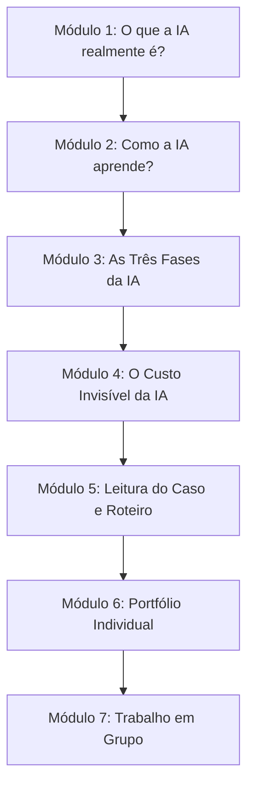

# 3 - Orientação de Estudo: Roteiro da Quinzena 1

> **Disciplina:** Inteligência Artificial na Prática Acadêmica e Profissional (COM170)  
> **Guia Passo a Passo**

---

## 🗺️ Como Percorrer a Quinzena 1 com Sucesso

1. **Semana 1:** Dedique-se à absorção crítica dos conteúdos teóricos dos Módulos 1 a 4. Assista às videoaulas e tome notas sobre os limites da previsão estatística de tokens.
2. **Semana 2:** Acesse o Estudo de Caso (Módulo 5). Escreva sua análise individual de forma independente no Módulo 6. Em seguida, participe das discussões síncronas/assíncronas com o seu grupo para redigir o relatório coletivo do Módulo 7.
