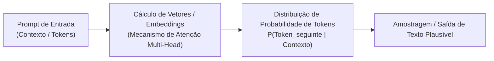

# Q1-M1: O que a Inteligência Artificial Realmente É?

> **Módulo 1:** Fundamentos Epistemológicos e Mecânica dos Grandes Modelos de Linguagem (LLMs)  
> **Disciplina:** Inteligência Artificial na Prática Acadêmica e Profissional (COM170)

---

## 🤖 Papagaio Estocástico: A Natureza Estatística dos LLMs

Um dos maiores erros cometidos por usuários leigos é o **antropomorfismo**: projetar intenções, sentimentos, crenças e raciocínio consciente em sistemas de software.

Como demonstrado no influente artigo de Emily Bender, Timnit Gebru, Angelina McMillan-Major e Margaret Mitchell (*On the Dangers of Stochastic Parrots: Can Language Models Be Too Big?*, 2021), um modelo de linguagem baseado na arquitetura **Transformer** opera como um **"papagaio estocástico"**:

### O Que Significa Prever o Próximo Token?
- O modelo não "pensa" antes de responder e não consulta um banco de fatos com julgamento de verdade.
- Ele calcula a probabilidade matemática de qual palavra (ou pedaço de palavra - *token*) tem maior probabilidade estatística de vir em seguida em um texto daquele gênero, dado o histórico de bilhões de textos da Internet com os quais foi treinado.
- A **fluência verbal** impressionante gera a ilusão de inteligência humana, mas trata-se de **plausibilidade sintática**, e não de compreensão semântica ou garantia de verdade factual.
