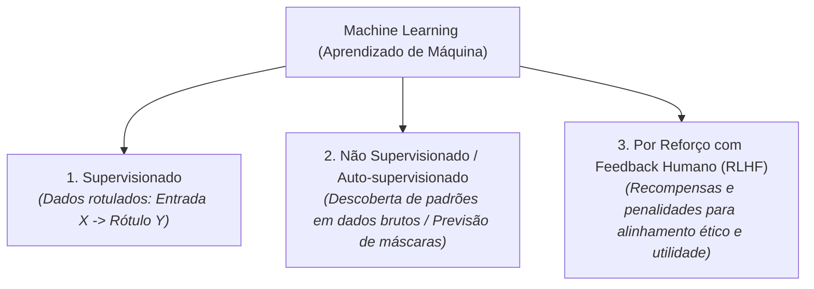

# Q1-M2: Como a IA Aprende? Paradigmas de Machine Learning

> **Módulo 2:** O Processo de Treinamento e Ajuste dos Modelos  
> **Disciplina:** Inteligência Artificial na Prática Acadêmica e Profissional (COM170)

---

## ⚙️ Os Três Paradigmas Clássicos de Aprendizado

---

## 🎯 O Ciclo de Treinamento dos Grandes Modelos

1. **Pré-treinamento (*Pre-training*):** O modelo ingere trilhões de palavras da Internet para aprender a estrutura da linguagem, gramática e fatos gerais por meio de aprendizado auto-supervisionado (prevendo a próxima palavra ocultada).
2. **Ajuste Fino Supervisionado (*SFT - Supervised Fine-Tuning*):** O modelo é treinado com pares de perguntas e respostas de alta qualidade elaboradas por especialistas humanos para aprender a se comportar como um assistente prestativo.
3. **Alinhamento via RLHF (*Reinforcement Learning from Human Feedback*):** Avaliadores humanos classificam múltiplas respostas geradas pelo modelo; um modelo de recompensa (*Reward Model*) orienta a rede neural a evitar respostas tóxicas, preconceituosas ou perigosas.
