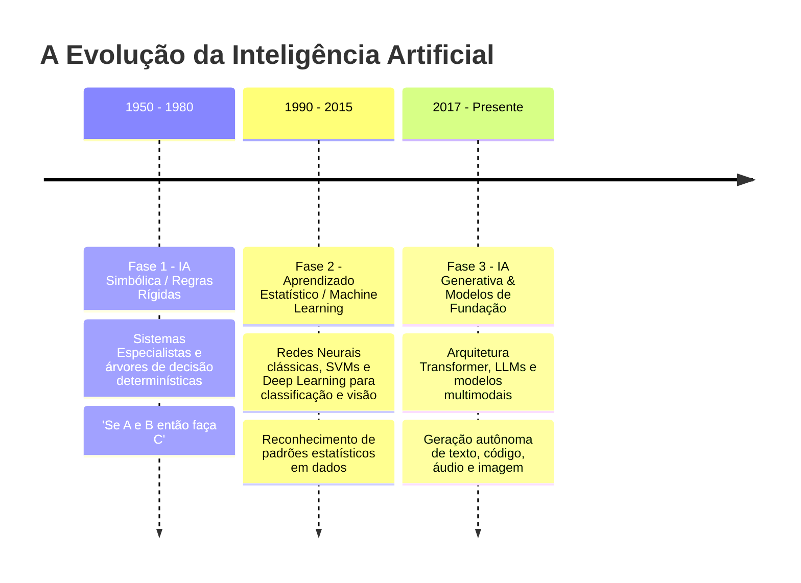

# Q1-M3: As Três Fases Históricas da Inteligência Artificial

> **Módulo 3:** Da Lógica Simbólica à IA Generativa de Fundação  
> **Disciplina:** Inteligência Artificial na Prática Acadêmica e Profissional (COM170)

---

## ⏳ A Evolução Histórica da IA em Três Eras

---

## 📊 Quadro Comparativo das Três Fases

| Critério | Fase 1 (Simbólica) | Fase 2 (Estatística) | Fase 3 (Generativa / Fundação) |
| :--- | :--- | :--- | :--- |
| **Princípio Básico** | Regras explícitas programadas por humanos (*Good Old-Fashioned AI*). | Ajuste de pesos estatísticos a partir de dados rotulados. | Redes neurais gigantescas pré-treinadas em escala planetária (*Transformers*). |
| **Capacidade Central** | Inferência lógica dedutiva rígida. | Classificação e predição (ex.: identificar se um e-mail é spam). | Síntese, transformação, tradução, raciocínio contextual e geração autoral. |
| **Principal Limitação** | Frágil diante de exceções e ambiguidades do mundo real (*Gargalo de Conhecimento*). | Exigia rotulagem manual cara para cada nova tarefa específica. | Alucinações factuais, alto custo computacional e opacidade estatística (*Black Box*). |
