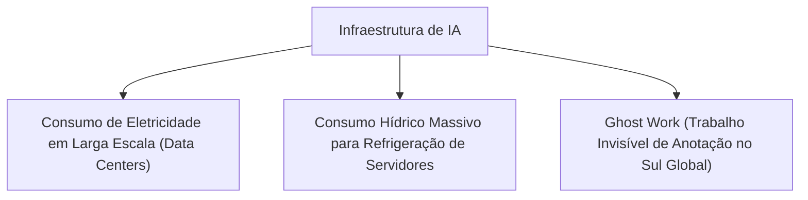

# Q1-M4: O Custo Invisível da Inteligência Artificial

> **Módulo 4:** Impactos Ecológicos, Pegada Hídrica e o Trabalho Humano Oculto  
> **Disciplina:** Inteligência Artificial na Prática Acadêmica e Profissional (COM170)

---

## ⚡ 1. O Custo Energético e a Pegada Hídrica

O discurso publicitário frequentemente retrata a inteligência artificial como uma tecnologia "imaterial e limpa", existente em uma "nuvem" etérea. A realidade física da infraestrutura de IA, contudo, é massivamente pesada e extrativista:

- **Consumo de Eletricidade:** O treinamento de um único modelo de fronteira pode consumir a mesma quantidade de energia elétrica que centenas de residências consomem ao longo de uma década inteira.
- **Consumo de Água para Resfriamento:** Os data centers utilizam milhões de litros de água potável por dia em torres de resfriamento evaporativo para impedir o superaquecimento de dezenas de milhares de GPUs dedicadas.
- **Emissão de Carbono:** A pegada de carbono cumulativa do ciclo de vida dos semicondutores e servidores pressiona as metas climáticas globais.

---

## 👥 2. O Trabalho Invisível (*Ghost Work*)

Por trás da automação aparentemente mágica da IA generativa, existe uma vasta cadeia humana invisível de trabalhadores precarizados (*trabalho fantasma*):
- Milhares de moderadores e anotadores de dados em países do Sul Global (Quênia, Filipinas, Índia, Venezuela) são remunerados com valores irrisórios por hora para ler, filtrar e rotular conteúdos violentos, abusivos e tóxicos, limpando os dados de treinamento antes que os modelos cheguem aos usuários finais.
- A compreensão desse custo humano e ambiental é indispensável para um uso consciente, sustentável e ético da tecnologia.
