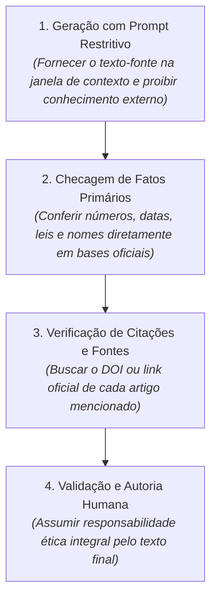

# Portfólio Individual: Diagnóstico Técnico e Protocolo de Verificação de IA

> **Estudante:** Henrique Freire Gabriel da Silva  
> **Disciplina:** Inteligência Artificial na Prática Acadêmica e Profissional (COM170)  
> **Quinzena 1 — Módulo 6**

---

## 1. Diagnóstico Técnico: Por que a IA Alucina?

A ocorrência de "alucinações factuais" em modelos de linguagem generativos (LLMs) não constitui uma falha temporária ou um defeito acidental de software; ela é uma **consequência estrutural direta da arquitetura estatística** desses sistemas.

Um LLM não possui uma base de dados relacional verificada, nem capacidade ontológica de julgamento de verdade. O modelo calcula exclusivamente a probabilidade matemática do próximo token mais plausível em determinado contexto linguístico:
$$P(\text{Token}_{t} \mid \text{Token}_1, \dots, \text{Token}_{t-1})$$

Quando solicitado a citar uma lei ou uma referência bibliográfica específica, a IA não "pesquisa" em um tribunal ou repositório científico; ela gera combinações de palavras que soam sintática e estilisticamente idênticas a artigos jurídicos ou citações acadêmicas reais, inventando autores, números de artigos e anos de publicação com absoluta convicção estilística. Tratar a saída de uma IA generativa como fonte de autoridade factual sem verificação externa independente é um grave equívoco epistêmico.

---

## 2. Protocolo Individual de Verificação Factual em 4 Camadas

Para garantir a integridade técnica e acadêmica na produção de conteúdos com suporte de IA, adoto o seguinte protocolo operacional:

1. **Ancoragem de Contexto:** Sempre que possível, inserir o material de referência diretamente no prompt, instruindo o modelo a responder *exclusivamente com base nos fragmentos fornecidos*.
2. **Checagem de Entidades Nomeadas:** Todo número de artigo legal, fórmula química, estatística ou data gerada pela IA deve ser obrigatoriamente submetido a busca em fontes primárias oficiais (Planalto, periódicos indexados, livros físicos).
3. **Detecção de Citações Fantasmas:** Nenhuma citação bibliográfica gerada pela IA é incluída em relatórios sem a verificação prévia de sua existência no Google Acadêmico ou na base SciELO.
4. **Assinatura de Responsabilidade:** O usuário humano é o único sujeito moral e jurídico da obra; a IA é apenas uma ferramenta instrumental de auxílio à escrita.
