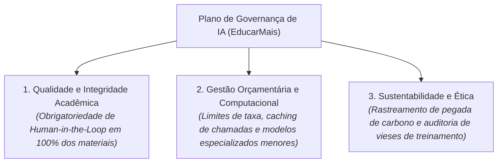

# Trabalho em Grupo: Plano Integrado de Governança, Qualidade e Sustentabilidade de IA

> **Grupo:** Integrantes do Grupo de Trabalho COM170  
> **Disciplina:** Inteligência Artificial na Prática Acadêmica e Profissional (COM170)  
> **Quinzena 1 — Módulo 7**

---

## 🏛️ Plano Coletivo de Governança para a Consultoria "EducarMais"

Após debate e consolidação das contribuições individuais dos membros da equipe, elaboramos uma diretriz tripartite de implementação de IA:

---

## 📋 Detalhamento das Ações Estratégicas

### 1. Política de Revisão Editorial (*Human-in-the-Loop*)
- Nenhuma questão avaliativa ou conteúdo didático pode ser publicado diretamente a partir da saída de IA sem a chancela e assinatura de um professor revisor humano especialista na disciplina.
- Proibição absoluta de utilizar IA generativa como juíza de veracidade histórica ou jurídica.

### 2. Otimização de Custos e Engenharia de Contexto
- Implementação de um sistema de *caching* local de respostas para evitar chamadas redundantes à API;
- Utilização de modelos menores e mais eficientes para tarefas rotineiras de formatação e correção ortográfica, reservando os grandes modelos de fronteira apenas para análises conceituais complexas.

### 3. Compromisso com a Sustentabilidade e Ética
- Medição e compensação da pegada de carbono decorrente do consumo de servidores;
- Seleção criteriosa de provedores de tecnologia que adotem data centers movidos a energia 100% renovável e práticas éticas de remuneração para equipes de curadoria de dados.
