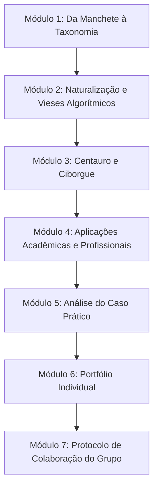

# 3 - Orientação de Estudo: Roteiro da Quinzena 2

> **Disciplina:** Inteligência Artificial na Prática Acadêmica e Profissional (COM170)  
> **Guia Passo a Passo**

---

## 🗺️ Roteiro Integrado de Aprendizagem

1. **Etapa 1 (Fundamentação Teórica):** Percorra os módulos 1 a 4 prestando atenção especial aos conceitos de *Fairness*, representatividade de dados e às diferenças práticas entre os modelos Centauro e Ciborgue.
2. **Etapa 2 (Aplicação Individual e Coletiva):** Elabore seu Portfólio no Módulo 6 identificando casos de aplicação na sua área profissional e, em seguida, construa o Protocolo Coletivo com sua equipe no Módulo 7.
