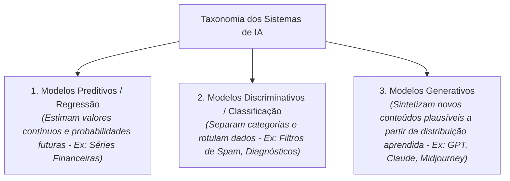

# Q2-M1: Da Manchete à Taxonomia - Desmistificando a IA

> **Módulo 1:** Mitos da Mídia e Categorização Taxonômica dos Modelos  
> **Disciplina:** Inteligência Artificial na Prática Acadêmica e Profissional (COM170)

---

## 📰 A Distorção das Manchetes

A cobertura jornalística diária costuma apresentar a inteligência artificial sob chavões sensacionalistas: *"IA ganha consciência"*, *"Robô assume sentimentos"* ou *"Superinteligência ameaça a humanidade"*.

Essas narrativas confundem duas categorias teóricas completamente distintas:
1. **Inteligência Artificial Geral (AGI / Forte):** Uma entidade hipotética de ficção científica dotada de consciência autônoma, sentimentos e capacidade de aprender qualquer tarefa humana sem supervisão (inexistente na realidade).
2. **Inteligência Artificial Estreita (ANI / Fraca / Específica):** Sistemas matemáticos reais de processamento de dados otimizados para tarefas específicas (como reconhecimento de padrões, tradução estatística, visão computacional e previsão de séries temporais).

---

## 🗂️ A Taxonomia Real dos Modelos de IA

