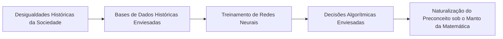

# Q2-M2: Naturalização e Vieses Algorítmicos

> **Módulo 2:** Como a IA Aprende e Reproduz Preconceitos Históricos  
> **Disciplina:** Inteligência Artificial na Prática Acadêmica e Profissional (COM170)

---

## ⚠️ A Falácia da Imparcialidade dos Dados

Os algoritmos de aprendizado de máquina não possuem valores morais próprios; eles são **espelhos estatísticos dos dados que consomem**:

### Tipos Comuns de Viés:
1. **Viés de Representação (*Sampling Bias*):** Ocorre quando certos grupos demográficos estão sub-representados nos dados de treinamento (ex.: sistemas de reconhecimento facial com taxas de erro muito superiores em peles negras e femininas por falta de dados diversificados).
2. **Viés Histórico (*Historical Bias*):** Ocorre quando os dados representam fielmente o passado, mas esse passado era estruturalmente machista, racista ou desigual (ex.: currículos de mulheres recebendo notas inferiores para cargos de liderança técnica porque o histórico histórico de contratações era predominantemente masculino).
3. **Viés de Confirmação e Filtros-Bolha:** Algoritmos de recomendação em redes sociais que maximizam o tempo de tela recomendando conteúdos cada vez mais extremistas e polarizados.
