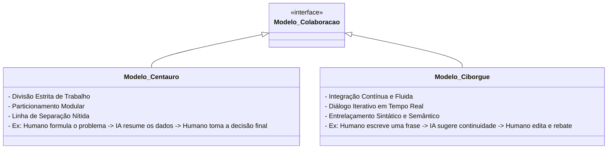

# Q2-M3: Centauro e Ciborgue - Modelos de Colaboração Humano-IA

> **Módulo 3:** Estratégias de Integração Cognitiva no Trabalho e na Pesquisa  
> **Disciplina:** Inteligência Artificial na Prática Acadêmica e Profissional (COM170)

---

## 🐎 O Conceito de Xadrez Centauro (Garry Kasparov)

Após ser derrotado pelo supercomputador *Deep Blue* da IBM em 1997, o campeão mundial de xadrez **Garry Kasparov** criou o conceito de **Xadrez Centauro (ou Xadrez Avançado)**: torneios onde um enxadrista humano joga em parceria com um computador contra outros pares humano+máquina.

A conclusão de Kasparov tornou-se uma lei da cibernética moderna:
$$\text{Humano Fraco} + \text{Máquina} + \text{Processo Superior} > \text{Supercomputador Sozinho} > \text{Humano Forte Sozinho}$$

---

## 🤖 Os Dois Grandes Modelos de Colaboração

O pesquisador Ethan Mollick (Wharton School / Universidade da Pensilvânia) sistematizou como profissionais de alta performance utilizam a IA generativa em dois arquétipos:

| Dimensão | Modelo Centauro | Modelo Ciborgue |
| :--- | :--- | :--- |
| **Metáfora** | Metade homem, metade cavalo (duas partes nítidas acopladas). | Fusão cibernética contínua (organismo expandido). |
| **Dinâmica** | Tarefas são fatiadas: o que a IA faz bem vai 100% para ela; o que exige julgamento crítico fica 100% com o humano. | O humano pensa *com* a IA, alternando palavras, refinando hipóteses e cocriando a cada segundo. |
| **Melhor Aplicação** | Processamento de relatórios longos, testes de código, compilação de bibliografias. | *Brainstorming* criativo, redação iterativa, depuração conceitual complexa. |
