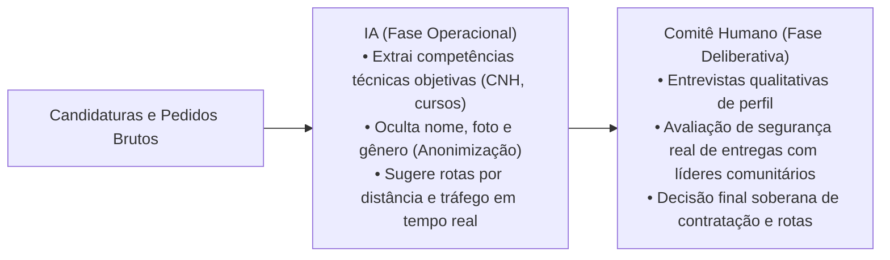

# Portfólio Individual: Desconstrução de Vieses e Parceria Cognitiva Centauro

> **Estudante:** Henrique Freire Gabriel da Silva  
> **Disciplina:** Inteligência Artificial na Prática Acadêmica e Profissional (COM170)  
> **Quinzena 2 — Módulo 6**

---

## 1. Análise dos Vieses Algorítmicos no Caso LogiTech

O descarte maciço de candidatas mulheres para vagas de motorista e mecânica na LogiTech Express é um exemplo clássico de **Viés Histórico de Amostragem (*Historical Sampling Bias*)**:
- O algoritmo foi treinado com decisões de contratação tomadas entre 2011 e 2025, época em que o setor de transporte rodoviário operava sob forte segregação cultural de gênero.
- A rede neural interpretou a correlação estatística histórica (mais homens contratados no passado) como uma relação causal de competência, aprendendo a penalizar qualquer currículo que contivesse termos associados ao gênero feminino.
- A solução técnica exige a expurgação de dados sensíveis (*blind screening*), reponderação de classes (*re-weighing*) e a proibição de decisões de descarte 100% automatizadas.

---

## 2. Proposta de Solução pelo Modelo Centauro

Para o processo seletivo e a roteirização de entregas, proponho a arquitetura de **Colaboração Centauro**:

### Por que o Modelo Centauro é Superior Aqui?
Porque estabelece uma linha de corte nítida: a máquina atua exclusivamente como assistente de organização de dados e anonimização, enquanto o julgamento ético, a equidade de oportunidades e a empatia permanecem sob o controle do profissional humano.
