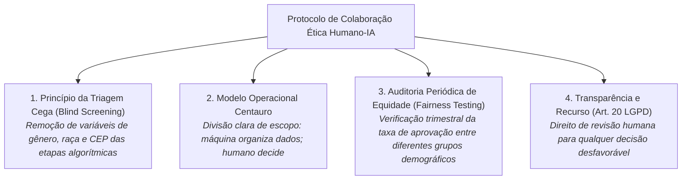

# Protocolo de Grupo: Diretrizes de Parceria Humano-IA e Mitigação de Vieses

> **Grupo:** Integrantes do Grupo de Trabalho COM170  
> **Disciplina:** Inteligência Artificial na Prática Acadêmica e Profissional (COM170)  
> **Quinzena 2 — Módulo 7**

---

## 🏛️ Protocolo de Colaboração Humano-IA e Ética Algorítmica

Consolidando as reflexões individuais em um manual corporativo e acadêmico, o grupo estabelece as seguintes diretrizes operacionais:

---

## 📋 Regras de Conduta para as Equipes

1. **Vedação ao Descarte Automático:** Nenhum candidato a emprego ou cliente pode ser sumariamente rejeitado por um score algorítmico sem a oportunidade de avaliação contextual por um analista humano.
2. **Combate ao Redlining Digital:** Áreas de entrega não podem ser bloqueadas por CEP genérico; as restrições logísticas devem basear-se exclusivamente em boletins oficiais de ocorrência em tempo real e rotas com escolta.
3. **Cultura de Prestação de Contas (*Accountability*):** A diretoria de tecnologia e os gestores de RH respondem solidariamente pelas decisões apoiadas por algoritmos.
