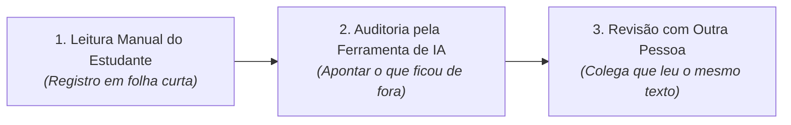

# Manual antes de IA: O Protocolo

> **Disciplina:** Inteligência Artificial na Prática Acadêmica e Profissional (COM170)  
> **Quinzena 5 - Módulo 2** | Bimestre: 2026S2B1 - Univesp  

---

## 💬 Introdução ao Módulo

Pense na última vez que você pediu a uma ferramenta que resumisse um texto que você ainda não tinha lido. O resumo chegou, você leu o resumo, e talvez tenha aberto o texto depois. 

Agora responda com sinceridade: **quando abriu o texto, você leu, ou foi apenas conferir se o resumo estava lá?**

É exatamente essa ordem que este módulo põe em questão. O método se chama **Manual antes de IA**, e o que ele fixa é a **sequência de trabalho**:

1. **Primeiro a sua leitura:** Escrita numa folha curta (apropriação cognitiva direta).
2. **Depois a ferramenta:** Chamada para apontar o que você deixou passar (auditoria e contraposição).
3. **Por fim, outra pessoa:** Um colega que leu o mesmo texto (comparação intersubjetiva).

> [!IMPORTANT]
> **Por que a ordem importa?**  
> Você vai ver o protocolo executado inteiro, com um artigo de verdade, e vai entender por que **trocar a sequência muda radicalmente o que você consegue enxergar**. Quem lê o resumo antes desenvolve viés de confirmação e fica cego para o subtexto e as nuances omitidas pela máquina.

---

## 🚀 Trilha de Aprendizado do Módulo 2

1. 🎥 **Assista à videoaula**;
2. 📖 **Leia o e-book**;
3. 🎯 **Feche decidindo**, apontamento por apontamento, o que a ferramenta tinha como saber e o que ela precisava do artigo para saber.
