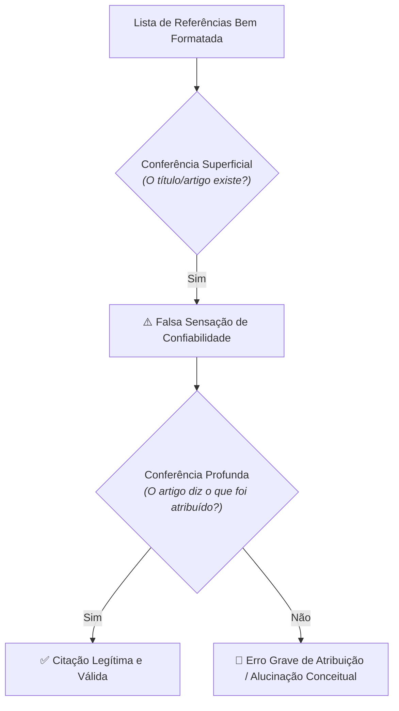

# A referência que existe e mesmo assim está errada

> **Disciplina:** Inteligência Artificial na Prática Acadêmica e Profissional (COM170)  
> **Quinzena 5 - Módulo 3** | Bimestre: 2026S2B1 - Univesp  

---

## 💬 Introdução ao Módulo

Uma lista de referências bem formatada transmite confiança. Autor, ano, revista, páginas, tudo no lugar. Talvez por isso ela seja o ponto do trabalho em que o erro passa com mais facilidade: **quase ninguém abre o que está citado**, e quem confere só se o título existe deixa passar mais do que imagina.

Você já conhece os cinco tipos de erro da Quinzena 2. Aqui eles ganham a forma que assumem num texto acadêmico, e a atenção vai para o mais difícil de perceber: **a referência que existe, com todos os dados corretos, e mesmo assim diz o que o texto citado não diz**. Fica também uma pergunta que este módulo abre a partir de um caso real: *quando um trabalho tem várias assinaturas, a quem pertence o erro de uma delas?*

> [!IMPORTANT]
> **A Falácia da Confiabilidade Formal:**  
> A integridade científica exige auditar o conteúdo e a correspondência factual, e não apenas a perfeição sintática das normas da ABNT/APA.

---

## 🚀 Trilha de Aprendizado do Módulo 3

1. 🎥 **Assista à videoaula**;
2. 📖 **Leia o e-book**;
3. 🎯 **Feche conferindo**, nas bases de busca reais, quatro referências que chegaram de uma conversa com IA.
