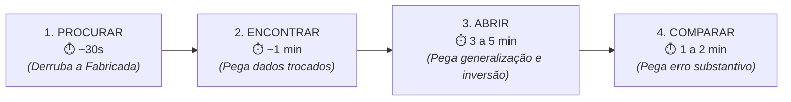

# Atividade: Conferir a lista: os quatro passos

> **Disciplina:** Inteligência Artificial na Prática Acadêmica e Profissional (COM170)  
> **Quinzena 5 - Módulo 3** | Bimestre: 2026S2B1 - Univesp  

---

## 📌 Passo 1 de 5: A Lógica e os Tempos dos Quatro Passos

Cada linha de uma lista de referências é uma promessa em duas partes: **existe um texto ali**, e **ele diz o que você afirmou que ele diz**. 

A conferência tem quatro passos sequenciais e tempos bem delimitados:



* **Passos 1 e 2 (~1,5 min por referência):** Verificam a existência formal e derrubam referências fabricadas ou com dados trocados.
* **Passos 3 e 4 (~4 a 7 min por referência):** Exigem abrir o documento original e ler os trechos citados; derrubam distorções, generalizações e inversões conceituais.

---

## 📌 Passo 2 de 5: Passo 1 — Procurar nas Bases Reais

| Referência | Dados Apresentados pela IA | Busca no SciELO / Google Acadêmico | Status no Passo 1 |
| :---: | :--- | :--- | :---: |
| **R1** | TRINDADE & OLIVEIRA (2024). *Inteligência artificial generativa e competência em informação...* Perspectivas em Ciência da Informação, v. 29, e47485. | Localizado com sucesso em ambas as bases. | ✅ **Passa para o Passo 2** |
| **R2** | MOREIRA & SANTOS (2023). *Letramento informacional e referências fabricadas...* Revista Brasileira de Letramento Digital e Pesquisa Acadêmica, v. 8, n. 2. | **Não existe**. Nem o título nem o periódico existem no mundo real. | 🚫 **Cai no Passo 1 (Referência Fabricada)** |
| **R3** | LIMA & SERRANO (2021). *Inteligência artificial generativa e ChatGPT: uma investigação sobre seu potencial na Educação.* Perspectivas em Ciência da Informação, v. 33, n. 2. | Título localizado nas buscas. | ✅ **Passa para o Passo 2** |
| **R4** | DARTORA & FETTERMANN (2025). *Inteligência artificial generativa e avaliação educacional: uma análise documental.* SciELOPreprints. | Documento localizado nas buscas. | ✅ **Passa para o Passo 2** |

> [!WARNING]
> **A Lição da R2:**  
> A referência fabricada tinha autores, título plausível, periódico convincente, volume, número, páginas e ano perfeitamente formatados nas normas. **Forma correta não é prova de existência.**

---

## 📌 Passo 3 de 5: Passo 2 — Encontrar e Validar Metadados

Com a R2 eliminada, analisamos a exatidão dos metadados das três restantes:

### 🔍 Análise da R1 (Trindade & Oliveira)
* **Conferência:** Autores, ano, título e periódico batem rigorosamente com a publicação oficial no SciELO.
* **Resultado:** ✅ **Aprovada nos Passos 1 e 2.**

### 🔍 Análise da R3 (Lima & Serrano)
* **Conferência:** Os nomes dos autores batem. Porém, o artigo foi publicado na revista ***Transinformação***, **volume 36**, em **2024** (e não *Perspectivas em Ciência da Informação, v. 33, 2021*).
* **Resultado:** ⚠️ **Não passa no Passo 2 como estava escrita.** Os dados de publicação estavam trocados (se alguém buscasse pelo periódico citado, não encontraria o artigo). Corrigida para a fonte real, a obra segue para análise de conteúdo.

### 🔍 Análise da R4 (Dartora & Fettermann)
* **Conferência:** Autoras, ano e título batem com o repositório SciELOPreprints.
* **Resultado:** ✅ **Passa no Passo 2.** 

---

## 📌 Passo 4 de 5: Passos 3 e 4 — Abrir e Comparar

### 📄 Caso Especial da R4: O que é este documento?
Ao abrir a página da **R4 (Dartora & Fettermann, 2025)**, o cabeçalho indica explicitamente: **SciELO Preprints**.
* **Natureza:** É um **preprint** (manuscrito disponibilizado publicamente antes de ser submetido ou aprovado pela revisão por pares de uma revista científica).
* **Conduta Ética:** O texto é legítimo e pode ser estudado, mas **deve ser citado explicitamente como preprint**, e não como artigo publicado em periódico revisado.

---

### 🔍 Análise das 3 Citações do Artigo de Lima & Serrano (2024)

O artigo de Lima e Serrano (2024, *Transinformação*, v. 36) foi utilizado para sustentar três frases em um trabalho acadêmico. Avaliamos a integridade de cada uma após ler o resumo original:

```text
Resumo Original do Artigo:
"O presente estudo teve como objetivo investigar o potencial da Inteligência Artificial Generativa, com foco no ChatGPT, no contexto educacional, por meio de uma revisão de literatura que analisou dez artigos científicos selecionados em bases de dados. Os resultados apontam a ferramenta como recurso complementar promissor, mas destacam limitações expressivas como lógica falha, respostas imprecisas, viés de treinamento e ausência de pensamento crítico. Conclui-se que ainda há muito a ser investigado antes de uma integração segura e eficaz do ChatGPT na prática educacional."
```

#### ❌ Citação 1:
> *"Lima e Serrano (2024) concluíram que o ChatGPT já pode ser integrado de forma segura e eficaz à prática educacional."*
* **Diagnóstico:** **INVERSÃO DA POSIÇÃO DO AUTOR** (Viés de Corpus).
* **Feedback:** O artigo diz exatamente o oposto: *"ainda há muito a ser investigado antes de uma integração segura e eficaz..."*. A citação usou as mesmas palavras do autor, mas inverteu o sentido da conclusão.

#### ❌ Citação 2:
> *"Um estudo com estudantes de ensino superior mostrou que o ChatGPT gera conteúdos e avaliações personalizadas (Lima; Serrano, 2024)."*
* **Diagnóstico:** **GENERALIZAÇÃO SEM RESSALVA** (Ausência de Contexto).
* **Feedback:** O artigo não realizou pesquisa empírica com estudantes; tratou-se de uma revisão de literatura baseada em dez artigos prévios. A citação transformou uma revisão documental em um estudo de campo com pessoas, perdendo a moldura metodológica.

#### ✅ Citação 3:
> *"Em revisão de dez estudos sobre ChatGPT e Educação, Lima e Serrano (2024) apontam a ferramenta como um recurso complementar e registram limitações como lógica falha, respostas imprecisas e enviesamento."*
* **Diagnóstico:** **CORRETA E TOTALMENTE SUSTENTADA**.
* **Feedback:** Carrega a moldura metodológica (revisão de dez estudos), a tese central (recurso complementar) e as ressalvas explícitas dos autores. É a única sustentável em uma arguição acadêmica.

---

## 📌 Passo 5 de 5: Síntese e Roteiro de Conferência

### 📊 Quadro Geral de Resultados

| Referência / Citação | 1. Procurar (30s) | 2. Encontrar (1 min) | 3 e 4. Abrir e Comparar (5 min) | Resultado Final |
| :--- | :---: | :---: | :---: | :--- |
| **R1 (Trindade & Oliveira)** | ✅ Passou | ✅ Passou | ✅ Passou | **Entra no trabalho** |
| **R2 (Moreira & Santos)** | 🚫 **Caiu aqui** | — | — | **Descartada:** Referência fabricada |
| **R3 (Lima & Serrano)** | ✅ Passou | ⚠️ **Dados trocados** | ✅ Passou após correção | **Entra no trabalho com dados corrigidos** |
| **R4 (Dartora & Fettermann)** | ✅ Passou | ✅ Passou | ✅ Passou | **Entra no trabalho, citada como Preprint** |
| **Citação 1 (Lima & Serrano)** | — | — | ❌ **Caiu no Passo 4** | **Rejeitada:** Inversão da posição autoral |
| **Citação 2 (Lima & Serrano)** | — | — | ❌ **Caiu no Passo 3** | **Rejeitada:** Generalização sem ressalva |
| **Citação 3 (Lima & Serrano)** | — | — | ✅ **Aprovada** | **Entra no trabalho:** Sustentação perfeita |

---

## 📝 Modelo do Roteiro de Conferência em Quatro Passos

Este roteiro serve para auditar qualquer lista de referências antes de submeter um trabalho acadêmico ou profissional:

```markdown
### 📌 ROTEIRO DOS QUATRO PASSOS DA CONFERÊNCIA

1. PROCURAR (~30 s): 
   > O título exato (entre aspas), o autor e o periódico numa base de busca real (Google Acadêmico / SciELO).
   > *Derruba referências fabricadas.*

2. ENCONTRAR (~1 min): 
   > Autor, ano, periódico, volume e páginas batem rigorosamente com a página oficial que abriu?
   > *Derruba dados de publicação trocados.*

3. ABRIR (3 a 5 min): 
   > Vá ao documento original e localize o trecho/página citada. O documento é artigo revisado ou preprint? O recorte empírico foi preservado?
   > *Derruba generalizações sem ressalva.*

4. COMPARAR (1 a 2 min): 
   > O que você escreveu afirma exatamente o que o autor defendeu, ou houve inversão/distorção do argumento?
   > *Derruba erros substantivos e inversões de posição autoral.*

---
Conferido em: ____/____/________
Referência Auditada: __________________________________________________
Status: [ ] Aprovada  [ ] Rejeitada  [ ] Corrigida
```

---

> [!IMPORTANT]
> **Conclusão:** Atividade concluída com 100% de aproveitamento. Não se esqueça de clicar no botão de encerramento da atividade no ambiente virtual.


