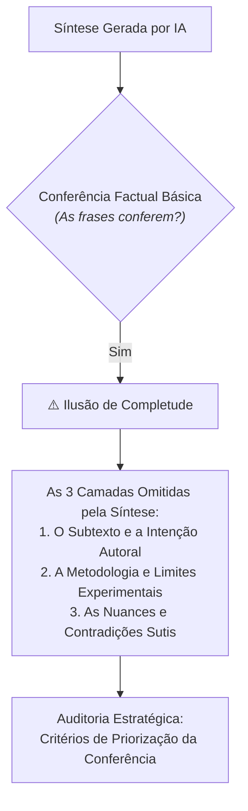

# O que a síntese não alcança

> **Disciplina:** Inteligência Artificial na Prática Acadêmica e Profissional (COM170)  
> **Quinzena 5 - Módulo 4** | Bimestre: 2026S2B1 - Univesp  

---

## 💬 Introdução ao Módulo

Existe um tipo de falta que passa por qualquer conferência de referência. A síntese gerada pela IA está correta, cada frase individualmente confere com o texto, e mesmo assim quem leu o artigo inteiro sente que **falta um pedaço essencial**. Este módulo dá nome a essa lacuna em **três camadas de profundidade** e demonstra como cada uma delas escapa dos modelos de linguagem.

Depois vem a dimensão prática e cotidiana: você quase nunca tem tempo de conferir tudo. Os três critérios da Quinzena 3 voltam com uma nova função — **decidir a ordem de prioridade na conferência** — para otimizar o tempo e garantir o rigor acadêmico.

> [!IMPORTANT]
> **Abertura da Parte Prática:**  
> A conclusão de todos os itens deste Módulo 4 é o marco que **desbloqueia a Parte Prática (Módulos 5, 6 e 7)** com o grupo!

---

## 🚀 Trilha de Aprendizado do Módulo 4

1. 🎥 **Assista à videoaula**;
2. 📖 **Leia o e-book**;
3. 🎯 **Feche respondendo ao miniquiz integrado**, que acompanha um estudante durante uma semana de trabalho, consolidando os quatro módulos.
