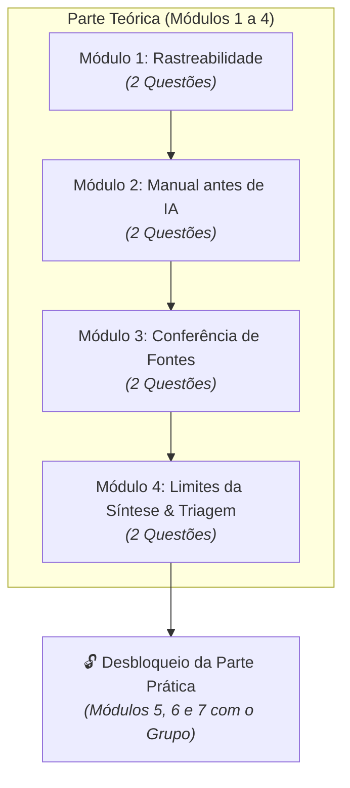

# Miniquiz: Uma semana, quatro decisões

> **Disciplina:** Inteligência Artificial na Prática Acadêmica e Profissional (COM170)  
> **Quinzena 5 - Módulo 4** | Bimestre: 2026S2B1 - Univesp  

---

## 📌 Contexto da Atividade: A Peça-Fechadura da Quinzena 5

Este miniquiz integrado consolida todo o aprendizado dos **Módulos 1 a 4**. Ele acompanha um estudante ao longo de uma semana inteira de produção acadêmica através de **oito situações práticas** (duas decisões por módulo):

---

> [!NOTE]
> **Status:** Atividade concluída com sucesso no AVA com 100% de aproveitamento em todas as 8 situações práticas, desbloqueando a Parte Prática da Quinzena 5 (Módulos 5, 6 e 7).

