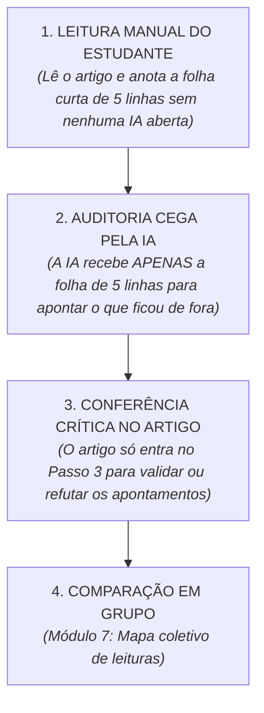

# Manual antes da IA, com um artigo de verdade

> **Disciplina:** Inteligência Artificial na Prática Acadêmica e Profissional (COM170)  
> **Quinzena 5 - Módulo 5** | Bimestre: 2026S2B1 - Univesp  

---

## 📄 Página de Abertura da Parte Prática da Quinzena 5

Nesta quinzena você conheceu, nas videoaulas e nos textos, o protocolo **Manual antes da IA**: ler primeiro, escrever o que entendeu, e só depois chamar a ferramenta para apontar o que passou despercebido. Agora você vai executar esse protocolo do começo ao fim, com um artigo científico de seis páginas e com a ferramenta de inteligência artificial que preferir. O que você entrega é o caminho que percorreu e o que encontrou nele.

> [!NOTE]
> **O Módulo 5 não tem entrega:**  
> Ele é o espaço de preparação onde você acessa o artigo que toda a turma vai ler, compreende a dinâmica metodológica e define a ferramenta de IA que será utilizada. O trabalho prático propriamente dito é registrado nos **Módulos 6 (Portfólio Individual)** e **7 (Trabalho em Grupo)**.

---

## 📑 O Artigo que Toda a Turma vai Ler

Todos os estudantes da turma leem o mesmo artigo para permitir a comparação intersubjetiva de leituras no Módulo 7.

* **Título:** *Percepções da Inteligência Artificial Generativa na educação: um estudo sobre o uso entre universitários*
* **Autores:** Maria Luise Britto da Silva, Anthony Ferreira La Marca e Robson da Silva Lopes (Universidade Federal de Mato Grosso - UFMT).
* **Contexto e Objeto de Estudo:** Em agosto de 2024, 123 estudantes de graduação de três instituições de Barra do Garças (MT) responderam a um questionário sobre o uso de ferramentas de IA (ChatGPT, Gemini, Copilot) nos estudos (finalidades, frequência, conferência crítica de resultados e percepções).
* **Extensão:** 6 páginas (Resumo, Introdução, Metodologia, Resultados, Considerações Finais e Referências).
* **Tipo de Publicação Acadêmica:** Artigo apresentado em evento científico e publicado nos Anais da Escola Regional de Informática de Mato Grosso (SBC, 2024).

### 📚 Referência Completa (ABNT):
```text
SILVA, Maria Luise Britto da; LA MARCA, Anthony Ferreira; LOPES, Robson da Silva. Percepções da Inteligência Artificial Generativa na educação: um estudo sobre o uso entre universitários. In: ESCOLA REGIONAL DE INFORMÁTICA DE MATO GROSSO (ERI-MT), 13., 2024, Alto Araguaia. Anais. Porto Alegre: Sociedade Brasileira de Computação, 2024. p. 108-113. DOI: 10.5753/eri-mt.2024.245844.
```

---

## 🤖 A Ferramenta de IA Escolhida

Escolha uma ferramenta entre **ChatGPT**, **Gemini** e **Copilot** (versão gratuita ou avançada). Anote no cabeçalho do trabalho:
1. **Nome da Ferramenta:** Ex.: Google Gemini / OpenAI ChatGPT / Microsoft Copilot.
2. **Modelo Exato em Uso:** Ex.: Gemini 2.5 Flash / GPT-4o / GPT-5.

---

## 🧭 O Protocolo: A Regra de Ouro



---

## 🗺️ Visão Geral: Módulo a Módulo

| Módulo | O que você faz | O que entrega e onde | Prazo |
| :---: | :--- | :--- | :---: |
| **Módulo 5** | Lê as orientações, baixa o artigo e escolhe a ferramenta. | *Sem entrega.* Preparação. | — |
| **Módulo 6** | Executa o protocolo em 4 passos e monta a Ficha de Resultados. | **Portfólio Individual** no Laboratório de Revisão do Módulo 6.<br>Revisão por pares de um colega. | **26/09** (Envio)<br>**29/09** (Revisão) |
| **Módulo 7** | Compara as fichas do grupo, monta o Mapa das Leituras e responde a 3 perguntas. | **Mapa do Grupo** enviado pelo representante no Laboratório de Revisão do Módulo 7.<br>Revisão por pares do grupo parceiro. | **26/09** (Envio)<br>**29/09** (Revisão) |

---

## ⚖️ Regras Gerais da Dinâmica

* **Tamanho do Grupo:** Grupos de qualquer tamanho são válidos. Estudantes individuais montam o mapa na primeira pessoa.
* **Transparência e Rastreabilidade:** O uso de IA é obrigatório e explícito: a ferramenta e modelo são declarados, os prompts e respostas são registrados, e a decisão humana é documentada.
* **Revisão entre Colegas:** O foco é formativo e processual: verificar se o caminho metodológico foi percorrido com integridade.
