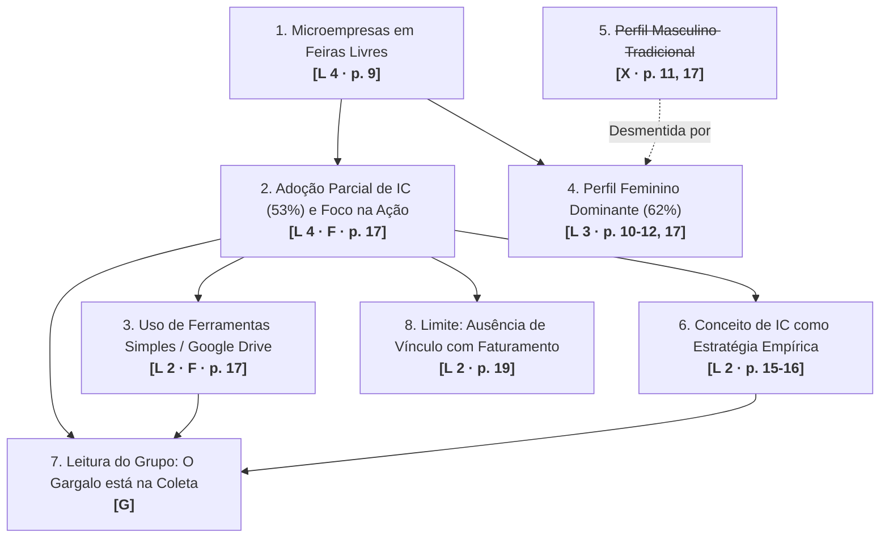

# Trabalho em Grupo: O Mapa das Leituras

> **Disciplina:** Inteligência Artificial na Prática Acadêmica e Profissional (COM170)  
> **Quinzena 5 - Módulo 7** | Bimestre: 2026S2B1 - Univesp  
> **Artigo Analisado:** USCAMAYTA, Mary Carmen Mozo; COELHO, Taiane Ritta; BARBOZA, Elder Lopes. *Inteligência competitiva em microempresas: um estudo nas feiras livres de artesanato de Curitiba*. Perspectivas em Ciência da Informação, v. 30, Fluxo Contínuo, e-52620, 2025. DOI: 10.1590/1981-5344/52620.  
> **Representante do Grupo:** Henrique Freire

---

## 🗺️ 1. O Mapa das Leituras

O mapa sintetiza as leituras individuais dos integrantes, identificando as origens de cada ideia através das marcas metodológicas:
* **`L [n]`**: Ideia presente na folha de leitura manual de *n* integrantes.
* **`F · p. [x]`**: Ideia apontada pela IA e confirmada na página *x* do artigo.
* **`X · p. [x]`**: Ideia/suposição gerada pela IA e **desmentida/refutada** na página *x* do artigo.
* **`G`**: Leitura e síntese crítica construída coletivamente na conversa do grupo.

---

### 📊 Tabela Estruturada do Mapa das Leituras

| Nº | Ideia / Proposição | Marca de Origem | De onde veio no grupo | Conexão / Liga-se a |
| :-: | :--- | :---: | :--- | :--- |
| **1** | A grande maioria das empresas no Brasil é de microporte, e em Curitiba o artesanato opera com lógica própria de microempresa. | **`L 4 · p. 9`** | Presente na folha dos 4 integrantes. | Base de contexto que sustenta as ideias 2 e 4. |
| **2** | Os feirantes adotam a Inteligência Competitiva de forma parcial (média geral de 53%), com maior intensidade na Fase 4 (execução de ações). | **`L 4 · F · p. 17`** | Presente na folha dos 4 integrantes. A ferramenta apontou ao Integrante 1 a falta do percentual, localizado na página 17. | Articula-se com as ideias 3, 6 e 7. |
| **3** | Predomínio de ferramentas tecnológicas gratuitas e informais, destacando-se o uso do Google Drive. | **`L 2 · F · p. 17`** | Integrantes 1 e 3. A ferramenta sugeriu a especificação dos meios e a página 17 confirmou. | Conecta-se à ideia 2 e fundamenta a leitura do grupo (Ideia 7). |
| **4** | O perfil dos feirantes é predominantemente feminino (62%), na faixa de 30 a 55 anos. | **`L 3 · p. 10-12, 17`** | Integrantes 1, 2 e 4. | Desmente frontalmente a afirmação gerada na Ideia 5. |
| **5** | ~~*"Os autores defendem que o perfil dos comerciantes em feiras é prioritariamente masculino, com média de 47 anos em cargos de chefia."*~~ | **`X · p. 11, 17`** | Apontada pela ferramenta ao Integrante 2. Na página 11 era citação de outro autor e na página 17 o artigo desmente com 62% feminino. | **Refutada e desmentida** pela Ideia 4. Mantida riscada como registro do erro da IA. |
| **6** | O conceito de IC é associado intuitivamente pelos feirantes a "estratégia de vendas" e "olhar a concorrência", com baixa sistematização analítica. | **`L 2 · p. 15-16`** | Integrantes 2 e 3. | Explica a fragilidade teórica da Fase 2 e sustenta a Ideia 7. |
| **7** | **Leitura do grupo:** Se os feirantes já executam ações práticas (Fase 4) mas não coletam dados estruturados (Fase 2), o gargalo formativo de políticas públicas não é motivá-los a agir, mas instrumentalizar a coleta simples e rotineira de informações de mercado. | **`G`** | **Construção coletiva.** Surgiu durante a comparação das fichas; ninguém tinha essa síntese isolada na folha inicial. | Nasce da integração crítica entre as Ideias 2, 3 e 6. |
| **8** | O estudo não investigou se a adoção de maior nível de IC resulta em faturamento ou lucratividade superior nas barracas. | **`L 2 · p. 19`** | Integrantes 1 e 4, a partir de suas perguntas em aberto. | Limite empírico declarado nas considerações finais (p. 19). |

---

## 💬 2. Respostas às Três Perguntas Reflexivas

### ❓ Pergunta 1. O que quase todos anotaram, e o que só uma pessoa viu. O que essa diferença mostra sobre ler o mesmo texto?
**Resposta:**  
Todos os quatro integrantes anotaram que os feirantes de Curitiba atuam como microempresas *(p. 9)* e que a adoção de Inteligência Competitiva é parcial, com prevalência da fase de implementação prática *(p. 17)*. Essas duas ideias formam a espinha dorsal factual do artigo. Em contrapartida, apenas o Integrante 3 atentou para o fato de que os feirantes associam o conceito de IC diretamente a noções cotidianas de "estratégia e concorrência" sem conhecer os modelos formais da literatura *(p. 15-16)*, enquanto o Integrante 4 foi o único a destacar a ausência de correlação estatística entre o índice de IC e o volume de vendas/faturamento *(p. 19)*. Essa divergência demonstra que a leitura humana não é um escaneamento mecânico homogêneo: cada leitor chega ao texto ancorado por repertórios e indagações prévias distintas. O confronto em grupo transforma leituras fragmentadas em uma compreensão tridimensional que nenhuma leitura individual alcançaria sozinha.

### ❓ Pergunta 2. Onde a ferramenta ajudou o grupo, e onde ela errou. Com a página do artigo em cada caso. Existe um padrão no que ela errou?
**Resposta:**  
A ferramenta foi altamente eficaz quando atuou como **auditora formal da nossa própria escrita**: ela alertou o Integrante 1 de que a palavra "parcial" exigia um dado quantitativo (encontrado na *página 17*, taxa de 53%) e provocou o Integrante 3 a explicitar os recursos digitais adotados (confirmando na *página 17* o uso do Google Drive). Por outro lado, a ferramenta errou de forma perigosa ao produzir **suposições de conteúdo baseadas em plausibilidade estatística**: ela atribuiu ao estudo do Integrante 2 um perfil masculino tradicional com média de 47 anos, quando na verdade o artigo registra categoricamente 62% de mulheres *(p. 11 e 17)*. O padrão de erro é evidente: **a ferramenta acerta com precisão cirúrgica ao apontar o que falta na estrutura lógica da folha do estudante, mas erra e alucina quando tenta adivinhar o que está escrito no artigo sem tê-lo na janela de contexto**.

### ❓ Pergunta 3. A regra do grupo, em duas ou três linhas. O que o grupo faria diferente na próxima leitura com ferramenta, e por quê.
**Resposta:**  
> **Regra de Ouro do Grupo:**  
> *"Nenhum apontamento da IA que afirme o que os autores defendem ou que deduza dados da pesquisa entrará em nosso trabalho sem a localização exata da página e do parágrafo no artigo original. Adotamos essa regra porque as alucinações mais nocivas da máquina não parecem absurdas — elas soam impecavelmente acadêmicas e convincentes, exigindo auditoria manual obrigatória."*

---

## 👥 3. Identificação da Equipe
* **Henrique Freire** (Representante do Grupo)
* Integrantes participantes da consolidação das fichas e montagem do mapa coletivo.
