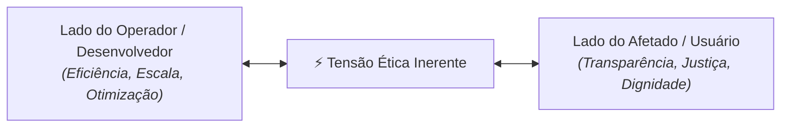

# Ética como estrutura

> **Docente Responsável:** Prof. Dr. José Avelino Placca  
> **Disciplina:** Inteligência Artificial na Prática Acadêmica e Profissional (COM170)  
> **Quinzena 6** | Bimestre: 2026S2B1 - Univesp  

---

## 💬 Apresentação da Quinzena 6

Na quinzena passada, a pergunta central era se a resposta da máquina estava correta, e a responsabilidade da conferência ficava individualmente com você. Agora a escala se amplia: **sistemas automatizados tomam decisões sobre pessoas diariamente**, definindo o que aparece na tela, qual pedido tem prioridade ou se uma inscrição é aprovada. Essas decisões chegam prontas, quase sempre sem transparência algorítmica sobre os critérios e sem uma pessoa a quem recorrer.

A Quinzena 6 convida você a trocar de perspectiva: **olhar o sistema simultaneamente pelo lado de quem o projeta/opera e pelo lado de quem é impactado pela decisão**.

---

## 🧭 Os Instrumentos da Quinzena

1. **A Bússola das Quatro Perguntas:**  
   Auditoria de sistemas de decisão automatizada com foco em: **Quem**, **Sabe**, **Responde** e **Custa**.
2. **Declaração Formal de Uso de IA:**  
   Como redigir a nota de transparência metodológica em trabalhos acadêmicos e técnicos, discriminando o que a ferramenta fez e o que foi validado humanamente.
3. **Tensões Reais entre Valores Legítimos:**  
   Dilemas sem solução simples ou culpados óbvios (onde dois direitos legítimos colidem).
4. **O Caso Prático da Comissão:**  
   Na parte prática, seu grupo atuará como uma **Comissão Deliberativa** que emitirá um parecer técnico sobre a implantação de um sistema de IA que toma decisões sobre estudantes.

---

## 🎯 Objetivos de Aprendizagem

Ao final desta quinzena, você será capaz de:

* [x] **01.** Separar a reação emocional imediata do julgamento ético estruturado por critérios objetivos, identificando quem opera o sistema e quem recebe o impacto da decisão.
* [x] **02.** Aplicar a sistemas automatizados as quatro perguntas da Bússola: *Quem opera?*, *Quem sabe como funciona?*, *Quem responde pelo erro?* e *Quem arca com o custo?*.
* [x] **03.** Declarar formalmente o uso de IA em produções acadêmicas e profissionais, explicitando os prompts, o papel da ferramenta e a conferência humana.
* [x] **04.** Reconhecer e mapear tensões éticas genuínas entre valores concorrentes.
* [x] **05.** Fundamentar recomendações técnicas e pareceres colegiados com explicitação de trade-offs, garantias mínimas e critérios de falseabilidade.
