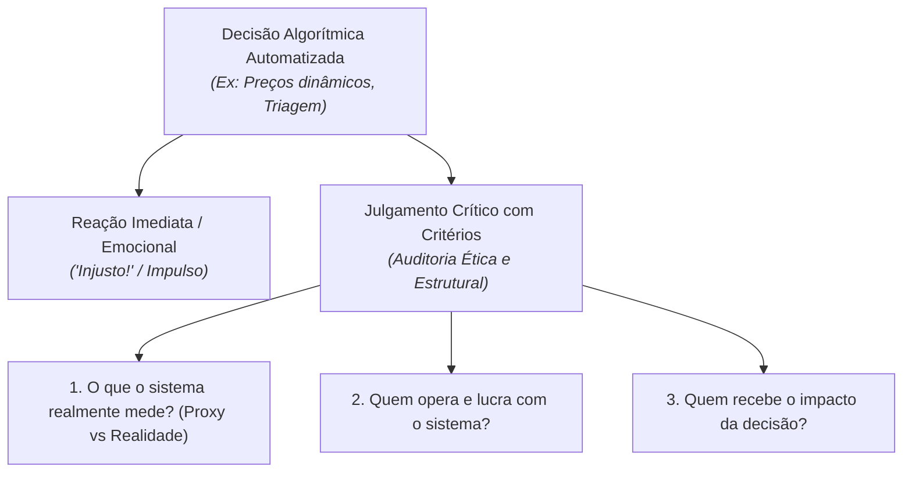

# De onde vem a decisão que parece óbvia

> **Disciplina:** Inteligência Artificial na Prática Acadêmica e Profissional (COM170)  
> **Quinzena 6 - Módulo 1** | Bimestre: 2026S2B1 - Univesp  

---

## 💬 Introdução ao Módulo

Quando um aplicativo mostra um preço para você e outro diferente para a pessoa ao seu lado, qual é a sua primeira reação? Em geral, uma palavra imediata: **injusto**. Ela surge rápido, no impulso emocional, antes de qualquer pergunta ou reflexão.

Este módulo parte dessa reação visceral e desvela o que opera nos bastidores: **um sistema automatizado que decide sobre pessoas precisou aprender a medir variáveis**, e o que ele efetivamente mede (*proxy*) raramente é o conceito abstrato que ele alega medir (como "mérito", "risco" ou "disposição a pagar").

> [!IMPORTANT]
> **A Pergunta Fundamental da Quinzena:**  
> *Quem usa e opera esse sistema, e quem recebe o impacto da decisão dele?*

---

## 🚀 Trilha de Aprendizado do Módulo 1

1. 🎥 **Assista à videoaula**;
2. 📖 **Leia o e-book**;
3. 🎯 **Feche mudando de posição**: pela primeira vez na disciplina, você monta os critérios do sistema em vez de ser mero receptor passivo da decisão.
