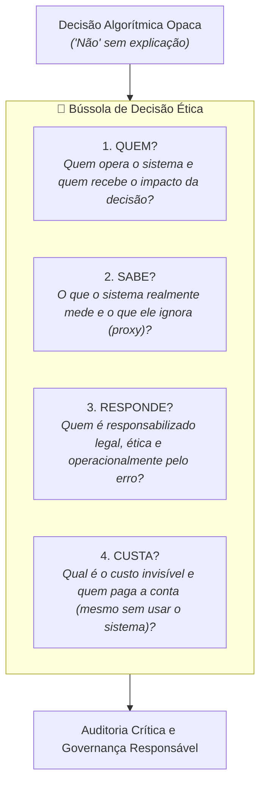

# Quatro perguntas a um sistema que decide sobre pessoas

> **Disciplina:** Inteligência Artificial na Prática Acadêmica e Profissional (COM170)  
> **Quinzena 6 - Módulo 2** | Bimestre: 2026S2B1 - Univesp  

---

## 💬 Introdução ao Módulo

Você já recebeu um "não" sem explicação? Uma conta bloqueada por "atividade incomum", um anúncio recusado, um crédito negado ou uma corrida que nenhum motorista aceita?

O "não" chega pronto, opaco e incontestável. Diante dele, a reação instintiva quase sempre é a pergunta errada: **"O que eu fiz de errado?"**. Essa reação internaliza a culpa e pressupõe a infalibilidade do sistema automatizado.

Este módulo propõe inverter essa lógica: **em vez de se culpar, você faz quatro perguntas ao sistema**. Elas formam a **Bússola de Decisão Ética**, um instrumental analítico fundamentado em quatro eixos cardeais: **Quem**, **Sabe**, **Responde** e **Custa**.

---

## 🧭 As Quatro Perguntas da Bússola de Decisão Ética

A bússola não decide no seu lugar: ela estabelece as coordenadas críticas para onde direcionar a auditoria ética e técnica de qualquer sistema automatizado.

### 1. 👤 QUEM?
* **A Pergunta:** Quem define as metas e opera o sistema, e quem sofre passivamente o impacto da decisão?
* **O Foco:** Identificar a assimetria de poder entre o operador (que busca escala, corte de custos ou lucro) e o indivíduo afetado (que sofre as consequências concretas).

### 2. 🔍 SABE?
* **A Pergunta:** O que o sistema tem condições de saber e o que ele de fato mede para tomar essa decisão?
* **O Foco:** Desmascarar as **variáveis *proxy***. O algoritmo nunca mede "idoneidade", "saúde" ou "mérito" de forma direta; mede cliques, histórico financeiro, CEP ou frequência de login.

### 3. ⚖️ RESPONDE?
* **A Pergunta:** Quando o sistema erra ou gera uma decisão injusta, quem responde por ela? Existe canal humano real de contestação e reparação?
* **O Foco:** Evitar a diluição da responsabilidade sob a falácia de que "foi o algoritmo que decidiu". Identificar a cadeia de governança e prestação de contas (*accountability*).

### 4. 💸 CUSTA?
* **A Pergunta:** Qual é o custo total dessa decisão e quem arca com ele?
* **O Foco:** Esta é **a pergunta que quase ninguém faz**. As externalidades de um sistema automatizado frequentemente recaem sobre pessoas que sequer são usuárias do serviço (trabalhadores invisíveis de rotulagem, comunidades impactadas pelo consumo energético e hídrico dos data centers, cidadãos excluídos de políticas públicas por decisões discriminatórias em cascata).

---

> [!IMPORTANT]
> **A Potência da 4ª Pergunta (Custa):**  
> Os custos de um sistema que decide sobre pessoas não se limitam à infraestrutura de TI. Eles incluem custos cognitivos, sociais, ambientais e distributivos que recaem sobre os elos mais vulneráveis da cadeia.

---

## 🚀 Trilha de Aprendizado do Módulo 2

1. 🎥 **Assista à videoaula** do Módulo 2;
2. 📖 **Leia o e-book** e a apostila de fundamentação;
3. 🎯 **Feche aplicando as quatro perguntas** a um sistema real a pedido de alguém que recebeu uma decisão automatizada opaca.
