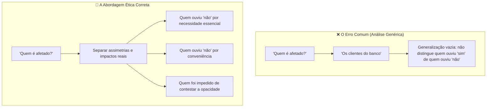

# Videoaula 2: Quem recebeu a decisão

> **Disciplina:** Inteligência Artificial na Prática Acadêmica e Profissional (COM170)  
> **Quinzena 6 - Módulo 2** | Bimestre: 2026S2B1 - Univesp  

---

## 🎥 Acesso à Videoaula

* **Título:** Quem recebeu a decisão
* **Link:** [Assistir no YouTube](https://www.youtube.com/watch?v=ghtwIqVLDNI)

---

## 📝 Resumo e Discussão Central

A aula parte de uma situação concreta: um cliente solicita o aumento de limite do cartão de crédito em seu banco e, em **2 segundos**, recebe uma resposta negativa ("Não") gerada 100% por um algoritmo, sem qualquer intervenção humana. A partir da carta-resposta enviada pelo banco, o professor demonstra como operacionalizar a **Bússola de Decisão Ética** e desvenda **o erro mais comum ao analisar quem é afetado por um sistema automatizado**.

---

## 🧭 As Quatro Perguntas Aplicadas ao Caso Concreto

### 1. 👤 QUEM é afetado por esse sistema?
* **O Erro Habitual:** Responder de forma ampla e abstrata: *"os clientes do banco"* ou *"os usuários da plataforma"*.  
* **A Crítica Ética:** Essa resposta serve para qualquer sistema bancário e mascara a realidade. Quem teve o pedido aprovado ("sim") não sentiu nenhum atrito ou prejuízo. A análise ética só ganha substância quando **separa as pessoas que experimentaram impactos desiguais**:
  - Quem recebeu a negativa ("não");
  - Quem pediu por simples conveniência/conforto vs. quem pediu por extrema necessidade (comprar remédios, pagar contas básicas);
  - **Exemplos em outros contextos:**
    - *App de entrega:* quem faz a entrega na rua e enfrenta riscos físicos vs. quem aguarda confortavelmente em casa.
    - *Triagem de currículos:* candidatos descartados sem explicação vs. candidatos pré-selecionados.

### 2. 🔍 SABE? (As pessoas afetadas sabem que há um algoritmo decidindo?)
* A carta enviada pelo banco apenas comunica a recusa, sem informar que a decisão foi tomada exclusivamente por um modelo automatizado de scoring.
* **Consequência:** Enquanto a pessoa não sabe que a decisão partiu de um sistema opaco, ela não tem condições de entender o que ocorreu, internaliza a culpa (*"o que eu fiz de errado?"*) e sequer sabe **o que ou como questionar**.

### 3. ⚖️ RESPONDE? (Quando o sistema erra, quem responde?)
A responsabilidade operacional e ética possui duas exigências fundamentais:
1. **Canal de Acesso:** Existir um meio acessível e transparente para contato e contestação;
2. **Autonomia Humana Real:** Haver uma pessoa do outro lado com autoridade técnica e institucional para **revisar, auditar e alterar a decisão algorítmica** quando houver injustiça ou equívoco.

### 4. 💸 CUSTA? (Quanto custa manter e quem paga a conta?)
* A infraestrutura de data centers consome gigawatts de energia elétrica e milhões de litros de água para refrigeração.
* **A Assimetria dos Custos:** Quem aperta o botão e quem lucra com a automação estão distantes do local onde os custos e externalidades ambientais recaem sobre as comunidades locais.

---

## 🎯 Onde a Análise Técnica vira Ética

| Perspectiva | Para quem constrói / opera o sistema | Para a pessoa que recebe a decisão |
| :--- | :--- | :--- |
| **Escala** | O sistema opera milhões de decisões diárias. | A decisão é única e impacta sua vida pessoal. |
| **Margem de Erro** | Uma falha é vista como mera taxa estatística residual (ex: 0,1%). | A falha representa a negação do seu pedido e seus direitos. |

---

## 🛡️ O "Teste do Espelho" (Regra de Validação)

> [!TIP]
> **Como evitar respostas genéricas:**  
> Depois de descrever quem é afetado por um sistema automatizado, faça a seguinte pergunta de teste:  
> 👉 *"Essa resposta serviria para qualquer outro sistema similar?"*  
> Se a resposta for **SIM**, a análise está incompleta. Volte e desmembre os grupos segundo o impacto real, as assimetrias de poder e as vulnerabilidades concretas.
