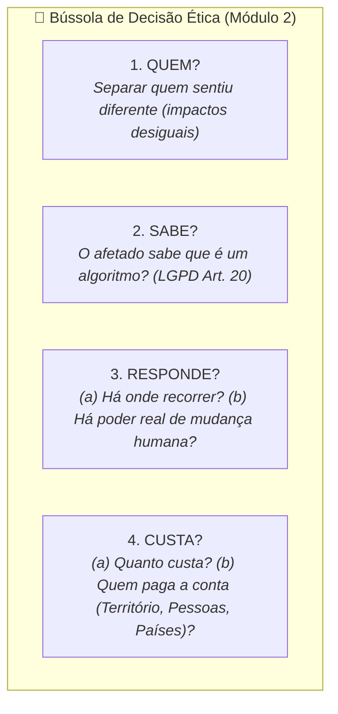

# Material-base: Módulo 2 - Quatro perguntas a um sistema que decide sobre pessoas

> **Disciplina:** Inteligência Artificial na Prática Acadêmica e Profissional (COM170)  
> **Quinzena 6 - Módulo 2** | Bimestre: 2026S2B1 - Univesp  

---

## 📚 Materiais de Apoio Disponíveis

Neste módulo, estão disponíveis os documentos em PDF para leitura aprofundada, análise crítica e fundamentação:

### 1. 📖 E-book: Módulo 2
* **Arquivo:** [Q6_M2-E-book.pdf](file:///home/henrique/Modelos/Univesp/2026S2/COM170-Inteligencia-Artificial-na-Pratica-Academica-e-Profissional/Quinzena-6/Q6-Modulo2/Q6_M2-E-book.pdf)
* **Descrição:** Guia ilustrado e didático sobre os quatro eixos da **Bússola de Decisão Ética**, o teste do espelho (resposta genérica vs. situada) e a governança de sistemas automatizados.

---

### 2. 📑 Apostila da Quinzena 6 (Módulo 2)
* **Arquivo:** [COM170_apostila_quinzena6_M2.pdf](file:///home/henrique/Modelos/Univesp/2026S2/COM170-Inteligencia-Artificial-na-Pratica-Academica-e-Profissional/Quinzena-6/Q6-Modulo2/COM170_apostila_quinzena6_M2.pdf)
* **Tema Central:** *Quatro perguntas a um sistema que decide sobre pessoas: Bússola Ética, LGPD, Responsabilidade e Custos Distributivos*

---

## 🔍 Síntese dos Principais Eixos Temáticos

### 1. 📋 Caso Concreto: A Triagem Algorítmica de Currículos (Gupy)
* Plataformas de recrutamento utilizam agentes de IA para ranquear e ordenar previamente os candidatos antes da avaliação humana.
* **A Assimetria:** A página pública informa que a IA ignora dados sensíveis, mas não revela ao candidato a sua posição exata na lista, as métricas aplicadas ou como contestar o corte algorítmico.

### 2. 👤 1. QUEM é afetado? (Resposta Genérica vs. Resposta Situada)
* **Resposta Genérica (Erro Comum):** *"Os candidatos da vaga"* ou *"os clientes do banco"*. Essa resposta serve para qualquer sistema e oculta as assimetrias.
* **Resposta Situada (Abordagem Ética):** Separa os grupos conforme a experiência concreta:
  - **Topo da lista:** Recebeu contato e entrevista.
  - **Fim da lista:** Recebeu silêncio e foi excluído sem saber que uma IA atuou na triagem.
  - **Vulnerabilidade:** Diferencia quem tinha reservas e alternativas de quem dependia daquela vaga para subsistência.

### 3. 🔍 2. SABE? (Direito à Informação e a LGPD)
* **Lei Geral de Proteção de Dados (LGPD - Lei nº 13.709/2018, Art. 20):**  
  - Garante ao titular o direito de solicitar a revisão de decisões tomadas unicamente com base em tratamento automatizado e informações sobre os critérios utilizados.
  - **O Veto do § 3º (Mensagem nº 288/2019):** O dispositivo que exigia expressamente que a revisão fosse feita por *pessoa natural (humano)* foi vetado por pressões de mercado. Portanto, a lei garante o direito de pedir revisão, mas essa revisão **pode ser realizada por outro programa automatizado**.
* **Crédito e Cadastro Positivo (Lei nº 12.414/2011, Art. 5º, VI):** Direito de pedir revisão ao *consulente* (ex: o banco que negou o crédito).

### 4. ⚖️ 3. RESPONDE? (Canais de Atendimento e Autonomia Decisória)
* A pergunta desdobra-se em duas exigências:
  1. *Existe canal de contato para reclamação?*
  2. *Existe alguém do outro lado com autoridade e autonomia para reverter a decisão da máquina?*
* **O Caso Proctorio (Universidade Vrije de Amsterdã - 2022/2023):** Em disputas sobre falhas e viés de reconhecimento facial, quem responde pelo sistema é quem detém a custódia exclusiva dos registros técnicos e logs para fins de auditoria.
* **Valor das Lacunas Informacionais:** Quando a documentação da empresa não explica quem tem poder de revisão, constatar e registrar formalmente essa ausência é um resultado analítico fundamental.

### 5. 💸 4. CUSTA? (Distribuição Territorial, Humana e Geopolítica)
A conta da inteligência artificial divide-se em três dimensões concretas:
1. **O Território (Energia e Água):** Relatório *Energy and AI* (IEA, 2025) aponta 415 TWh consumidos globalmente em 2024. Cerca de 85% do consumo elétrico concentra-se nos EUA, China e Europa. Economias emergentes possuem 50% dos usuários mundiais de internet, mas menos de 10% da infraestrutura de data centers. A água para refrigeração (Li et al., 2025) é extraída dos aquíferos locais onde os servidores estão instalados.
2. **As Pessoas (*Ghost Work* e Microtrabalho):** No Brasil, trabalhadores de anotação de dados (ex: plataforma Microworkers) recebem em média R$ 582,71/mês (~US$ 1,80/hora), com 49,5% possuindo ensino superior completo para rotular dados a clientes do Norte Global (Viana Braz, Tubaro & Casilli, 2025; Gray & Suri, 2019).
3. **Os Países (Geopolítica de Infraestrutura):** Poucos países detêm capacidade computacional para treinar modelos de ponta; a imensa maioria atua exclusivamente como consumidora passiva de tecnologia proprietária externa (Lehdonvirta, Wú & Hawkins, 2024).

---

> [!IMPORTANT]
> **Conclusão Ética:**  
> *"O sistema decide o dia inteiro. Você recebe a sua decisão uma vez."*  
> Para quem desenvolve o sistema, o erro é uma fração estatística imperceptível. Para quem recebe a decisão desfavorável, é a negação de sua oportunidade e de sua dignidade.
