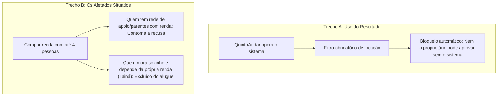
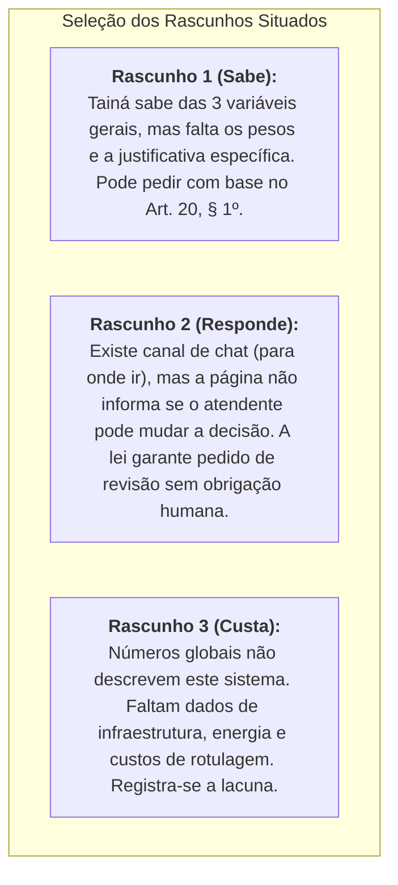

# Atividade Prática: A resposta que a Tainá pediu

> **Disciplina:** Inteligência Artificial na Prática Acadêmica e Profissional (COM170)  
> **Quinzena 6 - Módulo 2** | Bimestre: 2026S2B1 - Univesp  

---

## 📖 Passo 1: O Caso do "Não" Algorítmico do Domingo à Noite

* **A Situação:** Domingo à noite. Tainá encontra um apartamento de 1 quarto próximo ao seu trabalho no aplicativo do **QuintoAndar**. Para agendar a visita, o sistema solicita Nome, CPF e Renda declarada. Ela preenche e envia.
* **A Decisão Automatizada:** Em menos de **dois minutos**, surge na tela um grande **"X vermelho"** com o aviso: **"Não aprovada"**, sem qualquer detalhamento ou justificativa do motivo.
* **O Perfil de Tainá:** Tainá mora sozinha e seu salário é a **única fonte de renda** que possui para declarar (não possui fiador nem rede de apoio com alta renda para compor o contrato).
* **O Encontro no Polo:** Na segunda-feira, Tainá mostra o celular e pergunta:  
  👉 *"Quem decidiu isso? Dá para pedir para alguém olhar de novo?"*

---

## 🧭 Passo 2: Quem usa o resultado e Quem é afetado (Trechos A e B)



### Trecho A
> *“Mesmo que você não tenha a pré-aprovação, pode continuar o processo e enviar uma proposta. No entanto, só é possível avançar no processo de aluguel com a avaliação pré-aprovada, mesmo que o proprietário aprove a sua proposta.”*

* **Decisão 1 de 2 (Quem usa o resultado):**  
  A plataforma QuintoAndar realiza a análise e utiliza o resultado como filtro eliminatório obrigatório. Nem o dono do apartamento (a outra pessoa diretamente interessada no negócio) consegue aceitar a proposta ou passar por cima desse veredito algorítmico.

### Trecho B
> *“Você pode incluir até 4 pessoas para compor a renda e/ou o score necessários. Elas serão as responsáveis financeiras pelo contrato, mas não precisam morar no imóvel nem na mesma cidade.”*

* **Decisão 2 de 2 (Quem é afetado - Resposta Situada):**  
  O caminho de "compor renda com até 4 pessoas" divide os recusados em dois grupos desiguais:
  1. Quem tem parentes ou amigos com boa renda/score para assumir o contrato;
  2. **Quem mora sozinho e declara apenas o próprio salário (caso de Tainá)**, que fica completamente sem alternativa e excluído da moradia. Esse grupo só existe neste modelo e configura a **resposta situada**.

---

## 🔍 Passo 3: O que ela sabe e a quem recorrer (Trechos C, D, E e F)

### Trechos C e D
> **Trecho C:** *“A avaliação de crédito é a primeira etapa de análise do processo de aluguel. Nela, consultamos o nome, CPF e a renda das pessoas que vão alugar para saber se os perfis são compatíveis com os nossos critérios de crédito.”*  
> **Trecho D:** *“Nossos critérios são baseados em três pontos principais: 1. Comprometimento de renda (mínimo 2,5x o pacote total); 2. Score de crédito (Serasa e SCPC Boa Vista); 3. Risco financeiro (probabilidade de inadimplência calculada com base nos outros dois pontos). Nossa análise é 100% automatizada. Por questões de segurança, não conseguimos dar detalhes específicos sobre a recusa.”*

* **Decisão 1 de 3 (O que a Tainá fica sabendo):**  
  A resposta tem duas metades: Tainá sabe que a decisão foi **100% automatizada** e conhece as 3 variáveis analisadas (renda 2,5x, score Serasa/SCPC e risco). Porém, a página **não revela os pesos relativos**, qual variável causou a recusa dela nem como os fatores se combinam, justificando a opacidade por *"questões de segurança"*.

### Trechos E e F
> **Trecho E:** *“Você pode refazer a avaliação de crédito inicial para tentar um novo resultado.”*  
> **Trecho F:** *“Precisa de ajuda? Entre em contato com o nosso suporte no chat em ‘Ajuda e Atendimento’ do seu aplicativo.”*

* **Decisão 2 de 3 (Tentar de novo - "Dá para pedir para alguém olhar de novo?"):**  
  "Refazer" significa reenviar os dados para a mesma análise 100% automatizada. O trecho não garante que um ser humano avaliará o caso.
* **Decisão 3 de 3 (O Chat de Atendimento):**  
  O chat atende à primeira exigência da pergunta *Responde* (ter um canal onde reclamar). Contudo, a página não informa se o atendente tem autoridade e poder real para alterar uma decisão da IA.

---

## ⚖️ Passo 4: A Justificativa de "Segurança" vs. O Artigo 20 da LGPD

Confronto direto entre a política da plataforma e a legislação brasileira de proteção de dados:

| Plataforma QuintoAndar (Página de Ajuda) | Legislação Brasileira (LGPD - Lei nº 13.709/2018, Art. 20) |
| :--- | :--- |
| *“Nossa análise é 100% automatizada. Por questões de segurança, não conseguimos dar detalhes específicos sobre a recusa.”* | *“Art. 20. O titular dos dados tem direito a solicitar a revisão de decisões tomadas unicamente com base em tratamento automatizado de dados pessoais que afetem seus interesses [...].<br>§ 1º O controlador deverá fornecer, sempre que solicitadas, informações claras e adequadas a respeito dos critérios e dos procedimentos [...], observados os segredos comercial e industrial.<br>§ 2º Em caso de não oferecimento [...] baseado em segredo comercial, a autoridade nacional (ANPD) poderá realizar auditoria [...].<br>§ 3º (VETADO)”* |

### Conceitos Jurídicos Fundamentais
* **Titular dos dados:** A pessoa a quem os dados se referem (Tainá).
* **Controlador:** A empresa responsável pelas decisões sobre os dados (QuintoAndar).
* **Segredo comercial/industrial:** Ressalva legal para proteger fórmulas de negócio (a lei não fala em *"segurança"* genérica).
* **Autoridade Nacional (ANPD):** Órgão fiscalizador que pode auditar o algoritmo em caso de suspeita de discriminação abusiva (§ 2º).

### Decisões do Passo 4:
1. **Decisão 1 de 2: O que a Tainá pode fazer?**  
   * **Conclusão:** Tainá tem o direito legal expresso (Art. 20) de **solicitar a revisão da decisão automatizada** e de **pedir esclarecimentos claros sobre os critérios e procedimentos** adotados pelo controlador. A empresa pode invocar segredo comercial para não abrir a fórmula exata, mas se houver negativa infundada, a ANPD pode auditar o sistema.
2. **Decisão 2 de 2: Quem faz a revisão?**  
   * **Conclusão:** **A lei não garante que um ser humano fará a revisão.** O § 3º original (que exigia revisão por *pessoa natural*) foi vetado pela Presidência da República em 2019 (Mensagem nº 288) e o veto foi mantido pelo Congresso Nacional. Assim, a revisão pode ser processada por outro algoritmo. Para a Tainá, a resposta honesta é: *ela pode pedir a revisão, mas nem a plataforma nem a lei garantem que uma pessoa olhará o caso.*

---

## 📋 Ficha Consolidada da Devolutiva para Tainá

| Pergunta da Bússola | O que sabemos pela documentação pública e pela lei | Onde a informação acaba (Lacuna Registrada) |
| :--- | :--- | :--- |
| **1. QUEM?** | Operador: QuintoAndar (proprietário não interfere). Afetada situada: Tainá (mora sozinha e não tem como compor renda com terceiros). | Não informa a taxa de rejeição de proponentes individuais. |
| **2. SABE?** | Análise 100% automatizada (Renda 2,5x, Serasa/SCPC, Risco). LGPD Art. 20 dá direito de pedir critérios. | Oculta a fórmula e pesos sob alegação de "segurança" (invés do termo legal "segredo comercial"). |
| **3. RESPONDE?** | Há chat de suporte no app. Tainá tem direito legal de pedir revisão formal. | "Refazer" é reenviar à máquina. O § 3º da LGPD foi vetado: a revisão não é obrigatoriamente humana. |
| **4. CUSTA?** | Processamento contínuo em centros de dados de nuvem e integração com birôs privados de crédito. | Custos energéticos, hídricos e externalidades de exclusão de crédito recaem sobre a sociedade. |

---

## ✍️ Passo 5: Os Rascunhos da Resposta e a Escolha Situada

> **Critério Ético e Analítico de Escolha:**  
> Uma resposta genérica serviria para qualquer sistema e não descreve este caso concreto. A **resposta situada** usa a informação deste sistema específico (QuintoAndar) e, quando a informação acaba, **diz exatamente onde ela acaba e onde deveria estar**.



### Rascunho 1 de 3: SABE
* **Pergunta:** As pessoas afetadas sabem que há um sistema decidindo sobre elas?
* **Alternativa Escolhida:**  
  * *“O rascunho diz o que a Tainá sabe, diz o que falta, e diz que ela pode pedir o que falta, com base no § 1º do artigo 20 da LGPD.”*
* **Fundamentação:** A Tainá sabe que houve uma análise 100% automatizada e quais variáveis gerais foram consultadas (renda, score e risco). Falta a ponderação e a causa da sua recusa específica. Ela tem o direito legal de exigir essas informações claras.

### Rascunho 2 de 3: RESPONDE
* **Pergunta:** Quando o sistema erra, quem responde?
* **Alternativa Escolhida:**  
  * *“O rascunho registra as duas partes da pergunta. Para onde ir existe (o chat no app). Quem pode mudar a decisão, a página não informa. A segunda parte fica como lacuna, com endereço: essa informação deveria estar na própria página de ajuda, ou na resposta a um pedido da Tainá.”*
* **Fundamentação:** O canal de suporte atende à primeira metade. Contudo, a ausência de garantia sobre a autoridade humana do atendente ou sobre a revisão humana da decisão (visto o veto ao § 3º da LGPD) configura a lacuna crítica do sistema.

### Rascunho 3 de 3: CUSTA
* **Pergunta:** Quanto custa manter isso em operação, e quem paga?
* **Alternativa Escolhida:**  
  * *“Os números globais continuam verdadeiros e ajudam a entender por que a pergunta importa. Sobre este sistema específico, eles não dizem nada. Para responder 'Custa' sobre esta análise, faltam dados que a página não dá: onde roda, quanta energia usa, quem preparou os dados de treino. A ficha registra essa lacuna.”*
* **Fundamentação:** Uma auditoria honesta não projeta estimativas globais abstratas como se fossem fatos locais; ela aponta a falta de transparência corporativa sobre a pegada energética, custos de infraestrutura em nuvem e externalidades sociais de exclusão.

---

## 📄 A Ficha Consolidada Entregue à Tainá

No corredor do polo da Univesp, entregamos a folha consolidada com as quatro perguntas da Bússola respondidas na ordem analítica:

```
┌─────────────────────────────────────────────────────────────────────────────────────────────┐
│                             FICHA DE AUDITORIA ÉTICA - BÚSSOLA                              │
│                      Caso: Avaliação de Crédito Locatício (QuintoAndar)                     │
├─────────────────────────────────────────────────────────────────────────────────────────────┤
│ 1. QUEM É AFETADO POR ESSE SISTEMA?                                                         │
│    Operador: QuintoAndar (com bloqueio do proprietário).                                    │
│    Afetada Situada: Tainá, que mora sozinha e depende unicamente do próprio salário.        │
│    (Quem tem rede de apoio/família com renda consegue contornar compondo até 4 pessoas;     │
│    quem está sozinho fica sem alternativa de moradia).                                      │
├─────────────────────────────────────────────────────────────────────────────────────────────┤
│ 2. AS PESSOAS AFETADAS SABEM QUE HÁ UM SISTEMA DECIDINDO SOBRE ELAS?                        │
│    Sabem que a decisão é 100% automatizada e conhecem as variáveis gerais (renda 2,5x,      │
│    score Serasa/SCPC e risco).                                                              │
│    ➜ Lacuna: A plataforma oculta a fórmula e o peso exato sob o pretexto de "segurança".   │
│    ➜ Onde deveria estar: Tainá pode pedir esclarecimentos via Art. 20, § 1º da LGPD.        │
├─────────────────────────────────────────────────────────────────────────────────────────────┤
│ 3. QUANDO O SISTEMA ERRA, QUEM RESPONDE?                                                    │
│    Existe um canal de atendimento (chat de suporte no aplicativo).                          │
│    ➜ Lacuna: "Refazer" é apenas rodar o algoritmo de novo; não há menção a poder humano.    │
│    ➜ Onde deveria estar: Na política de atendimento. A LGPD garante o direito de pedir       │
│      revisão (Art. 20, caput), mas não obriga que seja feita por pessoa natural (§ 3º vetado).│
├─────────────────────────────────────────────────────────────────────────────────────────────┤
│ 4. QUANTO CUSTA MANTER ISSO EM OPERAÇÃO, E QUEM PAGA?                                       │
│    O sistema opera em nuvem com consultas pagas a birôs privados (Serasa / Boa Vista).      │
│    ➜ Lacuna: Não há dados públicos sobre a pegada de carbono, energia consumida ou custo     │
│      de rotulagem dessa IA.                                                                 │
│    ➜ Onde deveria estar: No relatório de governança e sustentabilidade (ESG) da plataforma. │
│    ➜ Quem paga: O proponente excluído (custo social/cognitivo) e a sociedade.               │
└─────────────────────────────────────────────────────────────────────────────────────────────┘
```

---

## 💬 O que eu diria à Tainá ao entregar a ficha (Mensagem de Envio / Devolutiva)

> *"Tainá, a primeira coisa que você precisa saber é: **você não fez nada de errado** e esse 'não' que você recebeu não mede quem você é como pessoa ou sua idoneidade.*
> 
> *Analisamos as regras públicas do sistema e a lei brasileira (LGPD, Art. 20) e montamos esta ficha para você. Aqui estão os pontos principais:*
> 
> 1. * **Por que você e não outros?** O sistema do QuintoAndar permite que quem tem rede de apoio contorne a recusa juntando a renda de até 4 parentes ou amigos. Como você mora sozinha e depende só do seu salário, você caiu no grupo que o modelo mais penaliza.*
> 2. * **O que eles dizem vs. o que escondem:** Eles informam que olham sua renda (mínimo de 2,5x o pacote), seu score no Serasa/Boa Vista e uma taxa de risco calculada pela IA. Mas eles não dizem qual desses fatores reprovou você e se escondem atrás da palavra 'segurança'.*
> 3. * **O que você pode fazer:** Pelo **artigo 20 da LGPD**, você tem o direito de abrir um chamado no chat de suporte do app e **exigir formalmente a revisão dessa decisão automatizada** e **informações claras sobre os critérios utilizados**.*
> 4. * **Uma verdade honesta:** A lei garante que você peça a revisão, mas o parágrafo que obrigava uma pessoa de carne e osso a fazer essa revisão foi vetado. Então, pode ser que eles apenas rodem os dados novamente em outro sistema automatizado. Ainda assim, registrar a sua contestação no suporte e na Ouvidoria é o seu direito como titular dos dados e cidadã.*
> 
> *Guarde essa ficha com você para embasar sua conversa no chat do aplicativo!"*

---

## 📋 Ficha da Bússola Oficial Gerada no AVA (A avaliação de crédito da Tainá)

```
┌─────────────────────────────────────────────────────────────────────────────────────────────┐
│                       FICHA DA BÚSSOLA · AVALIAÇÃO DE CRÉDITO DA TAINÁ                      │
├─────────────────────────────────────────────────────────────────────────────────────────────┤
│ 1. QUEM:                                                                                    │
│    Quem foi recusado e não tem ninguém com boa renda para incluir na avaliação,             │
│    porque o caminho que a página oferece depende dessas pessoas. A Tainá está nesse grupo.  │
├─────────────────────────────────────────────────────────────────────────────────────────────┤
│ 2. SABE:                                                                                    │
│    Ela sabe que a análise foi automatizada e usou renda, score e risco financeiro.          │
│    Não sabe qual critério pesou no caso dela, porque a página não dá detalhes da recusa.    │
│    Pode pedir os critérios à plataforma pelo artigo 20, § 1º, da LGPD, e a resposta         │
│    pode vir limitada pelo segredo comercial.                                                │
├─────────────────────────────────────────────────────────────────────────────────────────────┤
│ 3. RESPONDE:                                                                                │
│    Há um chat de atendimento, e dá para refazer a avaliação com outras pessoas na renda.    │
│    A página não diz se alguém pode mudar uma recusa, e nem o dono do apartamento consegue.  │
│    Essa informação deveria estar na página de ajuda, ou na resposta a um pedido de revisão. │
├─────────────────────────────────────────────────────────────────────────────────────────────┤
│ 4. CUSTA:                                                                                   │
│    A página não diz onde a análise roda, quanta energia ela usa nem quem preparou os dados  │
│    dela. A conta deste sistema fica em aberto. Essa informação deveria estar num relatório   │
│    público da plataforma sobre o sistema que ela usa.                                       │
├─────────────────────────────────────────────────────────────────────────────────────────────┤
│ PARA A TAINÁ:                                                                               │
│    Tainá, você não fez nada de errado. A recusa decorre de um modelo que penaliza quem      │
│    mora sozinho. Pelo Art. 20 da LGPD você pode pedir formalmente a revisão e os critérios  │
│    no suporte, embora a lei não garanta que a análise seja feita por um humano.             │
└─────────────────────────────────────────────────────────────────────────────────────────────┘
```

---

## 🗂️ Modelo de Ficha da Bússola em Branco (Para Auditorias Futuras)

```text
FICHA DA BÚSSOLA
Sistema examinado: 
1. Quem é afetado: 
2. O que as pessoas afetadas sabem: 
3. Quem responde quando o sistema erra: 
4. Quanto custa, e quem paga: 
Onde a informação acabou, e onde ela deveria estar: 
```

---

## ✅ Conclusão do Módulo 2
Com todas as decisões selecionadas, a ficha consolidada e o texto preenchido, a atividade foi finalizada com 100% de aproveitamento.
