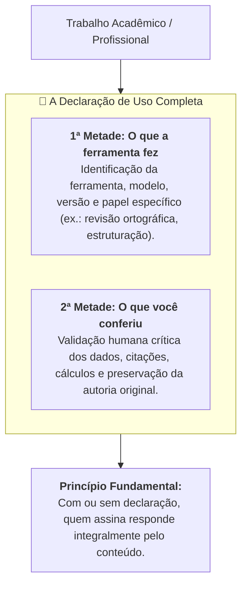

# A linha que você escreve no fim do trabalho

> **Disciplina:** Inteligência Artificial na Prática Acadêmica e Profissional (COM170)  
> **Quinzena 6 - Módulo 3** | Bimestre: 2026S2B1 - Univesp  

---

## 💬 Introdução ao Módulo

Imagine que um trabalho seu, entregue há dois anos, seja aberto hoje por alguém que quer saber como ele foi feito. O que essa pessoa encontra? Na maior parte dos trabalhos, o texto está lá, e o caminho até ele desapareceu.

Este módulo trata da **declaração de uso**: a frase, no fim do trabalho, que diz que uma ferramenta participou dele e o que ela fez. Regras publicadas passaram a pedir essa declaração, e você vai ler o que elas dizem, sem intermediário.

---

## 🧭 Os Dois Pilares da Declaração de Uso

1. **A 1ª Metade (Transparência de Processo):**
   * Especifica qual IA foi utilizada e qual tarefa foi delegada a ela.
2. **A 2ª Metade (A que quase ninguém escreve - Responsabilidade e Validação):**
   * Descreve os procedimentos de checagem, conferência de fontes e ajustes realizados pelo autor após o processamento da máquina.
   * **Regra de ouro:** A ferramenta nunca é coautora; a responsabilidade epistêmica e ética é sempre de quem assina o trabalho.

---

## 🚀 Trilha de Aprendizado do Módulo 3

1. 🎥 **Assista à videoaula** do Módulo 3;
2. 📖 **Leia o e-book e os materiais de leitura** com as regras publicadas pelas diretrizes acadêmicas/editoriais;
3. 🎯 **Pratique escrevendo a declaração de uso completa** (com as duas metades) sobre um texto revisado por IA.
