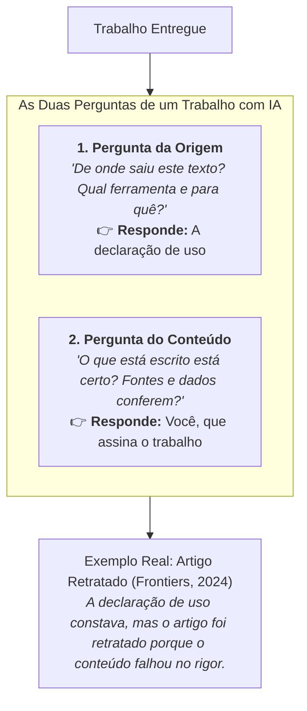

# Videoaula: A linha que fica com você

> **Disciplina:** Inteligência Artificial na Prática Acadêmica e Profissional (COM170)  
> **Quinzena 6 - Módulo 3** | Bimestre: 2026S2B1 - Univesp  
> **Link da Videoaula:** [YouTube - A linha que fica com você](https://www.youtube.com/watch?v=tuLJmsCTfTs)

---

## 📺 Visão Geral da Aula

A videoaula parte de uma situação cotidiana: você utilizou uma ferramenta de Inteligência Artificial para destravar ou revisar um trabalho acadêmico. Surge então a dúvida: **"Eu preciso declarar que usei? Declarar já resolve tudo?"**

A resposta direta é: **Declarar é apenas a primeira metade.** A regra exige duas coisas de quem escreve:
1. **Transparência:** Declarar o uso (de onde veio o texto);
2. **Responsabilidade Epistêmica:** Responder pelo conteúdo final (garantir que o que está escrito está certo).

---

## 🔍 Principais Pontos Abordados

### 1. Declarar conta a origem; Você responde pela veracidade
* A linha de declaração de uso atesta **a proveniência** do texto ou material.
* No entanto, ela **não garante a exatidão nem a validade**. Declarar se faz uma única vez; validar o conteúdo é um trabalho contínuo de linha por linha.

### 2. O Caso Real da Retratação (2024)
* Uma revista científica publicou um artigo com imagens geradas por IA.
* A origem das imagens não estava oculta — constava que foram geradas por IA.
* Mesmo assim, o artigo sofreu **retratação pública** (*retraction*), pois as ilustrações continham erros anatômicos e absurdos que violavam o rigor científico editorial.
* **Lição:** A transparência da origem não isenta o autor da reprovação por falhas de conteúdo.

### 3. As Normas Brasileiras Reais (Março de 2026)
* **CNPq (Portaria nº 2.664/2026):** Exige declarar o uso em qualquer fase da pesquisa, especificando ferramenta e finalidade; proíbe autoria por IA; determina que os autores respondem integralmente por imprecisões e plágios gerados pela ferramenta.
* **Unicamp (Deliberação CONSU-A-005/2026):** Exige declaração explícita; restringe a autoria a seres humanos; estabelece o usuário como único e integral responsável.

### 4. A Linha em Duas Metades
A declaração honesta e completa não tem apenas uma parte; ela é composta por **duas metades**:

$$\text{Declaração Completa} = \underbrace{\text{O que a ferramenta fez}}_{\text{1ª Metade (Origem)}} + \underbrace{\text{O que você conferiu}}_{\text{2ª Metade (Auditoria/Validação)}}$$

> **Exemplo da Linha Completa:**  
> *"Neste trabalho, usei uma ferramenta de inteligência artificial para revisar a redação **e li cada parágrafo revisado para conferir se ele ainda dizia o que eu queria dizer**."*

### 5. O Princípio da Reciprocidade e Simetria Docente-Discente
* A regra da integridade acadêmica não foi feita para "pegar" o aluno: ela existe para estabelecer a cadeia de governança.
* **Simetria:** Se o professor usa IA para preparar uma aula ou material didático, ele deve ao estudante a mesma declaração de transparência e verificação. Uma regra que vale só para o estudante não é uma regra ética, é uma conveniência.
