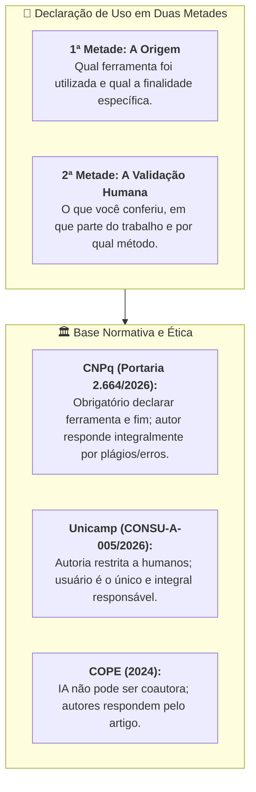
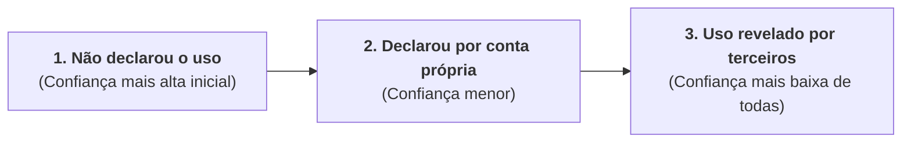

# Material-base: Módulo 3 - A linha que você escreve no fim do trabalho

> **Disciplina:** Inteligência Artificial na Prática Acadêmica e Profissional (COM170)  
> **Quinzena 6 - Módulo 3** | Bimestre: 2026S2B1 - Univesp  

---

## 📚 Materiais de Apoio Disponíveis

Neste módulo, estão disponíveis os documentos oficiais em PDF para leitura aprofundada, análise crítica e fundamentação:

### 1. 📖 E-book: Módulo 3
* **Arquivo:** [Q6_M3-E-book.pdf](file:///home/henrique/Modelos/Univesp/2026S2/COM170-Inteligencia-Artificial-na-Pratica-Academica-e-Profissional/Quinzena-6/Q6-Modulo3/Q6_M3-E-book.pdf)
* **Descrição:** Guia didático sobre a declaração de uso de ferramentas de IA, a anatomia das duas metades e a governança de integridade acadêmica.

---

### 2. 📑 Apostila da Quinzena 6 (Módulo 3)
* **Arquivo:** [COM170_apostila_quinzena6_M3.pdf](file:///home/henrique/Modelos/Univesp/2026S2/COM170-Inteligencia-Artificial-na-Pratica-Academica-e-Profissional/Quinzena-6/Q6-Modulo3/COM170_apostila_quinzena6_M3.pdf)
* **Tema Central:** *A linha que você escreve no fim do trabalho: Origem vs. Conteúdo, Normas (CNPq, Unicamp, COPE), As Duas Metades e o Dilema da Confiança (Schilke & Reimann, 2025)*

---

## 🔍 Síntese dos Principais Eixos Temáticos

### 1. 📍 Pergunta da Origem vs. Pergunta do Conteúdo
* **Pergunta da Origem (*De onde saiu este texto?*):** Responde qual ferramenta participou e qual tarefa executou. É resolvida pela declaração de uso.
* **Pergunta do Conteúdo (*O que está escrito está certo?*):** Responde se os dados, raciocínios e conclusões são verdadeiros e sustentáveis. É respondida exclusivamente pelo autor que assina o trabalho.
* **Regra Fundamental:** *A declaração conta de onde veio. Você continua dizendo se está certo.*

---

### 2. ⚠️ O Caso da Retratação Científica (Frontiers, 2024)
* **O Caso (Guo, Dong & Hao, 2024):** A revista *Frontiers in Cell and Developmental Biology* publicou um artigo com imagens geradas por IA contendo absurdos anatômicos grotescos.
* **A Transparência vs. O Rigor:** A origem das imagens não estava oculta (foi declarada), mas o artigo sofreu **retratação pública** porque o conteúdo falhou no controle de qualidade.
* **A Posição do COPE (Committee on Publication Ethics, 2024):**
  1. Ferramentas de IA **não podem ser listadas como autoras** (pois não possuem capacidade jurídica nem epistêmica de prestar contas ou responder por erros).
  2. Os autores humanos são **integralmente responsáveis** por todo o manuscrito.

---

### 3. 📜 O que as Normas Oficiais Brasileiras Exigem (Março de 2026)

| Diretriz / Norma | O que declarar | Quem pode assinar como autor | Quem responde pelo conteúdo final |
| :--- | :--- | :--- | :--- |
| **Portaria CNPq nº 2.664/2026** | Uso em qualquer fase da pesquisa, especificando ferramenta e finalidade. | **Apenas pessoas.** Vedado submeter conteúdo de IAG como autoria humana. | **Os autores, integralmente**, inclusive por plágios e imprecisões geradas pela IA. |
| **Deliberação CONSU-A-005/2026 (Unicamp)** | Uso explícito em nota de rodapé, seção específica ou equivalente. | **Apenas pessoas.** A contribuição principal e forma final são humanas. | **O usuário**, único e integral responsável pelo conteúdo produzido. |
| **Posição COPE (2024)** | Uso da ferramenta na seção de Métodos ou equivalente. | **Apenas pessoas.** Ferramentas de IA não podem ser autoras. | **Os autores**, inclusive pelas partes geradas por IA. |

---

### 4. ✍️ As Duas Metades da Linha que Você Escreve

A declaração deve conter obrigatoriamente duas metades integradas:

$$\text{Declaração Completa} = \underbrace{\text{Identificação da Ferramenta + Finalidade}}_{\text{1ª Metade (Origem)}} + \underbrace{\text{O que conferiu + Onde + Como}}_{\text{2ª Metade (Auditoria/Verificação)}}$$

#### Os 3 Elementos Obrigatórios da 2ª Metade:
1. **O que você conferiu:** (ex: as afirmações conceituais, as referências, o resultado dos cálculos).
2. **Em que parte do trabalho:** (ex: na conclusão, na seção 2, na tabela de dados).
3. **Como você conferiu:** (ex: confrontando com os artigos originais, recalculando manualmente, rodando os testes unitários).

> [!CAUTION]
> **Ponto Crítico:** *"Revisei tudo com atenção"* **NÃO** é uma segunda metade válida! Isso descreve uma disposição de espírito genérica. A 2ª metade exige a descrição de uma ação concreta e auditável que outra pessoa possa verificar.

---

### 5. 📉 O Impacto na Confiança do Leitor (Schilke & Reimann, 2025)
No estudo publicado na *Organizational Behavior and Human Decision Processes* com 4.093 participantes em 13 experimentos, analisou-se como a declaração afeta a percepção do avaliador:

* **O Dilema da Transparência:** Declarar o uso gera uma ligeira perda de confiança em relação a trabalhos sem uso de IA. Contudo, **esconder o uso e ser descoberto depois causa a maior perda de confiança de todas**.
* **Decisão Ética:** A transparência proativa com a linha em duas metades protege o autor e assegura a integridade acadêmica.

---

### 6. ⚖️ Simetria e Reciprocidade: A Regra Vale para Quem Ensina
* As normas da Unicamp e do CNPq aplicam-se a **docentes, pareceristas e pesquisadores seniores**.
* Se um professor utiliza IA para elaborar uma aula ou apostila, ele tem o dever ético de incluir a declaração em duas metades para os estudantes.
* *Uma regra que vale apenas para o estudante e não para o professor não é uma regra ética, é mera conveniência.*
