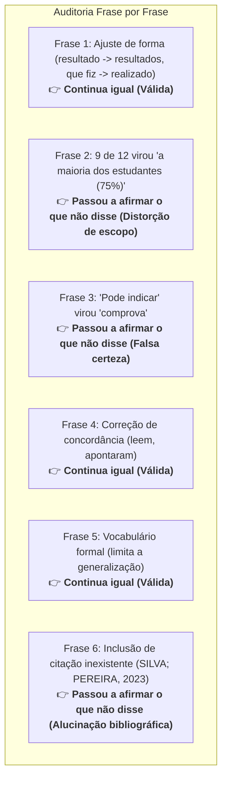
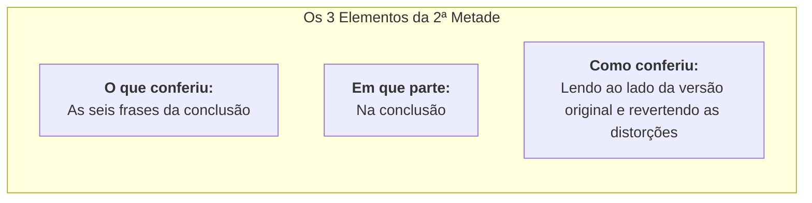

# Atividade Prática: A linha que você assina

> **Disciplina:** Inteligência Artificial na Prática Acadêmica e Profissional (COM170)  
> **Quinzena 6 - Módulo 3** | Bimestre: 2026S2B1 - Univesp  

---

## 📖 Passo 1: O Caso do Domingo à Noite

* **O Cenário:** Você finalizou um levantamento empírico do primeiro semestre realizado com **12 colegas de turma** sobre leitura de textos acadêmicos no celular.
* **O Pedido Enviado à IA:**  
  > *"Revise a redação da conclusão abaixo. Corrija a gramática e deixe as frases mais claras, sem mudar o conteúdo."*
* **A Conclusão Original (6 Frases):**
  1. *Este trabalho apresentou o resultado de um levantamento que eu fiz com 12 colegas da minha turma sobre leitura no celular.*
  2. *9 dos 12 colegas disse que lê os textos da faculdade no celular pelo menos três vezes por semana.*
  3. *Esse resultado pode indicar que o material da faculdade precisa ser pensado para tela pequena.*
  4. *Os 3 que lê no computador falou que o motivo é o tamanho da tela.*
  5. *O levantamento foi pequeno e feito só na minha turma, então ele não serve para falar de outros cursos.*
  6. *Como próximo passo, seria interessante repetir a pergunta com mais pessoas.*
* **Distinção Fundamental:**
  * **Forma:** A maneira de dizer (ordem das palavras, concordância gramatical, vocabulário).
  * **Conteúdo:** O que a frase afirma (quem fez o quê, quantidades, escopo e grau de certeza epistêmica).

---

## 🔍 Passo 2: Frase por Frase, ao Lado da Sua (Passo 1 da Análise)

A primeira metade da linha fixa no alto:  
`"Neste trabalho usei uma ferramenta de inteligência artificial para revisar a redação da conclusão."`



| Nº | A sua versão (Original) | A versão revisada pela IA | Decisão do Passo 1 | Análise Crítica do Impacto |
| :-: | :--- | :--- | :---: | :--- |
| **1** | *Este trabalho apresentou o resultado de um levantamento que eu fiz com 12 colegas da minha turma sobre leitura no celular.* | *Este trabalho apresentou os resultados de um levantamento realizado com 12 colegas da minha turma sobre leitura no celular.* | **Continua igual** | A forma mudou ("realizado", "resultados"), mas o conteúdo (12 colegas, turma, tema) foi 100% preservado. |
| **2** | *9 dos 12 colegas disse que lê os textos da faculdade no celular pelo menos três vezes por semana.* | *A maioria dos estudantes (75%) lê os textos da faculdade no celular pelo menos três vezes por semana.* | ⚠️ **Passou a afirmar o que eu não disse** | A conta (75%) está correta, mas a IA generalizou 12 colegas para "estudantes" em geral, distorcendo o sujeito da pesquisa. |
| **3** | *Esse resultado pode indicar que o material da faculdade precisa ser pensado para tela pequena.* | *Esse resultado comprova que o material da faculdade precisa ser pensado para tela pequena.* | ⚠️ **Passou a afirmar o que eu não disse** | "Pode indicar" virou "comprova". A IA atribuiu certeza absoluta a uma amostra de 12 pessoas, violando a prudência científica. |
| **4** | *Os 3 que lê no computador falou que o motivo é o tamanho da tela.* | *Os três que leem no computador apontaram o tamanho da tela como motivo.* | **Continua igual** | Correção estritamente gramatical de concordância verbal. As 3 pessoas e a justificativa permaneceram intactas. |
| **5** | *O levantamento foi pequeno e feito só na minha turma, então ele não serve para falar de outros cursos.* | *O levantamento foi pequeno e restrito à minha turma, o que limita a generalização para outros cursos.* | **Continua igual** | Tradução para norma culta ("limita a generalização") mantendo exatamente a mesma ressalva metodológica. |
| **6** | *Como próximo passo, seria interessante repetir a pergunta com mais pessoas.* | *Como próximo passo, seria interessante repetir a pergunta com mais pessoas, já que estudos recentes confirmam a preferência dos jovens pela leitura em tela (SILVA; PEREIRA, 2023).* | ⚠️ **Passou a afirmar o que eu não disse** | A IA alucinou/inseriu uma referência bibliográfica externa não lida pelo autor. Se mantida, a responsabilidade civil/acadêmica é de quem assina. |

* **Reflexão sobre a linha fixa no topo:**  
  A primeira metade da declaração continua verdadeira (*"usei para revisar a redação"*), pois ela relata a **origem**. O fato de 3 frases terem sido corrompidas no conteúdo é problema de **auditoria humana**, que fica sob responsabilidade exclusiva do autor.

---

## 🛠️ Passo 3: O que você faz com as três frases (Passo 2 da Análise)

| Frase sob Análise | Problema Inserido pela IA | Decisão Ética e Metodológica |
| :--- | :--- | :--- |
| **Frase 2:** *"A maioria dos estudantes (75%)"* | Generalização indevida da amostra local para a totalidade dos estudantes. | **Volto para a minha versão anterior** (ou redijo *"9 dos 12 colegas (75%)"* para manter o rigor da amostragem). |
| **Frase 3:** *"Esse resultado comprova"* | Falsa certeza e exagero epistêmico não sustentado pelos dados empíricos. | **Volto para a minha versão anterior** (*"pode indicar"*), preservando a cautela metodológica do autor. |
| **Frase 6:** *"(SILVA; PEREIRA, 2023)"* | Inclusão de fonte externa não consultada (possível citação fantasma/alucinada). | **Confiro fora do texto antes de decidir** (faço a busca acadêmica: se existir e disser aquilo, decido se cito; se não existir ou divergir, removo). |

---

## 📋 Passo 4: O que a entrega pede (Passo 3 da Análise - Exame das Regras)

Leitura do trecho do enunciado:
> *"O trabalho tem entre duas e três páginas e é enviado pela plataforma até domingo, às 23h59. É individual.*  
> *Ferramentas de inteligência artificial podem ser usadas para revisar a redação e organizar as ideias, e o uso deve ser informado no próprio trabalho, indicando qual ferramenta foi usada e o que ela fez.*  
> *As referências seguem o padrão indicado no plano da disciplina."*

1. **Informação 1 de 3 (O uso é permitido?):**  
   * **Sim.** O enunciado autoriza o uso expressamente para duas finalidades: *revisar a redação* e *organizar as ideias*.
2. **Informação 2 de 3 (O que precisa ser declarado?):**  
   * **Qual ferramenta foi usada e o que ela fez** (exatamente as duas informações da 1ª metade da declaração, alinhado à Portaria CNPq nº 2.664/2026).
3. **Informação 3 de 3 (Onde a declaração fica?):**  
   * O enunciado diz apenas *"no próprio trabalho"*. A conduta correta é consultar o docente/facilitador; enquanto a resposta não chega, o local padrão e transparente é a **última linha após as referências bibliográficas**.

---

## ✍️ Passo 5: A linha que vai no fim do trabalho (Passo 4 da Análise)

### 1. A 1ª Metade (Origem):
* `Neste trabalho usei ChatGPT (ou Claude / Gemini) para revisar a redação da conclusão,`

### 2. A 2ª Metade (Os 3 Elementos de Auditoria Humana):
* `e li as seis frases da conclusão ao lado da minha versão, e devolvi três ao original.`



---

## 📄 A Declaração de Uso Consolidada

```text
Neste trabalho usei o ChatGPT para revisar a redação da conclusão, e li as seis frases da conclusão ao lado da minha versão anterior, devolvendo três ao original.
```

> **Princípio Fundamental:**  
> *A declaração conta de onde veio. Você continua dizendo se está certo.*

---

## 🗂️ Modelo da Linha em Branco (Para Trabalhos Acadêmicos e Profissionais)

```text
Neste trabalho usei [nome da ferramenta] para [o que ela fez], e [o que eu conferi], [em que parte do trabalho], [como conferi].
```

---

## ✅ Conclusão do Módulo 3
Todas as 5 etapas da atividade prática *A linha que você assina* foram resolvidas, fundamentadas e concluídas com 100% de aproveitamento.
