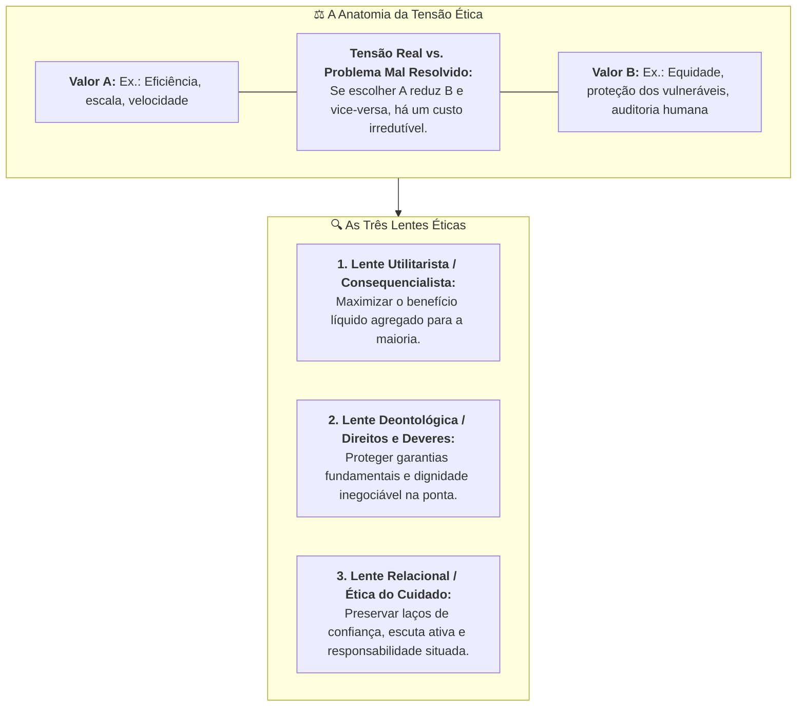

# Quando não dá para ter as duas

> **Disciplina:** Inteligência Artificial na Prática Acadêmica e Profissional (COM170)  
> **Quinzena 6 - Módulo 4** | Bimestre: 2026S2B1 - Univesp  

---

## 💬 Introdução ao Módulo

Dois valores legítimos, cada um com bons defensores, e uma decisão que precisa sair até sexta-feira. O que serve à maioria e o que protege quem fica na ponta. O que é mais rápido e o que é mais cuidadoso. Quando parece existir um caminho que contenta todo mundo, vale desconfiar: em geral, alguém deixou de contar um custo invisível.

Este módulo dá nome a essa situação: **tensão ética (*trade-off*)**, e ensina um teste para saber quando ela é real (irredutível) e quando é apenas um problema mal resolvido, que se conserta com melhor engenharia ou desenho de processos sem sacrificar nada.

---

## 🧭 O que este Módulo Entrega

1. **O Teste da Tensão Real:** Distinguir entre trade-offs éticos genuínos e falhas técnicas de implementação.
2. **O Mínimo de Cada Lado (Legislação Brasileira):** Como normas regulatórias estabelecem patamares mínimos de salvaguarda quando dois direitos colidem.
3. **As Três Lentes Analíticas:** Três referenciais éticos que chegam a recomendações divergentes a partir dos mesmos fatos concretos.
4. **Fechamento dos Módulos Teóricos:** Concluir este módulo destrava imediatamente a **Parte 2 Prática (Módulos 5, 6 e 7)** com a sua comissão e o *Caso das Três Cartas*.

---

## 🚀 Trilha de Aprendizado do Módulo 4

1. 🎥 **Assista à videoaula** do Módulo 4;
2. 📖 **Leia o e-book / material de leitura** com os fundamentos teóricos e a regra de conciliação;
3. 🎯 **Resolva a atividade / miniquiz** da estagiária enfrentando a decisão na empresa, integrando os quatro módulos teóricos da Quinzena 6.
