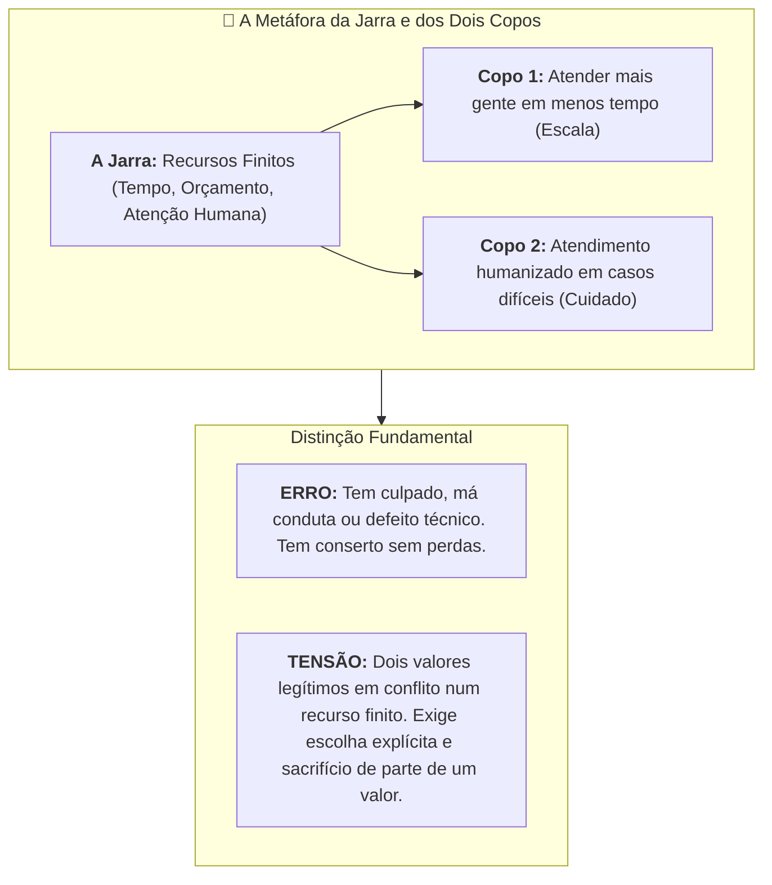
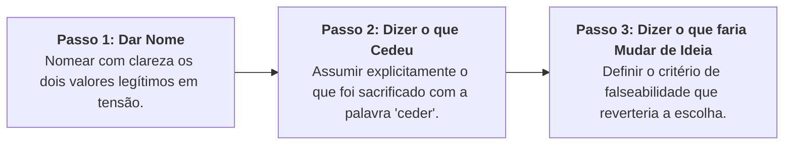

# Videoaula: A mesma jarra não enche os dois copos

> **Disciplina:** Inteligência Artificial na Prática Acadêmica e Profissional (COM170)  
> **Quinzena 6 - Módulo 4** | Bimestre: 2026S2B1 - Univesp  
> **Link da Videoaula:** [YouTube - A mesma jarra não enche os dois copos](https://www.youtube.com/watch?v=9Ecd3Xmciew)

---

## 📺 Visão Geral da Aula

A videoaula parte de um dilema real em uma central de atendimento ao cliente:
* Uma empresa implementou um sistema automatizado de respostas (IA / chatbot).
* **Resultado Positivo:** Mais pessoas atendidas em muito menos tempo (ganho de escala e eficiência).
* **Efeito Colateral:** Em casos complexos ou graves, os clientes não conseguem mais falar com um atendente humano.

Ninguém agiu de má-fé: são **duas coisas boas que não cabem inteiras no mesmo espaço**. Isso tem nome: **Tensão Ética (*Trade-off*)**.

---

## 🔍 Principais Conceitos Desenvolvidos

### 1. Erro vs. Tensão Ética
* **Erro:** Tem um culpado identificável e conserto direto. Se há uma solução mágica e simples sem nenhum custo colateral, o problema era apenas um erro ou má engenharia.
* **Tensão:** Não há culpado; existem dois objetivos legítimos que disputam os mesmos recursos finitos. Querer ignorar o custo é o único erro ético real: *"Escolher e fingir que não escolheu"*.

---

### 2. A Metáfora da Jarra
* O volume da jarra representa os recursos totais disponíveis (orçamento, capacidade de processamento, equipe).
* Encher o copo da escala e velocidade reduz obrigatoriamente o volume disponível para o copo do acolhimento humano personalizado.
* A mesma jarra não enche os dois copos até a borda.

---

### 3. Os 3 Passos para Deliberar e Explicar uma Escolha Ética

Para que uma decisão ética seja transparente, responsável e aberta ao debate público, ela deve seguir estritamente três passos:

1. **Passo 1 — Dar nome às duas coisas boas em tensão:**
   * *Exemplo:* Atender um volume massivo de clientes com rapidez **vs.** Garantir atendimento humano dedicado para problemas complexos.
2. **Passo 2 — Dizer qual das duas cedeu (usar a palavra *ceder*):**
   * *Exemplo:* *"Estamos cedendo o atendimento humano universal para conseguir atender toda a fila no mesmo dia."*
3. **Passo 3 — Dizer o que faria você mudar de ideia (Condição de Falseabilidade):**
   * *Exemplo:* *"Mudaremos de ideia se a taxa de casos complexos não resolvidos ultrapassar 3% ou se houver dano material ao consumidor."*

> [!IMPORTANT]
> **Por que o Passo 3 é o mais importante?**  
> Quase todo mundo pula o Passo 3. Sem ele, a decisão é um dogma impositivo (só pode ser aceita ou rejeitada). Com o Passo 3, a decisão se torna **auditável, falseável e negociável**.

---

### 4. Outros Exemplos de Tensões Éticas em IA
* **Detecção de Fraude:** Aumentar a sensibilidade do modelo bloqueia mais fraudadores (segurança), mas aumenta os falsos positivos, bloqueando compras legítimas de clientes idôneos (atrito e constrangimento).
* **Geração Rápida de Relatórios:** Gerar relatórios em minutos por IA economiza tempo, mas reduz a janela temporal para revisão humana e checagem de fontes.
