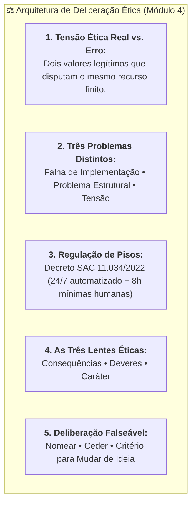

# Material-base: Módulo 4 - Quando não dá para ter as duas

> **Disciplina:** Inteligência Artificial na Prática Acadêmica e Profissional (COM170)  
> **Quinzena 6 - Módulo 4** | Bimestre: 2026S2B1 - Univesp  

---

## 📚 Materiais de Apoio Disponíveis

Neste módulo, estão disponíveis os documentos em PDF para leitura aprofundada, análise crítica e fundamentação:

### 1. 📖 E-book: Módulo 4
* **Arquivo:** [Q6_M4-E-book.pdf](file:///home/henrique/Modelos/Univesp/2026S2/COM170-Inteligencia-Artificial-na-Pratica-Academica-e-Profissional/Quinzena-6/Q6-Modulo4/Q6_M4-E-book.pdf)
* **Descrição:** Guia ilustrado sobre tensões éticas (*trade-offs*), a distinção entre falhas de implementação, problemas estruturais e tensões, e a aplicação das três lentes éticas.

---

### 2. 📑 Apostila da Quinzena 6 (Módulo 4)
* **Arquivo:** [COM170_apostila_quinzena6_M4.pdf](file:///home/henrique/Modelos/Univesp/2026S2/COM170-Inteligencia-Artificial-na-Pratica-Academica-e-Profissional/Quinzena-6/Q6-Modulo4/COM170_apostila_quinzena6_M4.pdf)
* **Tema Central:** *Quando não dá para ter as duas: Tensão Ética, Decreto do SAC (Decreto nº 11.034/2022), Gender Shades (Buolamwini & Gebru, 2018), As Três Lentes Éticas (USP/Fulbright) e Deliberação Falseável.*



---

## 🔍 Síntese dos Principais Eixos Temáticos

### 1. ⚖️ O Conceito de Tensão Ética (*Trade-off*)
* **Definição:** Situação em que dois valores legítimos e desejáveis não cabem inteiros na mesma decisão, de modo que preservar um custa parte do outro.
* **A Metáfora da Jarra e dos Dois Copos:**
  * O volume da jarra representa a finitude dos recursos (tempo de trabalho, capacidade de processamento, orçamento).
  * A mesma jarra não enche dois copos até a borda: se um copo é priorizado (ex: velocidade e escala), o outro necessariamente recebe menos (ex: atenção humana individualizada).

---

### 2. 🔬 O Teste: Quando ainda não é tensão
> **Regra de Ouro do Teste:**  
> *"Se você já tem um culpado e uma solução simples, você ainda não chegou à tensão."*

* A tensão só se revela quando **a sua própria proposta de solução também gera um custo concreto e você é capaz de apontar qual é esse custo e quem paga por ele**.
* Buscar culpados ("a empresa não se importa") trava a análise crítica. A pergunta ética é: *Se a empresa fizesse diferente, quanto custaria e quem arcaria com esse custo?*

---

### 3. 🧩 Três Problemas Diferentes que Parecem o Mesmo

```mermaid
flowchart LR
    P["O Ajuste Técnico Resolve?"] -->|SIM| F["<b>Falha de Implementação</b><br>Ex.: Adicionar opção faltante no menu.<br><i>Sobra depois: Nada.</i>"]
    P -->|NÃO (Causa nos Dados)| S["<b>Problema Estrutural</b><br>Ex.: Viés nos dados de treino (Gender Shades).<br><i>Sobra depois: Disparidade entre grupos.</i>"]
    P -->|NÃO (Valores Legítimos)| T["<b>Tensão Ética</b><br>Ex.: Escala veloz vs. Atendimento humano.<br><i>Sobra depois: O valor que cedeu.</i>"]
```

1. **Falha de Implementação:** O ajuste técnico resolve sem sacrifício de valor (ex: incluir opção esquecida no menu).
2. **Problema Estrutural:** O ajuste de código não resolve porque a causa está na matéria-prima dos dados de treino (ex: estudo clássico *Gender Shades* de Joy Buolamwini e Timnit Gebru, 2018, demonstrando menor acurácia em rostos de mulheres de pele escura devido à sub-representação nos conjuntos de treino).
3. **Tensão Ética:** Nenhum ajuste técnico devolve os dois lados; exige uma escolha deliberada e transparente de qual valor cederá.

---

### 4. 📜 A Solução Regulatória Brasileira: O Decreto do SAC (Decreto nº 11.034/2022)
O Poder Executivo enfrentou a tensão entre eficiência/escala e proteção ao consumidor sem proibir a tecnologia e sem exigir humanos em tempo integral:

* **Piso Tecnológico (Automação):** Acesso ininterrupto 24 horas por dia, 7 dias por semana (Art. 4º).
* **Piso Humano (Salvaguarda Mínima):** Disponibilização de atendimento por pessoa humana por no mínimo **8 horas diárias** (Art. 5º, I).
* **Eficiência do Usuário:** Proibição de repetição da demanda após o primeiro registro (Art. 10).
* **Prazo de Resposta:** Resolução em até 7 dias corridos (Art. 13).

> **Lição:** Uma escolha regulatória explícita com números e pisos pode ser criticada e negociada. Uma escolha oculta só pode ser obedecida.

---

### 5. 👓 As Três Lentes Éticas (Workshop Fulbright / USP, 2025)

| Lente Ética | Pergunta Central | Foco de Análise | Ponto Cego Crítico |
| :--- | :--- | :--- | :--- |
| **1. Consequências** *(Utilitarismo)* | *"O que produz os melhores resultados?"* | Maximizar o saldo de benefícios líquidos para a maioria (volume, rapidez). | Grupos minoritários ou vulneráveis podem ser severamente prejudicados sem alterar a média agregada. |
| **2. Deveres** *(Deontologia)* | *"Quais são as minhas obrigações?"* | Respeitar direitos fundamentais e regras inegociáveis, independentemente do volume. | Não oferece critério claro de desempate quando dois deveres legítimos colidem. |
| **3. Caráter** *(Ética das Virtudes)* | *"Que tipo de profissional age assim?"* | A integridade do tomador de decisão (se testou o caso mais difícil e se responsabiliza). | Quando profissionais igualmente íntegros divergem, não fornece fórmula de resolução. |

* **Onde as Lentes Divergem:** O ponto em que as três lentes discordam é precisamente **o ponto em que uma escolha ética consciente deve ser tomada e documentada**.

---

### 6. ✍️ Como Escrever uma Deliberação Falseável (Os 3 Passos)

$$\text{Deliberação Forte} = \underbrace{\text{Nomear os dois lados}}_{\text{Passo 1}} + \underbrace{\text{Dizer qual cedeu (usar a palavra 'ceder')}}_{\text{Passo 2}} + \underbrace{\text{Dizer o que faria mudar de ideia (Falseabilidade)}}_{\text{Passo 3}}$$

#### Exemplo de Recomendação Forte e Auditável:
> *"Recomendo manter o atendimento automático na primeira camada e abrir saída para atendente humano em qualquer ponto do menu. **Estou cedendo tempo médio de resposta**, que deve subir, para preservar o acesso a uma pessoa nos casos complexos. **Eu mudaria de ideia se** os registros do atendimento demonstrassem que a saída para atendente dobra o tempo de espera de todos os demais usuários."*

* **Requisitos do Passo 3 (Condição de Falseabilidade):**
  1. Nomear uma informação concreta que não se tem no momento;
  2. Ser um dado auditável que outra pessoa possa verificar;
  3. Ter força real para reverter a decisão caso se confirme.
* *Nota:* Dizer apenas *"mudaria de ideia se surgissem novas evidências"* é genérico e inválido.
