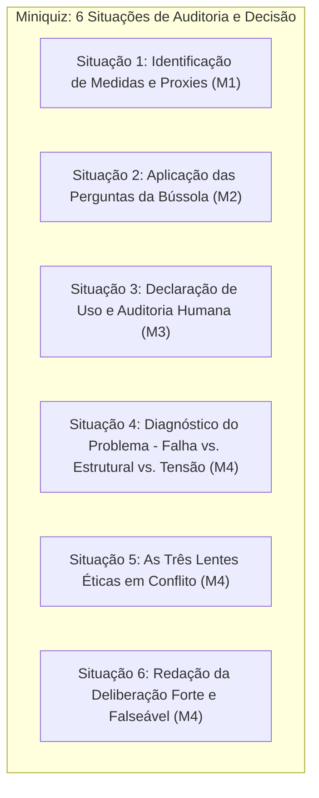
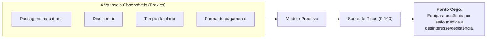
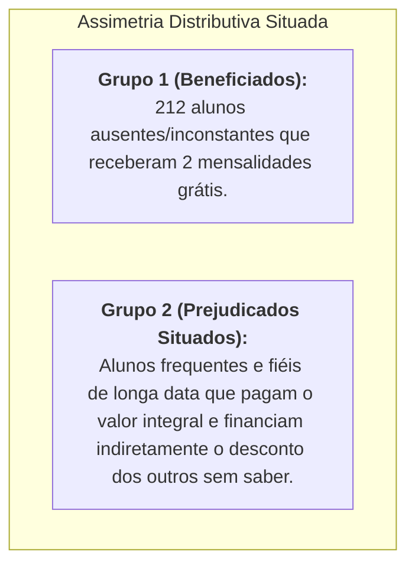
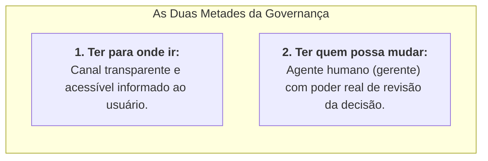
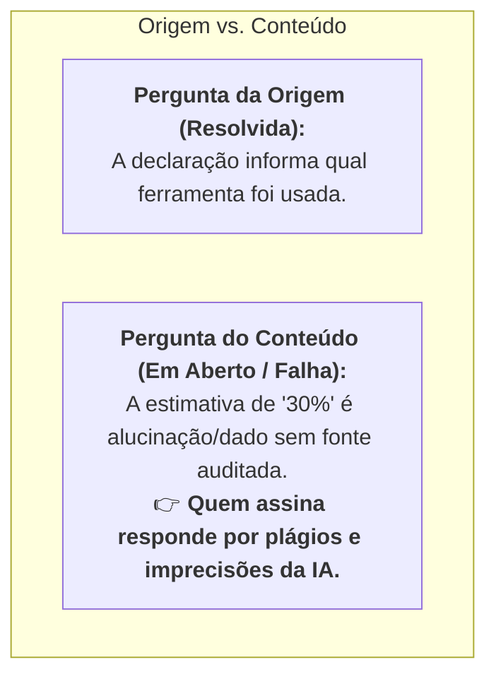
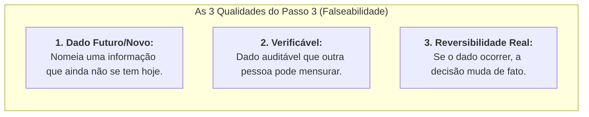
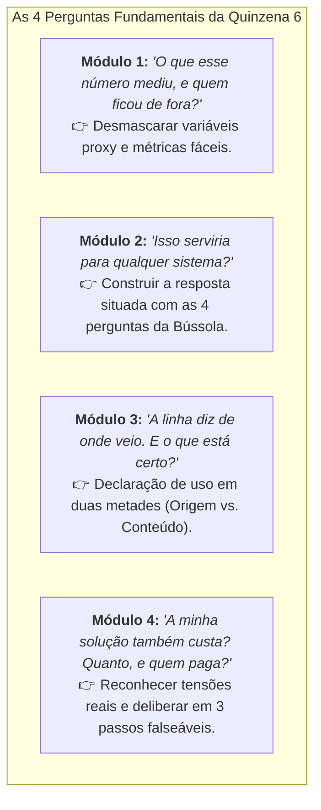

# Miniquiz: Quem paga o desconto

> **Disciplina:** Inteligência Artificial na Prática Acadêmica e Profissional (COM170)  
> **Quinzena 6 - Módulo 4** | Bimestre: 2026S2B1 - Univesp  
> **Peça-fechadura da Parte 1:** Concluir este miniquiz finaliza a Parte 1 Individual e abre a Parte 2 Prática (Módulos 5, 6 e 7).

---

## 📖 Contexto Geral da Atividade

* **Cenário:** Seis situações enfrentadas por uma estagiária diante de um sistema algorítmico que gera uma lista para decidir quem recebe desconto comercial.
* **Objetivo:** Integrar os conhecimentos dos Módulos 1, 2, 3 e 4 (medidas/proxies, Bússola Ética, declaração de uso e tensões éticas/deliberação com três lentes).



---

## 🏋️ Situação 1: Segunda-feira, a nota de cada aluno

* **O Cenário:** A rede de academias contratou um sistema preditivo que atribui a cada aluno uma nota de risco de cancelamento (0 a 100). A gerente solicita a Letícia que envie um cupom de desconto de duas mensalidades para todos os alunos com score acima de 70.
* **A Arquitetura do Modelo:**
  * **Dados de Treino:** Registros históricos de 2 anos das 5 unidades da rede.
  * **Variável-alvo (*Ground Truth*):** Marcação binária se o aluno cancelou ou não o plano nas 4 semanas seguintes.
  * **Variáveis de Entrada (*Features* / Proxies):** 
    1. Frequência de passagens na catraca por semana;
    2. Dias decorridos desde a última passagem;
    3. Tempo total de contrato ativo;
    4. Forma de pagamento cadastrada.



### Questão da Situação 1: O que a nota de um aluno mede?
* **Alternativa Correta (Gabarito Oficial):**  
  > *“A nota compara a ficha de hoje com as fichas do passado que terminaram em cancelamento. Ela sabe se o padrão se repete; o motivo, ela não sabe.”*
* **Fundamentação (Módulo 1 - Medidas e Proxies):**  
  O algoritmo não mede "vontade de desistir", "satisfação" ou "motivação" de forma direta. Ele correlaciona variáveis observáveis de comportamento com desfechos passados. Assim, um aluno temporariamente afastado por cirurgia ou viagem a trabalho e um aluno desmotivado recebem exatamente o mesmo score de cancelamento.

---

## 👥 Situação 2: Terça-feira, quem é afetado

* **O Cenário:** O desconto foi concedido a 212 alunos em risco de evasão. A gerente solicita a Letícia a redação da resposta para a 1ª pergunta da Bússola Ética: *Quem é afetado por esse sistema?*
* **Critério Metodológico:**  
  * **Resposta Genérica (Inadequada):** Dizer simplesmente *"os alunos da academia"* ou *"os clientes cadastrados"*.
  * **Resposta Situada (Adequada):** Identificar a assimetria concreta criada pelo modelo específico.



### Questão da Situação 2: Qual versão representa a resposta situada?
* **Alternativa Correta (Gabarito Oficial):**  
  > *“A versão que nomeia o grupo que só existe neste sistema: quem paga mais justamente por ter ficado e sido frequente, sem saber que uma lista automatizada decidiu isso.”*
* **Fundamentação (Módulo 2 - Bússola: QUEM):**  
  A resposta situada não apela para adjetivos ou generalizações vagas; ela utiliza dados cadastrais, tempo de permanência e assimetria de informação para demonstrar o impacto distributivo assimétrico: os clientes mais assíduos e leais pagam mais caro do que os clientes infrequentes que foram selecionados pela IA.

---

## ⚖️ Situação 3: Quarta-feira, quem responde

* **O Cenário:** Um aluno que não foi contemplado viu o desconto no celular de um colega e procurou a recepção da unidade para questionar o critério e solicitar o mesmo benefício.
* **O Instrumental Analítico (Pergunta RESPONDE da Bússola):**
  1. **1ª Metade (Canal):** O usuário afetado tem para onde ir / um canal acessível de contestação?
  2. **2ª Metade (Autoridade):** Do outro lado do canal, existe um ser humano com autonomia e autoridade real para alterar a decisão algorítmica?



### Questão da Situação 3: Qual alternativa cumpre integralmente as duas metades?
* **Alternativa Correta (Gabarito Oficial):**  
  > *“A opção em que as duas metades estão presentes: há uma pessoa (gerente) que pode mudar a decisão, e o aluno sabe quem é e por onde chegar a ela, porque a própria comunicação do sistema informa esse canal.”*
* **Fundamentação (Módulo 2 - Bússola: RESPONDE):**  
  Disponibilizar apenas um FAQ genérico ou canal de SAC sem alçada decisória deixa a governança capenga. A prestação de contas real (*accountability*) exige um canal auditável onde um gestor humano tenha autoridade expressa para avaliar o contexto e, se justificado, reverter o veredito da lista algorítmica.

---

## 📝 Situação 4: Quinta-feira, o relatório e a linha

* **O Cenário:** Letícia utilizou IA generativa para organizar a redação de seu relatório executivo. O texto gerado incluiu uma afirmação estatística não pesquisada por ela:  
  > *“Estudos mostram que descontos direcionados reduzem os cancelamentos em até 30% nos três meses seguintes.”*
* **A Conduta de Letícia:** Ela manteve a frase e inseriu apenas a 1ª metade da declaração no rodapé:  
  > *“Usei uma ferramenta de inteligência artificial para organizar a redação deste relatório.”*



### Questão da Situação 4: O que a linha resolveu, e o que ficou em aberto?
* **Alternativa Correta (Gabarito Oficial):**  
  > *“A declaração responde à pergunta da origem (de onde veio o texto), mas a frase dos 30% é uma pergunta de conteúdo (se é verdadeira e quais estudos comprovam). Como quem assina responde pelo conteúdo integral, se Letícia não tem a fonte validada, a frase deve ser retirada.”*
* **Fundamentação (Módulo 3 - Declaração em Duas Metades e Normas CNPq/Unicamp):**  
  A declaração de uso não atua como salvo-conduto para dados inventados pela IA. Conforme a Portaria CNPq nº 2.664/2026 e a Deliberação Unicamp CONSU-A-005/2026, o autor é integralmente responsável pelas imprecisões introduzidas pela ferramenta. A validação exige auditoria das fontes ou supressão de dados não verificados.

---

## ⚖️ Situação 5: Sexta-feira, isso é um erro?

* **O Cenário:** Diante da reclamação dos alunos antigos, a gerente calculou o impacto financeiro e operacional de todas as saídas possíveis:
  1. **Conceder desconto a todos os alunos:** Custo orçamentário inviável (equivalente ao custo de fechar a menor unidade da rede).
  2. **Manter o desconto só para quem tem score alto (>70):** Preserva a retenção, mas perpetua a penalização aos clientes mais fiéis.
  3. **Extinguir o desconto para todos:** Elimina o sentimento de injustiça, mas traz de volta a evasão massiva de alunos.
* **A Indagação da Gerente:** *"Isso é um erro de programação ou concepção do sistema?"*

```mermaid
flowchart TD
    subgraph Dilema["Diagnóstico: Tensão Ética Real"]
        S1["Saída 1: Desconto Geral ➔ Inviabilidade financeira"]
        S2["Saída 2: Desconto Seletivo ➔ Assimetria com alunos fiéis"]
        S3["Saída 3: Fim do Desconto ➔ Aumento de cancelamentos"]
        Dilema --- T["<b>Conclusão:</b> É uma TENSÃO ÉTICA real (não é erro).<br>O recurso financeiro é finito e qualquer saída tem custo."]
    end
```

### Questão da Situação 5: O que Letícia deve responder?
* **Alternativa Correta (Gabarito Oficial):**  
  > *“Não é um erro, é uma tensão ética real. Nenhuma solução técnica elimina o custo, pois o orçamento é finito. Como ambos os lados são legítimos, a escolha precisa ser deliberada por escrito, nomeando o valor que vai ceder.”*
* **Fundamentação (Módulo 4 - O Teste da Tensão):**  
  Um erro possui conserto simples e sem perdas. Na situação descrita, toda e qualquer intervenção impõe sacrifício financeiro ou relacional. Aplicando o teste do módulo, constatou-se que não há solução neutra: trata-se de um *trade-off* genuíno que exige deliberação pública e transparente.

---

## 🎯 Situação 6: Sexta-feira, o que faria você mudar de ideia

* **A Recomendação de Letícia (Passos 1 e 2):**  
  > *“Os dois lados em tensão são manter as cinco unidades abertas e tratar igual quem paga o mesmo plano. Recomendo manter o desconto só para quem tem nota alta, e avisar todos os alunos de que o desconto existe e como é calculado. **Estou cedendo o tratamento igual entre alunos do mesmo plano** para preservar a receita que mantém a unidade menor aberta.”*
* **O Desafio do Passo 3:** Redigir a **Condição de Falseabilidade** que torne a deliberação aberta ao escrutínio e debate.



### Questão da Situação 6: Qual versão cumpre o terceiro passo?
* **Alternativa Correta (Gabarito Oficial):**  
  > *“A versão que contém as três qualidades: nomeia uma métrica que não existe hoje (ex: taxa de cancelamento de alunos fiéis sem desconto superar a retenção gerada pelo cupom), é auditável por qualquer membro da equipe através dos relatórios de cancelamento e tem o poder real de derrubar a recomendação.”*
* **Fundamentação (Módulo 4 - Deliberação Falseável):**  
  Evitar afirmações vagas como *"mudaria se houvesse novas evidências"*. A deliberação robusta fixa exatamente o limiar quantitativo e o indicador de monitoramento que faria o tomador de decisão rever sua posição, permitindo que quem discorda saiba exatamente qual evidência precisa levantar.

---

## 🏁 Conclusão da Parte 1: O que ficou desta Quinzena

As seis situações do caso de Letícia demonstraram na prática que o sistema de inteligência artificial executou exatamente o que foi programado para fazer (medir proxies, ranquear e gerar a lista). **Todas as decisões éticas, políticas de aviso, critérios de alocação de perdas e governança de atendimento foram e continuam sendo tomadas por seres humanos.**



---

### 📌 Os Três Passos para a Deliberação Ética:
1. **Dê nome aos dois lados em conflito.**
2. **Diga qual deles cedeu, usando expressamente a palavra *ceder*.**
3. **Diga o que faria você mudar de ideia:** nomeando qual informação futura e onde ela estaria disponível para verificação.

---

## ✅ Conclusão do Módulo 4
O Miniquiz foi finalizado com 100% de aproveitamento em todas as 6 etapas. Com a conclusão deste módulo, a **Parte 1 Individual (Módulos 1 a 4)** está oficialmente encerrada, desbloqueando a **Parte 2 Prática (Módulos 5, 6 e 7)** no Ambiente Virtual de Aprendizagem.
