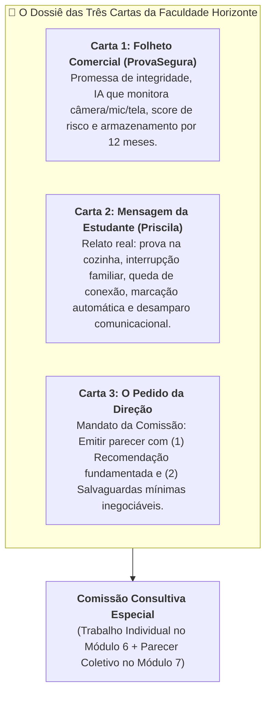
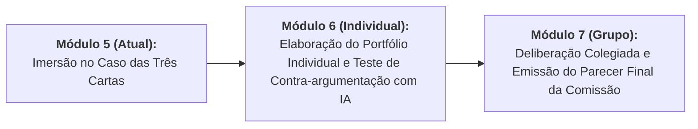

# Módulo 5: O Caso das Três Cartas (A Prova em Casa)

> **Disciplina:** Inteligência Artificial na Prática Acadêmica e Profissional (COM170)  
> **Quinzena 6 - Módulo 5** | Bimestre: 2026S2B1 - Univesp  
> **Papel:** Membro da Comissão Consultiva Especial da Faculdade Horizonte  

---

## 🏛️ Contexto Geral do Caso

A **Faculdade Horizonte** é uma instituição de ensino superior a distância (EaD) que atende milhares de estudantes em múltiplos polos. Historicamente, suas avaliações regimentais eram realizadas remotamente em ambiente web cronometrado, sem monitoramento invasivo (registrando apenas horário de início, término e submissão de respostas).

Buscando mitigar eventuais fraudes acadêmicas, a coordenação de provas realizou um **teste piloto** em uma turma com a ferramenta **ProvaSegura** (software de proctoring com IA). Com o término do semestre, a empresa fornecedora propôs a **contratação e extensão do sistema para 100% das provas da faculdade**.

A Direção da instituição congelou a contratação e instaurou uma **Comissão Deliberativa** (composta por nós, estudantes), entregando o dossiê com as **Três Cartas** para emissão de um parecer fundamentado.

---

## 📜 As Três Cartas da Comissão

### 📄 Carta 1: O Folheto do Fornecedor (*ProvaSegura*)
> **ProvaSegura — Integridade para a sua prova on-line.**
> 
> * **Como funciona:** O ProvaSegura acompanha o estudante do começo ao fim da prova pela câmera, pelo microfone e pela tela do computador. A inteligência artificial do sistema identifica automaticamente comportamentos de risco:
>   * Olhar para fora da tela por mais de alguns segundos;
>   * Presença de outra pessoa no ambiente;
>   * Voz ou ruído de conversa;
>   * Troca de janela ou de aba;
>   * Uso de celular.
> * **Relatório e decisão:** Ao final de cada prova, a coordenação recebe um relatório por estudante, com um nível de risco (baixo, médio ou alto) e os trechos de vídeo marcados pelo sistema. A decisão sobre cada caso é sempre da instituição.
> * **Informações do fornecedor:**
>   * Instituições que adotaram o ProvaSegura relatam queda nas ocorrências de fraude já no primeiro semestre de uso.
>   * Sem instalação complexa. O estudante precisa apenas de computador com câmera e microfone, internet estável e um ambiente silencioso.
>   * As gravações ficam armazenadas por 12 meses nos servidores da empresa.
>   * Cobrança por prova aplicada, por estudante. Sem custo para o aluno.

---

### ✉️ Carta 2: A Mensagem da Estudante (*Priscila*)
> **De:** Priscila, estudante do 2º semestre · **Para:** Coordenação de provas · **Assunto:** Minha prova de Estatística foi marcada
> 
> *"Boa tarde. Recebi hoje um e-mail automático dizendo que a minha prova de sábado 'foi marcada para análise pela coordenação' e que eu 'receberia novo contato'. Não diz o que foi marcado, nem quem vai analisar, nem até quando.*
> 
> *Eu faço as provas na cozinha, porque é o único lugar da casa com mesa e tomada. Durante a prova minha irmã entrou duas vezes para pegar água, e em um momento eu olhei para o lado porque o meu sobrinho chorou. A internet também caiu por uns quarenta segundos, e o sistema me deixou voltar.*
> 
> *Eu não colei. Mas também não tenho outro lugar para fazer prova, e não sei com quem falar. Vocês podem me dizer o que aconteceu?"*

---

### 📋 Carta 3: O Mandato e Pedido da Direção
> *“A Faculdade Horizonte usou o ProvaSegura em caráter de teste em uma turma, no semestre passado. O e-mail da Priscila é de uma estudante dessa turma. A empresa apresentou a proposta para uso em todas as provas on-line a partir do próximo semestre.*
> 
> *A direção pede à comissão um parecer com duas partes:*
> 1. * **A Recomendação:** Adotar, Adotar com condições ou Não adotar, com as razões explicadas.*
> 2. * **As Garantias Mínimas:** O que a faculdade passa a garantir ao estudante e o que passa a garantir à validade da prova, qualquer que seja a decisão.”*

---

## 🔍 Matriz de Análise Crítica do Caso (Cruzamento das Três Cartas)

| Dimensão de Análise | O que a Carta 1 (Empresa) Afirma | O que a Carta 2 (Priscila) Revela na Prática | Impacto Ético / Jurídico (LGPD & Bússola) |
| :--- | :--- | :--- | :--- |
| **Ambiente de Prova** | Exige *"ambiente silencioso e isolado"*. | Priscila mora em casa compacta; o único ponto com mesa/tomada é a cozinha compartilhada. | **Exclusão socioespacial:** Penaliza estudantes de baixa renda que não dispõem de escritório individual. |
| **Variáveis *Proxy* da IA** | Desvio de olhar, vozes de terceiros e ruídos são marcados como *"risco de fraude"*. | Olhou para o lado pelo choro do sobrinho; irmã pegou água; internet oscilou. | **Falsos positivos sistemáticos:** Confunde dinâmicas da vida doméstica com desonestidade acadêmica. |
| **Privacidade e Dados** | Gravações biométricas e de tela armazenadas por 12 meses em nuvem privada. | A gravação capturou a intimidade familiar da casa (irmã, sobrinho criança). | **Violação da LGPD e ECA:** Coleta e guarda prolongada de dados biométricos e imagens de terceiros (inclusive menores) sem consentimento específico. |
| **Transparência e Governança** | *"A decisão é sempre da instituição."* | Recebeu e-mail automático vago, sem justificativa, sem prazo e sem canal de atendimento. | **Opacidade total:** Violação do Art. 20 da LGPD (direito a informações claras e revisão de decisão automatizada). |
| **Custo Invisível** | *"Sem custo para o aluno."* | Priscila sofreu ansiedade, insegurança jurídica, ameaça de anulação e desgaste emocional. | **Custo cognitivo, humano e distributivo:** A conta do controle recai sobre os elos mais vulneráveis. |

---

## 🚀 Próximos Passos na Quinzena 6

1. **Módulo 6:** Construir a sua ficha de deliberação individual respondendo à recomendação e garantias mínimas, testando seu argumento contra uma IA.
2. **Módulo 7:** Reunir as fichas no grupo para redigir o Parecer Oficial da Comissão.
