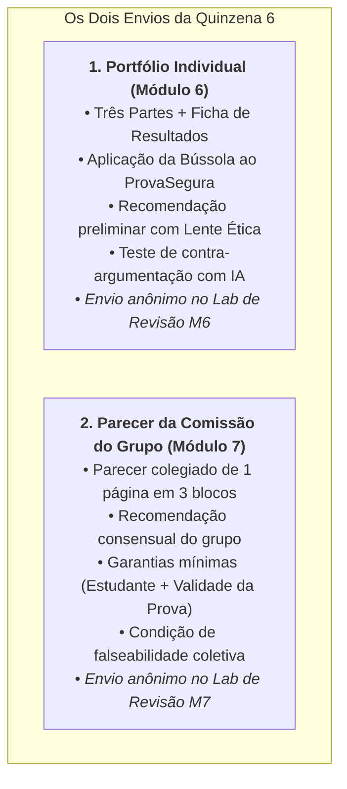

# Instruções para os Trabalhos da Quinzena 6 (Módulos 6 e 7)

> **Disciplina:** Inteligência Artificial na Prática Acadêmica e Profissional (COM170)  
> **Quinzena 6 - Módulo 5** | Bimestre: 2026S2B1 - Univesp  
> **Janela de Envios:** De 05 de outubro (Segunda) a 10 de outubro de 2026 (Sábado), às 23h59  
> **Janela de Revisão por Pares:** De 11 de outubro (Domingo) a 13 de outubro de 2026 (Terça), às 23h59  

---

## 🎯 Visão Geral dos Dois Trabalhos

---

## 📄 1. O Portfólio Individual (Módulo 6)

### Estrutura Obrigatória:
* **Identificação:** Apenas **Ferramenta** e **Modelo** de IA utilizados (sem nome do aluno e sem número do grupo para garantir a revisão anônima).
* **Parte 1 — A Bússola:** 4 respostas (Quem, Sabe, Responde, Custa), em até 4 linhas cada, citando obrigatoriamente o documento/trecho ou afirmando *"os documentos não dizem"*.
* **Parte 2 — A minha recomendação:** Decisão (Adotar, Adotar com condições ou Não adotar); Razão principal baseada na Bússola; Os dois lados em tensão e qual cedeu; A lente ética adotada (Consequências, Deveres ou Caráter).
* **Parte 3 — O contrário (Contra-argumentação com IA):** 
  * O prompt enviado à IA (assumindo o papel de membro discordante da comissão);
  * A resposta da IA colada na íntegra sem edições;
  * 1 argumento aceito e o que ele alterou na recomendação;
  * 1 argumento recusado com o trecho do documento que refuta a alegação;
  * A recomendação final em até 5 linhas com a cláusula *"Eu mudaria de ideia se..."*.
* **Ficha de Resultados:** 6 campos consolidados para compartilhamento com o grupo.

---

## 👥 2. O Parecer da Comissão (Módulo 7)

### Estrutura Obrigatória (1 Página):
* **Bloco 1 — A recomendação da comissão:** Em até 8 linhas, a decisão consensual do grupo, as razões, o que ficou de fora e o registro de divergências remanescentes (sem nomes).
* **Bloco 2 — As garantias mínimas (uma para cada lado):**
  * *Garantia ao Estudante:* Ação concreta, com prazo e responsável, apontando a origem na Bússola/cartas.
  * *Garantia à Validade da Prova:* Ação concreta de integridade acadêmica com prazo, apontando a origem.
* **Bloco 3 — O que faria a comissão mudar de parecer:** Em até 5 linhas, a informação futura que não se tem hoje, quem poderia auditá-la e o impacto de reversão.

---

## 🏆 Rubrica Oficial de Avaliação por Pares

| Critério Avaliado | Para Retomar | Em Construção | Consolidado (Nota Máxima) |
| :--- | :--- | :--- | :--- |
| **Bússola Situada** | Respostas genéricas ou faltam perguntas. | Respostas presentes, mas apenas parte cita trechos dos documentos. | As 4 respostas tratam do ProvaSegura citando trechos exatos ou indicam onde a informação acaba. |
| **Ferramenta como Adversária** | Falta o prompt, resposta não colada ou sem avaliação. | Resposta colada, mas falta motivo ou citação de documento na recusa. | Declara ferramenta/modelo, cola resposta inteira, avalia 1 aceito (com alteração) e 1 recusado (com trecho de refutação). |
| **Escolha Discutível e Falseável** | Decisão sem razões ou sem *"mudaria de ideia se"*. | Traz razões e lente, mas *"mudaria de ideia"* é vago ou genérico. | Traz os dois lados, o que cedeu, as razões e o *"mudaria de ideia se"* com dado auditável e reversível. |
| **Garantias dos Dois Lados (Grupo)** | Falta garantia de um lado ou são meras intenções. | Garantias escritas como ação, mas sem citar de onde nasceram na Bússola. | Cada lado possui garantia acionável (com prazo e responsável) apontando a origem na Bússola. |
