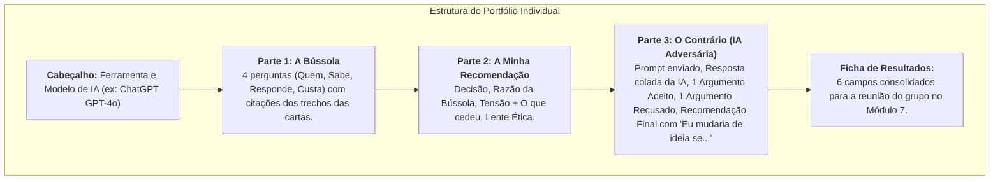

# Módulo 6: Guia do Portfólio Individual (A Prova em Casa)

> **Disciplina:** Inteligência Artificial na Prática Acadêmica e Profissional (COM170)  
> **Quinzena 6 - Módulo 6** | Bimestre: 2026S2B1 - Univesp  
> **Prazo de Envio:** De 05 de outubro (Segunda) a 10 de outubro de 2026 (Sábado), às 23h59  
> **Local de Envio:** Laboratório de Revisão do Módulo 6  
> **Anonimato Obrigatório:** Documento sem nome e sem identificação de grupo.

---

## 🎯 Instruções de Formatação e Construção

O Portfólio Individual é composto por **Três Partes** e uma **Ficha de Resultados**:

---

## 📋 Regras de Ouro da Avaliação (Rubrica de Nota Máxima)

1. **Bússola Situada:** Toda resposta deve citar expressamente a carta e o parágrafo (ex: `"folheto, parágrafo 3"`, `"e-mail da Priscila, parágrafo 2"`), ou registrar formalmente que *"os documentos não dizem"*.
2. **Resposta da IA na Íntegra:** A resposta gerada pela ferramenta ao prompt adversário deve ser colada integralmente na Parte 3, sem edições ou cortes.
3. **Justificativa com Fato e Trecho:** O argumento recusado deve conter o trecho do documento que refuta a premissa da IA.
4. **Falseabilidade Real (Passo 3):** A cláusula *"Eu mudaria de ideia se..."* deve nomear uma métrica futura que não se tem hoje, auditável por terceiros e com força para reverter a decisão.
