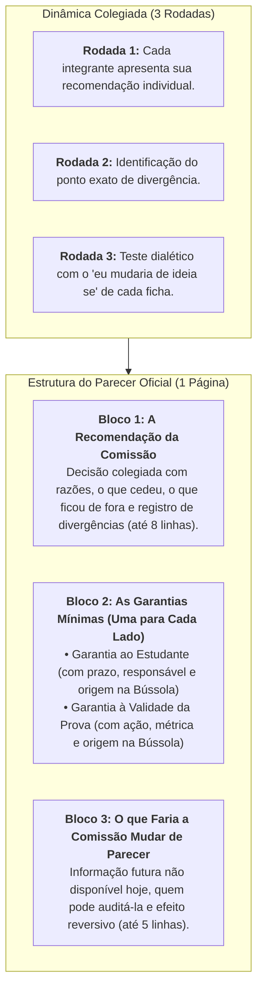

# Módulo 7: Guia do Trabalho de Grupo (O Parecer da Comissão)

> **Disciplina:** Inteligência Artificial na Prática Acadêmica e Profissional (COM170)  
> **Quinzena 6 - Módulo 7** | Bimestre: 2026S2B1 - Univesp  
> **Prazo de Envio:** De 05 de outubro (Segunda) a 10 de outubro de 2026 (Sábado), às 23h59  
> **Local de Envio:** Laboratório de Revisão do Módulo 7 (enviado pelo representante do grupo)  
> **Anonimato Obrigatório:** Documento sem identificação nominal de integrantes ou número de grupo.

---

## 🏛️ Dinâmica de Construção do Parecer

O Parecer da Comissão é um documento executivo de **1 página**, estruturado em **Três Blocos**:

---

## 📋 Regras de Avaliação por Pares do Parecer (Rubrica Consolidada)

1. **Recomendação Forte:** Apresenta as razões de cada parte, declara o que cedeu e explicita o que ficou de fora (ex.: custo monetário por licença ausente nas cartas).
2. **Garantias Acionáveis e com Origem:** Cada garantia deve ser uma **ação concreta** (com sujeito, prazo e procedimento), apontando a resposta da Bússola de onde derivou.
3. **Falseabilidade Auditável:** O Bloco 3 deve nomear uma métrica auditável por fontes institucionais capazes de reverter o parecer.
