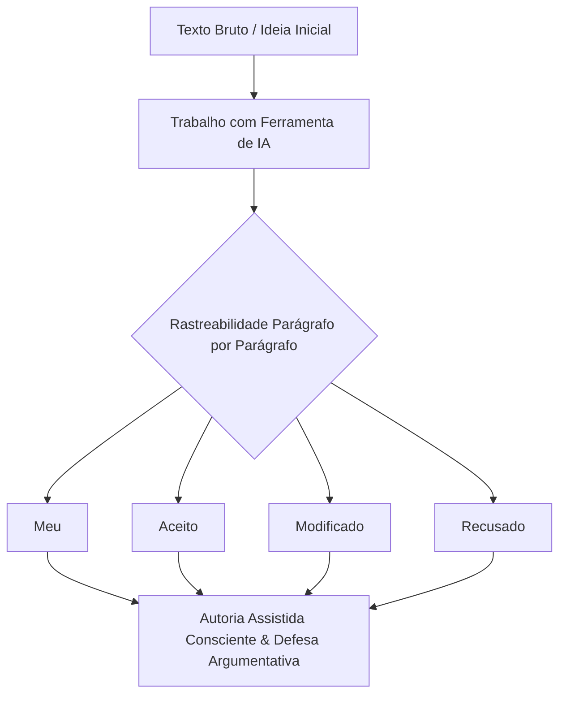

# Autoria Assistida

> **Docente Responsável:** Prof. Dr. José Avelino Placca  
> **Disciplina:** Inteligência Artificial na Prática Acadêmica e Profissional (COM170)  
> **Quinzena 7** | Bimestre: 2026S2B1 - Univesp  

---

## 💬 Apresentação da Quinzena 7

Olá, boas-vindas à sétima quinzena!

Pense no último trabalho que você entregou com a ajuda de uma ferramenta de inteligência artificial. Se alguém apontasse um parágrafo e perguntasse quem escreveu aquilo, você saberia responder? E saberia explicar por que aquela frase está ali, e não outra?

Até aqui, a disciplina tratou do que a ferramenta devolve: se a resposta está certa, de onde veio a informação, quem recebe a decisão. Nesta quinzena, a pergunta passa a ser sobre o seu próprio texto. Você vai aprender a reconhecer o texto que serviria para qualquer situação, a testar se uma ideia que veio da ferramenta já é sua, a conferir um texto que voltou revisado e a dizer, parágrafo por parágrafo, onde a ferramenta entrou.

Esta é a **última quinzena de conteúdo da disciplina**. Ela termina com um trabalho escrito para alguém que ainda não chegou: uma pessoa que começa o curso no ano que vem e que precisa do que você sabe hoje.

> [!TIP]
> **Uma sugestão antes de começar:**  
> Separe um texto seu, de qualquer disciplina, escrito com ou sem ferramenta. No fim de cada módulo, volte a ele e repare no que você enxerga agora e não enxergava antes.

---

## 🎯 O que você vai aprender nesta quinzena

Ao final desta quinzena, você vai conseguir:

* [x] **01. Reconhecimento dos Três Sinais do Padrão:** Apontar os três sinais do padrão num texto pronto, sabendo que eles não provam quem escreveu o texto.
* [x] **02. Apropriação Crítica de Ideias:** Explicar, com as suas palavras, por que uma ideia que veio da ferramenta funciona e o que responder a quem discorda dela.
* [ ] **03. Auditoria de Revisão e Tradução:** Conferir o que uma ferramenta mudou ao revisar um texto, inclusive em outra língua, e pedir a revisão dizendo onde ela deve olhar.
* [ ] **04. Matriz de Rastreabilidade Textual:** Indicar de onde veio cada parágrafo de um texto com as palavras **Meu**, **Aceito**, **Modificado** e **Recusado**, registrando o motivo.
* [ ] **05. Autoria Assistida e Defesa por Escrito:** Escrever um texto com a ferramenta, registrar a origem de cada parágrafo e defender por escrito uma ideia que veio dela.
