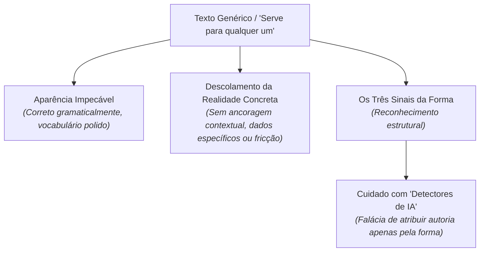

# O texto que serve para qualquer um

> **Disciplina:** Inteligência Artificial na Prática Acadêmica e Profissional (COM170)  
> **Quinzena 7 - Módulo 1** | Bimestre: 2026S2B1 - Univesp  

---

## 💬 Introdução ao Módulo

Você já leu um texto que poderia estar em qualquer lugar? Ele está correto, está bem escrito, e mesmo assim nada nele foi escrito para aquele caso concreto. É difícil dizer o que falta, e fica ainda mais difícil quando o texto é seu.

Este módulo dá nome a esse texto e mostra como reconhecê-lo pela forma, sem tentar adivinhar quem o escreveu. Você vai ver que a mesma forma genérica aparece também em textos escritos exclusivamente por pessoas, e vai entender por que o resultado de programas que prometem "detectar IA" ou descobrir o autor precisa ser lido com extrema cautela e ceticismo metodológico.

> [!IMPORTANT]
> **Reconhecer pela forma, não pela adivinhação:**  
> A forma padronizada não é prova cabal de quem escreveu. Detectores automáticos geram falsos positivos porque seres humanos também escrevem textos padronizados e vagos. O objetivo é desenvolver a acuidade crítica para identificar a falta de substância e especificidade.

---

## 🚀 Trilha de Aprendizado do Módulo 1 (Concluída)

1. ✅ 🎥 **Videoaula:** [1-Videoaula-O-texto-que-serve-para-qualquer-um.md](file:///home/henrique/Modelos/Univesp/2026S2/COM170-Inteligencia-Artificial-na-Pratica-Academica-e-Profissional/Quinzena-7/Q7-Modulo1/1-Videoaula-O-texto-que-serve-para-qualquer-um.md)
2. ✅ 📖 **Material-base e E-book:** [2-Material-base.md](file:///home/henrique/Modelos/Univesp/2026S2/COM170-Inteligencia-Artificial-na-Pratica-Academica-e-Profissional/Quinzena-7/Q7-Modulo1/2-Material-base.md)
3. ✅ 📝 **Atividade Prática:** [3-Atividade-O-paragrafo-que-serve-para-qualquer-um.md](file:///home/henrique/Modelos/Univesp/2026S2/COM170-Inteligencia-Artificial-na-Pratica-Academica-e-Profissional/Quinzena-7/Q7-Modulo1/3-Atividade-O-paragrafo-que-serve-para-qualquer-um.md)

