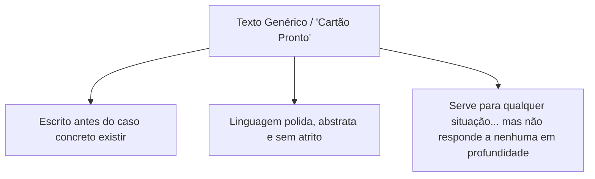
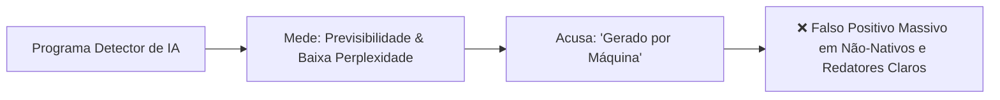

# Videoaula: O texto que serve para qualquer um

> **Docente:** Prof. Dr. José Avelino Placca  
> **Disciplina:** Inteligência Artificial na Prática Acadêmica e Profissional (COM170)  
> **Quinzena 7 - Módulo 1** | Bimestre: 2026S2B1 - Univesp  

---

## 🎥 Acesso à Videoaula

* **Título:** O texto que serve para qualquer um
* **Link:** [Assistir no YouTube](https://www.youtube.com/watch?v=ZugwSkFpwPA)

---

## 📝 Resumo e Conceitos Centrais

A videoaula parte de uma situação real e angustiante: um estudante entrega um trabalho escrito inteiramente por ele, mas recebe de volta o comentário de que o texto *"parece ter saído de uma inteligência artificial"*. A questão central colocada pelo Prof. Placca é: **o que no texto faz alguém dizer isso?**

A resposta está no conceito de **PADRÃO**.

### 🎂 A Metáfora do Cartão de Aniversário
Para ilustrar o que é o padrão, o professor compara o texto com os cartões de aniversário que vêm com mensagens pré-impressas na loja. Essas mensagens são praticamente idênticas entre si porque foram escritas **antes de existir a pessoa concreta que iria recebê-las** e, portanto, precisavam caber em qualquer um. 

Da mesma forma, a inteligência artificial generativa responde com um texto pronto, neutro e padronizado sempre que **ninguém fornece contexto, restrições ou especificidades situacionais**.

---

## 🔬 O Experimento do Professor: A Falácia da Forma

Para demonstrar os perigos de julgar textos unicamente pela aparência, o professor coloca dois parágrafos na tela sobre o mesmo tema e tenta identificar qual foi gerado por máquina e qual foi escrito por estudante. 

Ele escolhe o parágrafo da esquerda... e **erra**. **Ambos haviam sido escritos por estudantes humanos.**

O professor foi induzido ao erro porque julgou exclusivamente pelos **três sinais do padrão**.

---

## 🚩 Os Três Sinais do Padrão

Os três traços estruturais que comumente caracterizam o texto padronizado:

1. **A palavra que aparecia pouco e de repente está em todo lugar:**
   * Termos que tiveram uma explosão estatística de frequência na literatura e em redações após a popularização dos LLMs (ex.: *crucial*, *pivotal*, *meticuloso*, *imperativo*, *panorama*).
2. **O elogio vazio:**
   * Declarações laudatórias genéricas sem demonstração empírica. O texto afirma que determinado trabalho é *"excelente"*, *"inovador"* ou *"revolucionário"*, mas não apresenta fatos, dados ou evidências concretas que justifiquem o adjetivo.
3. **A lista de três itens onde a ideia era uma frase só:**
   * A clássica estrutura tripartida típica dos modelos de linguagem, que desdobra um raciocínio simples em três marcadores paralelos (geralmente formulações redundantes ou simétricas).

> [!IMPORTANT]
> **O sinal mostra o padrão, não quem escreveu:**  
> Ter o padrão não significa ter sido escrito por máquina. Estudantes que leem muitos textos gerados por IA ou manuais corporativos passam a mimetizar inconscientemente essa mesma cadência e vocabulário.

---

## 📊 Evidências Científicas e Limites dos "Detectores de IA"

A videoaula traz dois estudos rigorosos que desconstroem a confiabilidade de programas detectores de IA:

### 1. Salto Estatístico na Literatura Científica
Pesquisadores analisaram **15 milhões de resumos científicos publicados ao longo de 14 anos**. Identificaram que certas palavras tiveram saltos abruptos de uso de um ano para o outro, mantendo o tema inalterado. Em 2024, **mais de 13% dos resumos** apresentavam essas palavras de alta frequência de LLMs. Isso revela a disseminação do padrão estilístico, mas não comprova fraude.

### 2. O Teste dos Sete Detectores (Vieses contra Não-Nativos)
Em 2023, **sete programas detectores** foram testados em 91 redações escritas comprovadamente por humanos em testes de proficiência em língua inglesa (TOEFL):
* **6 em cada 10 redações** de falantes não-nativos foram falsamente acusadas de terem sido geradas por IA.
* O erro recaiu sistematicamente sobre pessoas que aprenderam inglês como segunda língua, pois elas utilizam um vocabulário mais direto e previsível (menor perplexidade linguística), que os algoritmos detectores rotulam erroneamente como *"padrão de máquina"*.

---

## 🛡️ A Verdadeira Prova de Autoria

Uma acusação ou suspeita baseada em detectores de IA vale **apenas como suspeita do padrão**, e jamais como prova pericial ou pedagógica.

A verdadeira comprovação de autoria reside em demonstrar a **ancoragem pessoal e contextual do texto**:
* O exemplo prático que só você vivenciou ou conhecia;
* A objeção específica que você enfrentou e soube responder;
* A explicação, em suas próprias palavras, de por que aquela formulação foi escolhida em detrimento de outra.

> [!TIP]
> **Gancho para a Próxima Aula:**  
> A aula seguinte abordará a apropriação crítica: como pegar *"uma ideia boa que não era minha e defendê-la com argumentos próprios"*.
