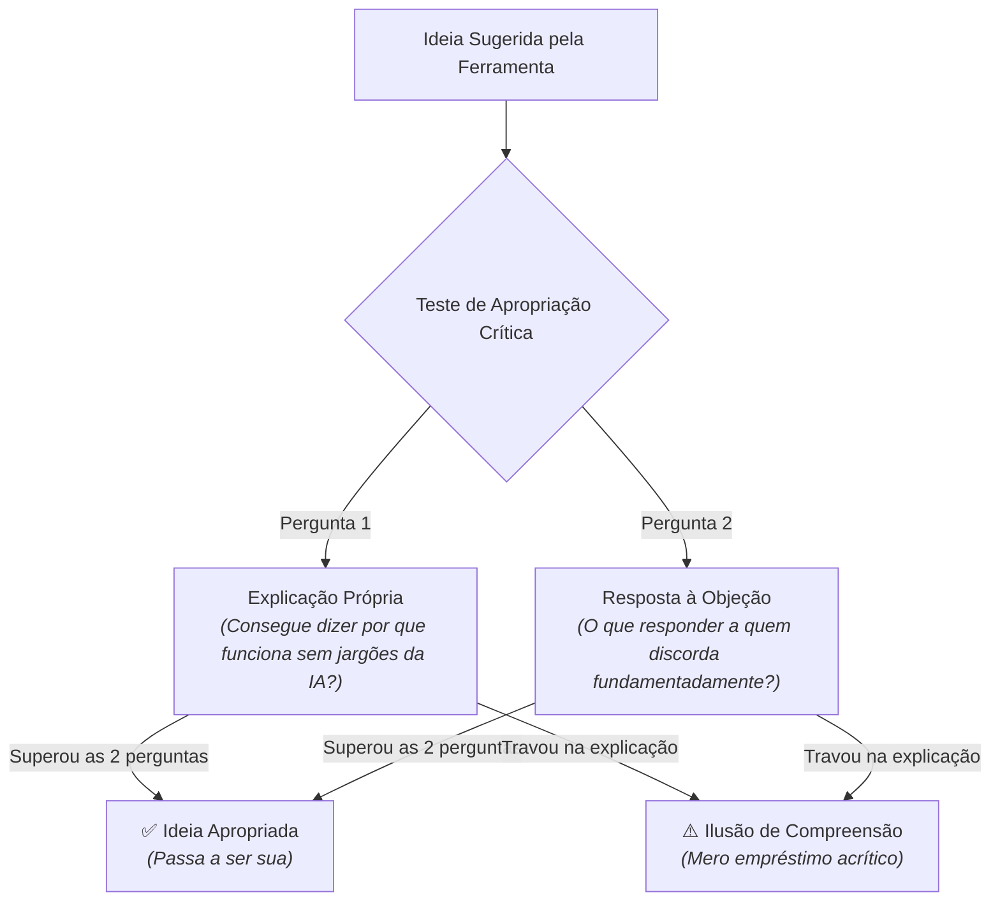

# O argumento que você não tinha

> **Disciplina:** Inteligência Artificial na Prática Acadêmica e Profissional (COM170)  
> **Quinzena 7 - Módulo 2** | Bimestre: 2026S2B1 - Univesp  

---

## 💬 Introdução ao Módulo

Quando alguém pergunta por que você escreveu determinada frase, o que você responde? Às vezes a resposta vem na hora, com segurança e precisão. Outras vezes, você percebe que a frase parece correta, mas você simplesmente não sabe dizer o porquê nem como defender a afirmação.

Este módulo trata da **ideia boa que chega pela ferramenta de inteligência artificial**. Incorporar sugestões relevantes da máquina faz parte legítima do trabalho contemporâneo. O ponto crucial investigado aqui é: **você consegue explicar essa ideia com as suas próprias palavras e responder com consistência a quem discorda dela?**

Você vai conhecer um **teste de duas perguntas** para avaliar se uma ideia gerada pela ferramenta já foi verdadeiramente apropriada por você, e vai entender os fundamentos cognitivos de por que a sensação de entender um assunto costuma ser ilusoriamente muito maior do que a capacidade real de explicá-lo.

> [!IMPORTANT]
> **Apropriação Crítica vs. Ilusão de Profundidade:**  
> Concordar com um texto bem escrito pela IA não equivale a dominá-lo cognitivamente. Uma ideia só se torna legitimamente sua quando você é capaz de sustentá-la diante de contra-argumentos e explicar seus mecanismos sem depender do texto da máquina.

---

## 🚀 Trilha de Aprendizado do Módulo 2

1. ✅ 🎥 **Videoaula:** [1-Videoaula-O-argumento-que-voce-nao-tinha.md](file:///home/henrique/Modelos/Univesp/2026S2/COM170-Inteligencia-Artificial-na-Pratica-Academica-e-Profissional/Quinzena-7/Q7-Modulo2/1-Videoaula-O-argumento-que-voce-nao-tinha.md)
2. ✅ 📖 **Material-base e E-book:** [2-Material-base.md](file:///home/henrique/Modelos/Univesp/2026S2/COM170-Inteligencia-Artificial-na-Pratica-Academica-e-Profissional/Quinzena-7/Q7-Modulo2/2-Material-base.md)
3. ✅ 📝 **Atividade Prática:** [3-Atividade-Por-que-isso-funciona.md](file:///home/henrique/Modelos/Univesp/2026S2/COM170-Inteligencia-Artificial-na-Pratica-Academica-e-Profissional/Quinzena-7/Q7-Modulo2/3-Atividade-Por-que-isso-funciona.md)

