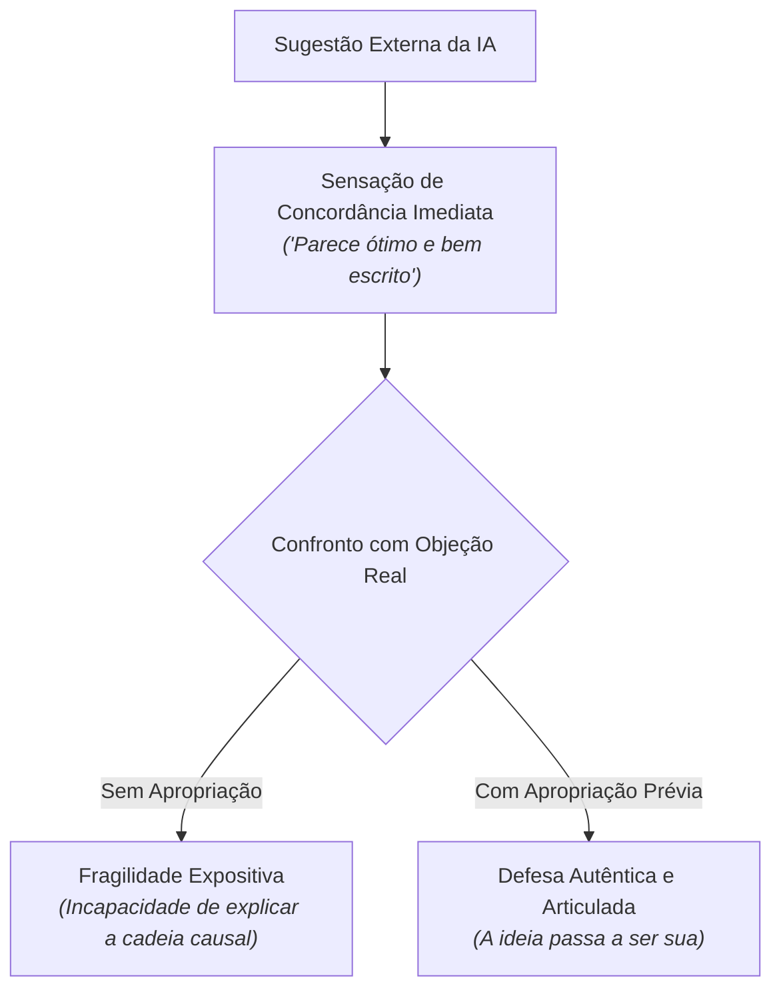

# Videoaula: O argumento que você não tinha

> **Docente:** Prof. Dr. José Avelino Placca  
> **Disciplina:** Inteligência Artificial na Prática Acadêmica e Profissional (COM170)  
> **Quinzena 7 - Módulo 2** | Bimestre: 2026S2B1 - Univesp  

---

## 🎥 Acesso à Videoaula

* **Título:** O argumento que você não tinha
* **Link:** [Assistir no YouTube](https://www.youtube.com/watch?v=sOn6TjOhh6g)
* **Contexto:** *Uma ideia boa veio da ferramenta para destravar um parágrafo, e o professor tenta defendê-la em cena.*

---

## 📝 Resumo e Conceitos Centrais

A videoaula parte de um momento bastante comum na escrita assistida por inteligência artificial: o estudante está diante de uma trava criativa em um parágrafo difícil, pede sugestões à ferramenta e ela devolve uma ideia ou linha de raciocínio aparentemente excelente, bem articulada e persuasiva. O estudante aceita a sugestão e a inclui no trabalho.

O Prof. Placca coloca então a pergunta decisiva: **em que momento essa ideia que veio da ferramenta passa a ser verdadeiramente sua?**

---

### 🎭 A Demonstração em Cena: A Fragilidade do Argumento Emprestado

Para responder a essa questão, o professor simula uma situação em cena na qual tenta defender ao vivo o argumento sugerido pela máquina:

1. **A Aceitação Passiva:** O texto devolvido pela IA parece sólido e convincente na leitura preliminar. A sensação imediata de quem lê é de concordância: *"isso faz total sentido"*.
2. **O Choque da Fricção Argumentativa:** Quando alguém confronta a afirmação com uma objeção concreta ou indaga os fundamentos por trás daquela premissa, quem apenas colou o texto percebe que não domina a cadeia causal da ideia.
3. **A Diferença entre Reconhecer e Sustentar:**
   * *Reconhecer* que um argumento parece bom é um ato passivo e superficial.
   * *Sustentar* o argumento exige compreender os pressupostos, limites e respostas a contraposições.

---

## 🧠 A Ilusão de Profundidade Explanatória

A videoaula conecta essa experiência à chamada **ilusão de profundidade explanatória** (fenômeno cognitivo amplamente documentado na psicologia e na filosofia da ciência):

* As pessoas tendem a superestimar drasticamente o quanto entendem os mecanismos de um conceito ou objeto até que são convidadas a explicá-lo detalhadamente passo a passo.
* Ao ler uma síntese polida gerada por IA, nosso cérebro confunde a fluência verbal do texto (*fluência de processamento*) com a nossa própria capacidade explicativa.

---

## 🛡️ O Teste das Duas Perguntas

Para garantir a apropriação legítima antes de aceitar um argumento sugerido por inteligência artificial, o professor estabelece o **teste das duas perguntas**:

| Etapa | Pergunta de Teste | Critério de Validação |
| :---: | :--- | :--- |
| **1ª Pergunta** | **Você consegue explicar essa ideia com as suas próprias palavras?** | Sem olhar para a resposta da ferramenta e sem reproduzir jargões mecânicos decorados. Se você gaguejar ou recorrer a sinônimos vazios, você ainda não assimilou o conceito. |
| **2ª Pergunta** | **O que você responde a quem discorda dela de forma fundamentada?** | Antecipar a principal contra-argumentação possível e estruturar a réplica com base em premissas lógicas ou dados empíricos. |

> [!IMPORTANT]
> **Veredito Pedagógico:**  
> Usar ideias boas fornecidas pela ferramenta não é trapaça nem problema ético; o erro reside em incluí-las sem passar pelo filtro da apropriação. Uma ideia só se torna parte legítima da sua autoria quando você se torna capaz de responder por ela.
