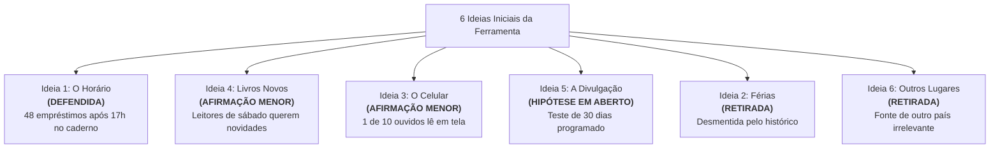

# Atividade: Por que isso funciona?

> **Disciplina:** Inteligência Artificial na Prática Acadêmica e Profissional (COM170)  
> **Quinzena 7 - Módulo 2** | Bimestre: 2026S2B1 - Univesp  

---

## 📌 Contexto e Apresentação da Atividade (Passo 1 de 5)

Joana é da sua turma. Ela trabalha de dia numa farmácia e estuda à noite. Aos sábados, atua como voluntária na biblioteca comunitária do seu bairro. Neste ano, os empréstimos de livros caíram, e ela escolheu esse caso real para um trabalho da disciplina.

Joana pediu à ferramenta de inteligência artificial explicações para a queda e colocou as seis sugestões que voltaram diretamente no trabalho. No dia seguinte, ela apresentará o trabalho para a **dona Célia**, a coordenadora da biblioteca, conhecida por questionar minuciosamente o porquê de cada afirmação antes de tomar qualquer decisão administrativa.

> 💬 **A mensagem da Joana para você:**  
> *"A dona Célia pergunta o porquê de tudo. Você faz o papel dela hoje? Pergunta 'por que isso funciona?' para cada ideia e me diz se a minha resposta defende a ideia."*

---

### 🤖 O Pedido que a Joana enviou à ferramenta (Prompt)
> *"Sou voluntária numa biblioteca comunitária do meu bairro. Neste ano, os empréstimos de livros caíram. Em fevereiro, a biblioteca passou a fechar às 17h; antes, fechava às 19h. Estou fazendo um trabalho da faculdade sobre isso. Me dê seis explicações possíveis para a queda."*

*(A ferramenta só conhecia o que estava nesse pedido genérico. Por isso, as seis hipóteses não continham números e usavam o modalizador "pode": meras possibilidades abstratas).*

---

### 📋 As Seis Ideias Devolvidas pela Ferramenta:
1. **Ideia 1:** A mudança de horário pode ter afastado quem só consegue ir à biblioteca depois do trabalho.
2. **Ideia 2:** Se muitos leitores forem estudantes, as férias escolares podem reduzir os empréstimos.
3. **Ideia 3:** Parte dos leitores pode ter passado a ler no celular e procura menos o livro de papel.
4. **Ideia 4:** Se chegam poucos livros novos, quem já leu os antigos pode deixar de voltar.
5. **Ideia 5:** Se a biblioteca divulga pouco o que chega de novo, os leitores podem esquecer de voltar.
6. **Ideia 6:** A queda pode acompanhar uma redução de leitores de bibliotecas em outros lugares.

---

### 📊 O Caderno de Empréstimos da Biblioteca (Dados Empíricos Reais da Joana)
A Joana anota manualmente cada empréstimo com data e hora:

| Empréstimos em Março | Até as 17h | Depois das 17h | Total Geral |
| :--- | :---: | :---: | :---: |
| **Ano passado** | 72 | 48 | **120** |
| **Este ano** | 70 | 0 *(biblioteca fecha às 17h)* | **70** |

> [!IMPORTANT]
> **Fato Empírico Revelador:**  
> No horário até as 17h, o movimento permaneceu praticamente idêntico (caiu de 72 para 70, variação estatisticamente desprezível). Toda a queda de 50 empréstimos (de 120 para 70) coincide matematicamente com os **48 empréstimos que ocorriam no intervalo das 17h às 19h** no ano anterior!

---

### 🔑 Conceitos Fundamentais da Atividade

* **Ideia Emprestada:** A ideia que a pessoa só consegue explicar repetindo a própria frase com outras palavras (sinônimos ou paráfrases circulares).
* **Razão de Fora da Frase:** Uma informação externa que a frase não contém e que demonstra por que ela é verdadeira: um número medido, uma observação em campo, uma fonte documental, uma entrevista com quem vive a rotina ou o resultado de um teste.
* **Ideia Defendida:** A ideia que a pessoa sustenta com uma razão de fora da frase e que permanece sólida diante de contra-argumentos e objeções.

---

## 📌 Passo 2 de 5: Por que isso funciona? (Passo 1 da Atividade)

Você assume o papel da **dona Célia**. Para cada uma das seis hipóteses sugeridas pela ferramenta, indaga: *"Por que isso funciona?"*, avaliando criticamente se a resposta de Joana defende a ideia ou se ela permanece meramente emprestada.

### 🔍 Critério Metodológico de Avaliação:
* **Ideia Ainda Emprestada:** A resposta apenas repete a frase da ferramenta com paráfrases, sinônimos rebuscados ou explicações circulares geradas pela própria IA.
* **Ideia Defendida:** A resposta aporta uma **razão de fora da frase** — um dado concreto contado, uma observação direta em campo, uma fonte documental explícita ou o depoimento de quem vive a rotina.

---

### 📊 Avaliação Pormenorizada das 6 Ideias:

| # | Tema da Ideia | Frase Original da Ferramenta | Resposta Apresentada por Joana | Veredito | Análise Crítica e Justificativa |
| :---: | :--- | :--- | :--- | :---: | :--- |
| **1** | **O Horário** | *"A mudança de horário pode ter afastado quem só consegue ir à biblioteca depois do trabalho."* | *"No caderno do ano passado, 48 dos 120 empréstimos de março aconteceram depois das 17h. Neste março foram 70, uma queda de 50."* | **Defende** | A resposta traz um dado quantitativo exato que a frase não continha: o caderno comprova que 48 empréstimos ocorriam após as 17h, explicando com precisão matemática a quase totalidade da queda observada (50). |
| **2** | **As Férias** | *"Se muitos leitores forem estudantes, as férias escolares podem reduzir os empréstimos."* | *"Porque nas férias os estudantes não têm aula e, por isso, pegam menos livro."* | **Ainda emprestada** | Resposta puramente tautológica: *"não ter aula"* é a própria definição de férias, e *"pegar menos livro"* repete *"reduzir empréstimos"*. Ademais, deixa sem resposta o dado empírico básico: os frequentadores são de fato estudantes? (além de março não ser período de férias escolares). |
| **3** | **O Celular** | *"Parte dos leitores pode ter passado a ler no celular e procura menos o livro de papel."* | *"Porque, com a digitalização crescente dos hábitos de leitura, os leitores migraram para as plataformas digitais, o que reduz a procura pelo livro impresso tradicional."* | **Ainda emprestada** | Prolixidade ornamental: dobrou o tamanho da frase com jargão corporativo (*"digitalização crescente"*, *"plataformas digitais"*), sem apresentar qualquer dado de campo sobre os leitores reais da biblioteca comunitária. |
| **4** | **Os Livros Novos** | *"Se chegam poucos livros novos, quem já leu os antigos pode deixar de voltar."* | *"Perguntei às oito pessoas que foram à biblioteca no sábado. Cinco disseram que já leram o que interessa na estante de romances e esperam livro novo."* | **Defende, por enquanto** | A razão foi obtida junto a quem frequenta a biblioteca (entrevista de campo com 5 de 8 usuários no sábado). Uma razão externa legítima, que será confrontada com contraposição no passo seguinte. |
| **5** | **A Divulgação** | *"Se a biblioteca divulga pouco o que chega de novo, os leitores podem esquecer de voltar."* | *"Pedi para a ferramenta explicar e colei: 'a baixa visibilidade das novidades reduz o estímulo ao retorno, pois o leitor não percebe motivo para voltar'."* | **Ainda emprestada** | Erro comum de circularidade: pedir à IA para justificar a própria sugestão. A explicação da máquina apenas refraseia a hipótese (*"baixa visibilidade"* = divulgar pouco; *"não percebe motivo para voltar"* = esquecer de voltar), sem qualquer comprovação prática. |
| **6** | **Outros Lugares** | *"A queda pode acompanhar uma redução de leitores de bibliotecas em outros lugares."* | *"Li num site que as bibliotecas estão perdendo leitores."* | **Ainda emprestada** | Citação vaga e desancorada: não menciona qual site, qual estudo, quais números comparativos ou região geográfica. Para que uma fonte externa valide um argumento, é mandatório explicitar o que ela constatou. |

---

## 📌 Passo 3 de 5: A Dona Célia Discorda (Passo 2 da Atividade)

Duas ideias passaram na primeira pergunta: a do **horário (Ideia 1)** e a dos **livros novos (Ideia 4)**. Agora entra a segunda pergunta do teste: *Se alguém discordar, o que você responde?*

Responder a quem discorda de forma consistente significa **apresentar um dado ou mecanismo que a sua explicação sustenta e que a explicação da outra pessoa é incapaz de justificar**.

---

### 🥊 Objeção 1 de 2: Sobre a Ideia 1 (O Horário)

> 🗣️ **Dona Célia contra-argumenta:**  
> *"Não acredito que seja o horário. Hoje todo mundo lê no celular, e por isso ninguém mais pega livro."*

* **A réplica consistente de Joana:**  
  As duas explicações implicam previsões opostas sobre os registros do caderno:
  * Se o motivo fosse a migração geral para o celular, a retração dos empréstimos se distribuiria por **todos os turnos de funcionamento**.
  * Se a causa for a restrição de horário, a queda deve se concentrar **estritamente após as 17h**.
  * **O dado empírico que decide:** O caderno registrou **72 empréstimos até as 17h no ano passado** e **70 neste ano** (estabilidade plena no período diurno). Toda a perda de 50 empréstimos ocorreu no período noturno fechado. Logo, a hipótese do celular não se sustenta diante dos dados reais.

---

### 🥊 Objeção 2 de 2: Sobre a Ideia 4 (Os Livros Novos)

> 🗣️ **Dona Célia contra-argumenta:**  
> *"Discordo. O acervo é o mesmo de sempre, e as pessoas continuam vindo."*

* **A resposta e o ajuste de escopo de Joana:**  
  A razão de Joana (entrevista com 5 de 8 frequentadores no sábado) é verdadeira e legítima, porém **defende uma afirmação menor** do que a frase original da ferramenta:
  * O depoimento prova que os leitores do sábado têm interesse em títulos novos;
  * Não prova, contudo, que a falta de novidades seja a causa da queda global dos empréstimos (já que o fluxo diurno permaneceu estável).
  * *Lição Metodológica:* A ideia passou na 1ª pergunta, mas a 2ª pergunta revelou que **o escopo da afirmação precisa ser reduzido** para não extrapolar a evidência empírica disponível.

---

## 📌 Passo 4 de 5: Atrás da Razão que Falta (Passo 3 da Atividade)

Quatro ideias permaneceram inicialmente emprestadas. Joana precisou investigar onde obter a razão de fora da frase e definir o destino de cada uma no trabalho:

### 🧭 Onde procurar a razão e o que fazer:

| Ideia Avaliada | Onde Procurar a Razão | O que Joana Encontrou em Campo | Decisão Metodológica no Trabalho |
| :--- | :---: | :--- | :---: |
| **Ideia 2: As Férias**<br>*(Se muitos forem estudantes, férias reduzem empréstimos)* | **Observar e contar**<br>*(Caderno mês a mês)* | Contou os registros mês a mês nos dois anos: a queda persistiu em todos os meses após fevereiro, com ou sem férias; além disso, férias ocorrem todos os anos de forma idêntica. | **Retirar do trabalho**<br>*(Os dados históricos contradizem a premissa).* |
| **Ideia 3: O Celular**<br>*(Migração para leitura em telas)* | **Perguntar a quem conhece**<br>*(Ligar para cadastrados)* | Ligou para 10 leitores que pararam de frequentar: 7 saíram do trabalho após as 17h (reforçando a Ideia 1!), apenas 1 declarou ler em celular e 2 não justificaram. | **Escrever afirmação menor**<br>*(Escrever exatamente o dado apurado: "Uma das dez pessoas ouvidas passou a ler no celular").* |
| **Ideia 5: A Divulgação**<br>*(Pouca divulgação das novidades afasta leitores)* | **Testar**<br>*(Ação no mural e redes sociais)* | O teste empírico requer um mês completo de monitoramento, e a reunião ocorre na manhã seguinte (tempo insuficiente para mensuração prévia). | **Escrever como hipótese**<br>*(Registrar explicitamente como hipótese em aberto que será verificada por um teste de 30 dias com contagem).* |
| **Ideia 6: Outros Lugares**<br>*(Queda segue tendência de outros locais)* | **Ler a fonte**<br>*(Abrir a pesquisa original)* | Acessou o site referenciado e constatou que a pesquisa abordava bibliotecas de outro país, sem séries históricas claras nem dados comunitários comparáveis. | **Retirar do trabalho**<br>*(A fonte não possui validade externa para o contexto da biblioteca do bairro).* |

---

## 📌 Passo 5 de 5: O Desfecho da Reunião e a Ficha do Teste (Passo 4 da Atividade)

No dia seguinte, Joana compareceu à reunião com a coordenadora dona Célia com as seis propostas rigorosamente categorizadas pelo critério de autoria:



### 🤝 Decisão Administrativa de Dona Célia:
> *"Então vamos abrir até as 19h às terças e quintas, por dois meses, e contar os empréstimos. E em abril vamos testar a divulgação dos livros novos, do jeito que você escreveu."*

### 💬 Reconhecimento da Joana:
> *"Obrigada pelas perguntas de ontem. Metade das ideias eu teria explicado repetindo a frase."*

> [!IMPORTANT]
> **A Máxima da Quinzena:**  
> **A ideia passa a ser sua quando você consegue defendê-la.**

---

## 📋 Modelo da Ficha do Teste da Defesa

Esta ficha consolida o protocolo prático de apropriação crítica:

```markdown
### 📌 FICHA DO TESTE DA DEFESA DE IDEIAS

1. **A frase que veio da ferramenta:**
   > 

2. **Primeira Pergunta: Por que isso funciona?**
   * Razão de fora da frase (observação, dado, fonte, entrevista ou teste):
   > 

3. **Segunda Pergunta: Se alguém discordar, o que você responde?**
   * Objeção prevista:
   > 
   * Contraposição sustentada por evidência:
   > 

4. **Destino da Ideia no Trabalho:**
   * [ ] **Defendida:** Mantida com a razão externa comprovada.
   * [ ] **Afirmação menor:** Escopo reduzido ao tamanho da evidência.
   * [ ] **Hipótese:** Registrada como suposição com teste proposto.
   * [ ] **Retirada:** Descartada por falta de sustentação empírica.
```

---

### 🎓 Ficha Preenchida na Atividade Interativa do AVA

* **Minha Ideia:**  
  > *Resolver exercícios práticos de programação antes de assistir às aulas teóricas facilita a fixação dos conceitos em disciplinas de computação.*

* **Por que ela funciona (Razão de fora da frase):**  
  > *Testei na prática: ao programar primeiro, mapeio exatamente onde o código trava. Quando abro a aula teórica, vou direto à dúvida sem precisar reassistir ao vídeo várias vezes.*

* **Onde vou procurar a razão:**  
  > *No próprio compilador e nas anotações de estudo: registrando os erros gerados no terminal antes da aula e verificando se a teoria respondeu diretamente a eles.*

* **Destino da Ideia no Trabalho:**  
  * [x] **Defendida:** Sustentada por teste empírico e observação direta da prática de programação.

> ✅ **Status da Atividade:** Concluída e submetida na plataforma AVA da Univesp.


