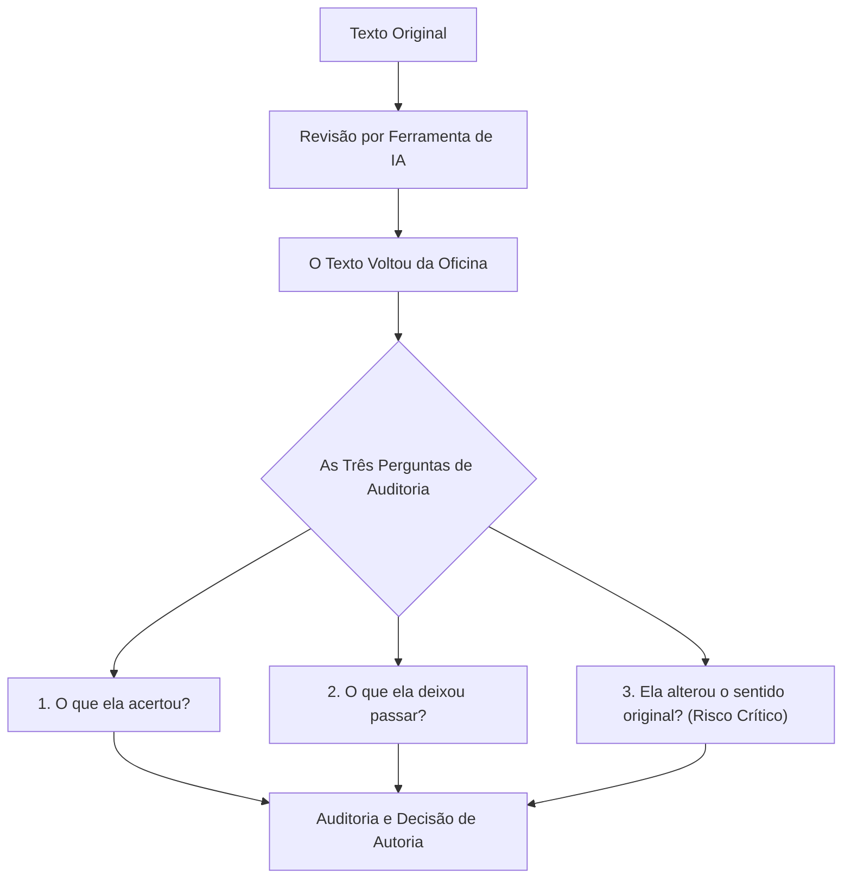

# Q7 M3 - O texto voltou revisado

> **Disciplina:** Inteligência Artificial na Prática Acadêmica e Profissional (COM170)  
> **Quinzena 7 - Módulo 3** | Bimestre: 2026S2B1 - Univesp  
> **Docente Responsável:** Prof. Dr. José Avelino Placca  

---

## 💬 Apresentação do Módulo 3

Quando alguém revisa um texto seu, o que você faz com as mudanças? Lê uma por uma, ou aceita todas de uma vez porque quem revisou entende mais do assunto? E se a revisão estiver numa língua que você lê com dificuldade?

Este módulo mostra o que a revisão feita por uma ferramenta acerta, o que ela deixa sem corrigir e a correção mais difícil de perceber: a que muda o que o seu texto afirmava. Você vai aprender três perguntas para conferir um texto revisado e um jeito de pedir a revisão que ajuda a ferramenta a encontrar mais problemas.

---

## 🎯 Objetivos de Aprendizagem

* **03. Auditoria de Revisão e Tradução:** Conferir o que uma ferramenta mudou ao revisar um texto, inclusive em outra língua, e pedir a revisão dizendo onde ela deve olhar.
* Aplicar as **três perguntas de checagem** para textos revisados.
* Identificar quando uma intervenção altera a afirmação fática original.
* Realizar a atividade prática: conferir para um colega, que lê pouco inglês, o resumo acadêmico que ele enviará para um evento científico.
