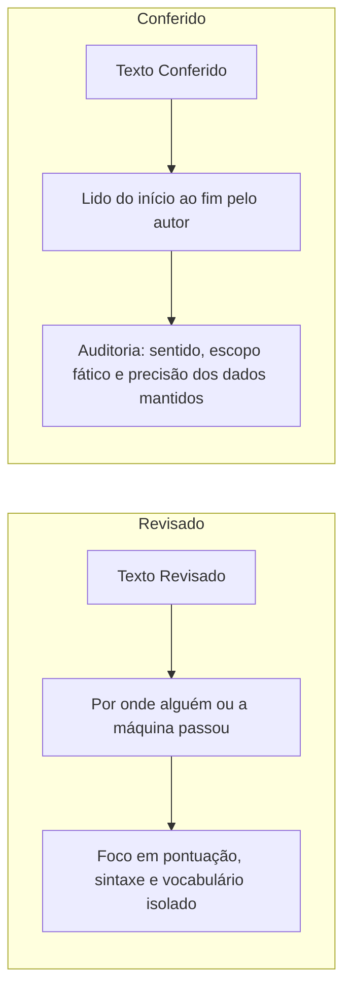
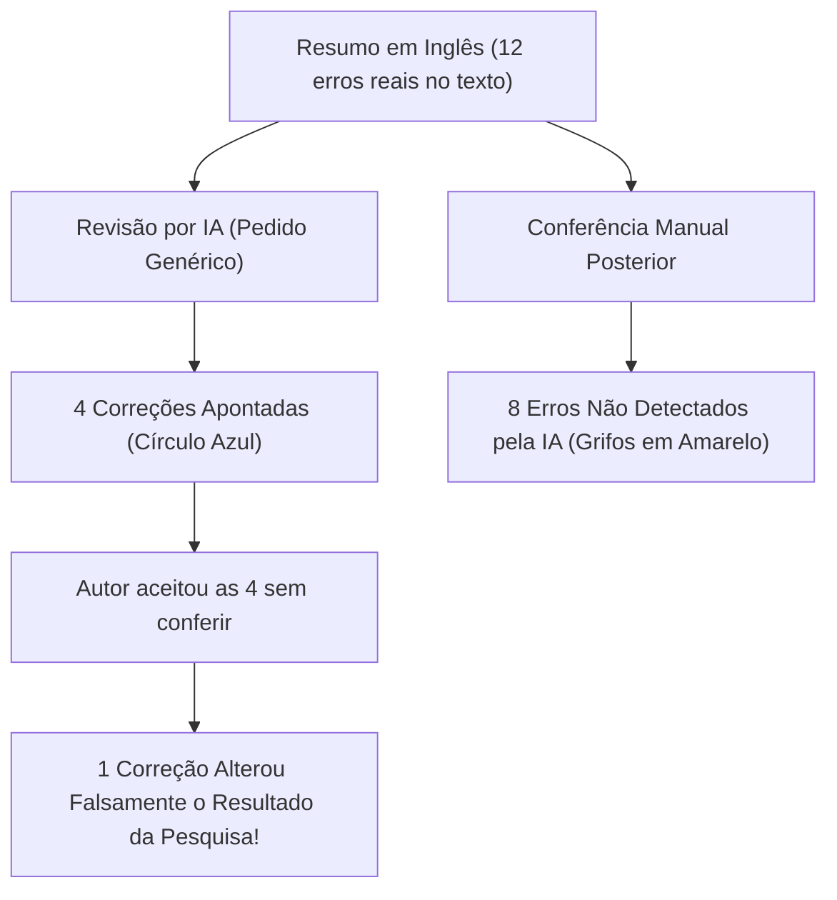

# Videoaula: O texto voltou revisado

> **Disciplina:** Inteligência Artificial na Prática Acadêmica e Profissional (COM170)  
> **Quinzena 7 - Módulo 3** | Bimestre: 2026S2B1 - Univesp  
> **Docente Responsável:** Prof. Dr. José Avelino Placca  
> **Link da Videoaula:** [YouTube (0phQVPQwBV0)](https://www.youtube.com/watch?v=0phQVPQwBV0)

---

## 📌 Visão Geral da Videoaula

A aula aborda a relação de dependência acrítica que frequentemente se estabelece quando pedimos a uma ferramenta de inteligência artificial para revisar ou traduzir um texto — especialmente em idiomas estrangeiros (como o inglês), nos quais o autor tem menor domínio e busca na ferramenta justamente a segurança linguística.

A pergunta central que norteia toda a aula é:  
**Revisado quer dizer certo?**

A resposta categórica do professor é: **Não.**

---

## 🔑 Conceitos Fundamentais e Distinções

### 1. A Diferença entre Texto Revisado e Texto Conferido
* **Texto Revisado:** É um texto por onde alguém (ou uma ferramenta) passou, aplicando alterações formais ou gramaticais.
* **Texto Conferido:** É um texto que o autor leu do começo ao fim para verificar se ele **ainda diz exatamente o que se pretendia dizer**, sem deturpações de sentido ou extrapolação fática.

### 2. A Armadilha do Corretor Automático
O professor traça um paralelo com os corretores ortográficos dos celulares:
* O corretor sublinha 3 palavras erradas; você aceita as correções e envia.
* A mensagem sai sem nenhum erro de digitação, mas o destinatário entende algo completamente diferente do planejado.
* O corretor analisa vocábulos isolados; a responsabilidade de conferir se o conjunto comunica a mensagem desejada é indelegável do autor.

---

## 🔬 O Caso Real do Professor: O Resumo em Inglês

O Prof. Dr. José Avelino Placca compartilhou um caso pessoal verídico ao submeter um resumo acadêmico (*abstract*) de meia página em inglês:

### ⚠️ O Erro Mais Perigoso: A Mudança de Sentido e Escopo
Ao aceitar as alterações sem auditar, uma das frases sofreu uma mutação crítica:

| Versão | Redação | Implicação Metodológica e Fática |
| :--- | :--- | :--- |
| **Original do Autor** | *"Os resultados **sugerem que o programa pode diminuir** o abandono do curso."* | Hipótese cautelosa, aderente às limitações reais dos dados experimentais (*modalizadores de prudência acadêmica*). |
| **Revisão da Ferramenta** | *"Os resultados **provam que o programa diminui** o abandono."* | Afirmação categórica, dogmática e científica/faticamente falsa em relação ao que a pesquisa de fato demonstrou. |

> [!CAUTION]
> **O Risco da Elegância Formal:**  
> O inglês soou mais fluído, sofisticado e acadêmico, mas o texto passou a **afirmar mais do que a pesquisa comprovava**. E o autor assinou seu nome embaixo de uma inverdade científica.

### 📊 A Ilusão da "Coisa Pronta"
* O texto original continha **12 erros**.
* A ferramenta identificou **4 correções** (1/3 do total).
* **8 erros passaram despercebidos** e permaneceram no texto, mascarados pela aparência de "texto pronto e polido".

---

## 📋 As Três Perguntas para Conferir um Texto Revisado

Toda auditoria de revisão assistida por IA deve responder formalmente a três perguntas:

1. **O que a ferramenta corrigiu?**  
   *(Identificar as alterações feitas e verificar se ela acertou na regra gramatical ou vocabulário).*
2. **O que ela deixou passar?**  
   *(Reler atenta e ativamente procurando os erros residuais que a ferramenta não enxergou).*
3. **Qual frase mudou de sentido?**  
   *(Identificar se a IA alterou o tom, exagerou o escopo, removeu ressalvas ou colocou na sua boca afirmações que você não fez).*

---

## 💡 Como Pedir a Revisão: O Prompt Direcionado

O professor apresentou um experimento empírico conduzido com **30 redações de estudantes de inglês**:

| Tipo de Pedido (Prompt) | Exemplo de Instrução | Taxa de Erros Detectados | Precisão do que Apontou |
| :--- | :--- | :---: | :---: |
| **Pedido Solto / Genérico** | *"Corrija o meu texto."* | **~10%** (1 em cada 10 erros) | Alta (~95%) |
| **Pedido Direcionado** | *"Revise este texto procurando concordância verbal, preposições e tempo verbal..."* | **> 50%** (mais da metade dos erros) | Alta (~95%) |

### 🎯 Conclusão sobre o Comportamento da Ferramenta:
* **O que ela aponta:** costuma estar certo (baixo falso-positivo).
* **O que ela deixa passar:** chega com "cara de pronto", criando uma falsa sensação de segurança no usuário descuidado (alto falso-negativo se o prompt for genérico).
* **Direcionar o olhar da ferramenta** multiplica por 5 a eficácia da detecção de falhas.

---

## 📝 Síntese da Videoaula

* **Revisado $\neq$ Certo:** Revisão é apenas passagem formal; conferência é checagem integral de sentido e integridade.
* **Autoria é Responsabilidade:** Quem assina o texto responde pelas afirmações, inclusive pelas distorções introduzidas pela máquina.
* **Protocolo de Ação:**
  1. Pedir revisão **dizendo onde a ferramenta deve olhar**.
  2. Aplicar as **três perguntas de checagem**.
  3. Desconfiar sempre do ganho de elegância que sacrifica o rigor do escopo.
