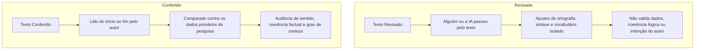
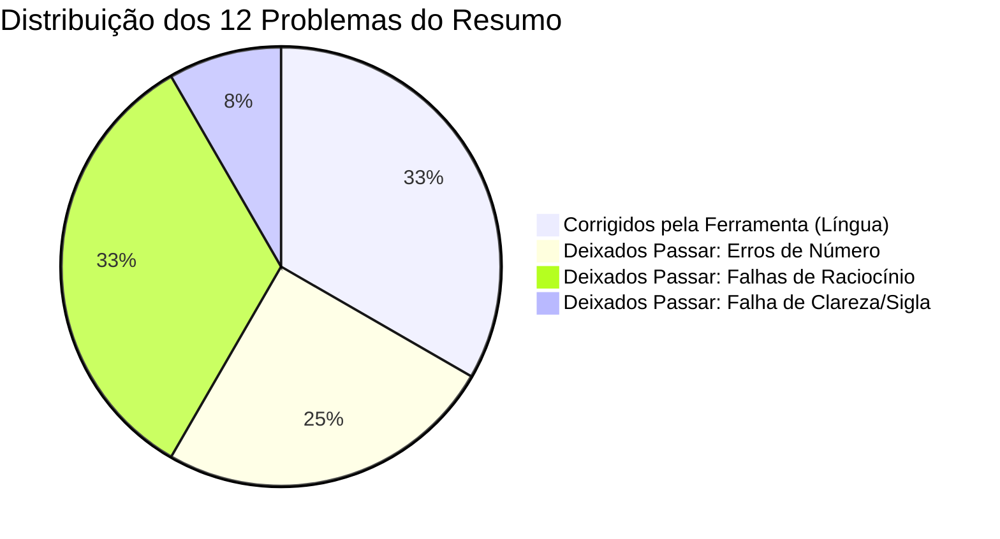
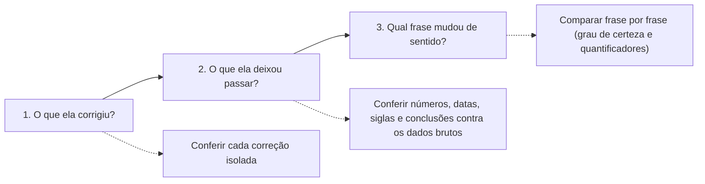
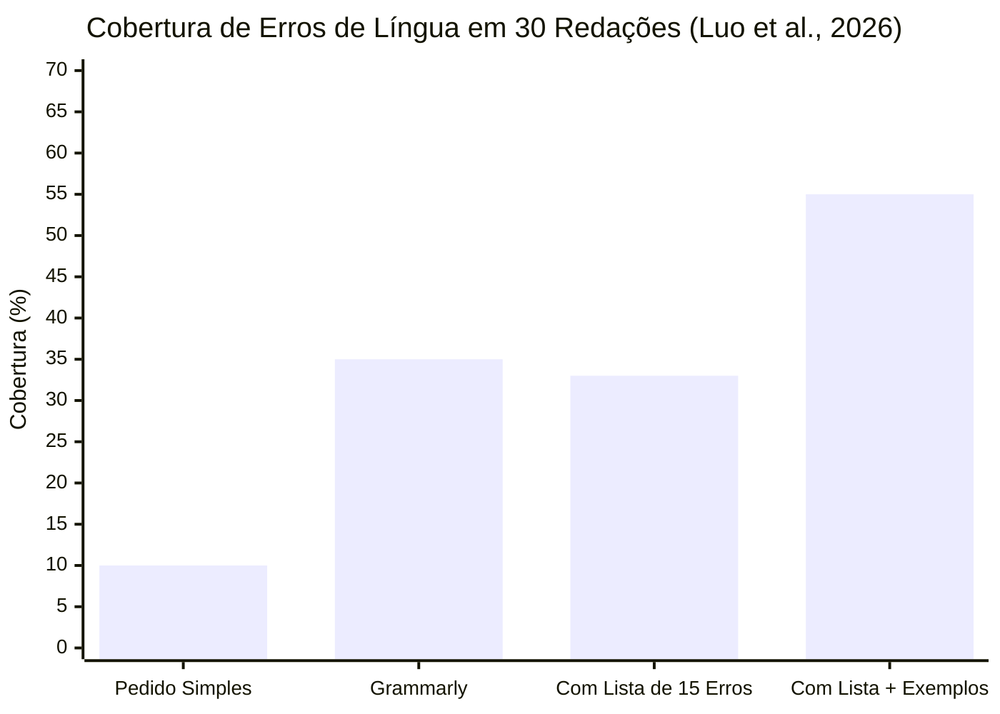

# Material-base: O texto voltou revisado

> **Disciplina:** Inteligência Artificial na Prática Acadêmica e Profissional (COM170)  
> **Quinzena 7 - Módulo 3** | Bimestre: 2026S2B1 - Univesp  
> **Docente Responsável:** Prof. Dr. José Avelino Placca  

---

## 📚 Materiais de Apoio

* **Apostila:** [COM170_apostila_quinzena7_M3.pdf](file:///home/henrique/Modelos/Univesp/2026S2/COM170-Inteligencia-Artificial-na-Pratica-Academica-e-Profissional/Quinzena-7/Q7-Modulo3/COM170_apostila_quinzena7_M3.pdf) *(Autor: Prof. Dr. José Avelino Placca; Coordenação: Wesley de Souza Lima; Design Instrucional: Claudia Mori; Revisão: Juliana Nascimento Costa e Valteir Vaz; Arte: Henrique Inhauser Caldas)*.
* **E-book:** [Q7_M3-E-book.pdf](file:///home/henrique/Modelos/Univesp/2026S2/COM170-Inteligencia-Artificial-na-Pratica-Academica-e-Profissional/Quinzena-7/Q7-Modulo3/Q7_M3-E-book.pdf).
* **Origem e Evidências:** Base pedagógica da disciplina e do Workshop Fulbright na USP (setembro/2025). Evidências científicas de Luo et al. (2026, *ReCALL*) e Mali (2026, *TOJDE*).

---

## 1. 🔑 Conceito-Chave: Revisado vs. Conferido

A disciplina estabelece uma fronteira ética e metodológica rigorosa entre duas ações que frequentemente são confundidas:



* **Texto Revisado:** É um texto por onde alguém ou uma ferramenta passou, corrigindo o que encontrou na superfície linguística. A revisão pode ser delegada à máquina.
* **Texto Conferido:** É um texto que o autor leu do começo ao fim para verificar se ele **ainda diz o que se pretendia dizer**, comparando cada afirmação com os dados reais. A conferência **cabe exclusivamente ao autor**.

> 💡 *"Olhar e achar que está certo é apenas uma impressão. A conferência pede uma ação: ler o texto do começo ao fim com os seus dados ao lado."* (Workshop Fulbright / USP, 2025).

---

## 2. 🔬 O Caso Real do Resumo em Inglês: O que a Revisão Deixa Passar

O estudo de caso analisa um resumo científico (*abstract*) de meia página sobre um programa de tutoria universitária (PAE) com **12 problemas conhecidos**:

### 📄 O Texto que Voltou da Ferramenta:
> *"Peer tutoring and student dropout in a first-year engineering course*  
> *Student dropout is one of the main problems of Brazilian public universities. According to official data, 40% of engineering students leave the course in the first year. This paper describes PAE, a peer tutoring program offered at a public university in the state of São Paulo for two years. Thirty-two first-year students have participated in weekly meetings with senior students between March and June 2025. No control group was used. Data were collected through attendance records and a questionnaire with information about study habits.*  
> *Over the twelve months of the study, the 30 participants attended 84% of the meetings. Dropout fell from 18% to 11%, a reduction of 12 percentage points, compared with the control group. Grades did not change. The results prove that the program reduces dropout. Because the participants were volunteers, the results can be generalized to all first-year students. We conclude that PAE reduces dropout and improves academic performance."*

---

### 📊 Auditoria Pormenorizada dos 12 Problemas

| # | Trecho no Resumo Original | Quem Resolveu | Classificação do Erro | O Problema Concreto Identificado |
| :-: | :--- | :---: | :---: | :--- |
| **1** | *"since two years"* | **Ferramenta** | Língua | Tradução literal do português *"há dois anos"*. Em inglês correto: *for two years*. |
| **2** | *"Thirty-two first-year students has participated"* | **Ferramenta** | Língua | Erro de concordância: sujeito no plural com verbo no singular (*has* $\rightarrow$ *have*). |
| **3** | *"informations"* | **Ferramenta** | Língua | Em inglês, o substantivo *information* é incontável (não admite plural). |
| **4** | *"The results sugest that the program may reduce dropout"* | **Ferramenta** | Língua / Sentido | Corrigiu a grafia de *sugest*, mas **alterou indevidamente o sentido da frase** (trocou prudência por certeza). |
| **5** | *"According to official data, 40% of engineering students..."* | **Ninguém** | Número / Fato | Dado sem indicação de fonte: qual órgão, qual base, qual ano? |
| **6** | *"PAE"* | **Ninguém** | Clareza | Sigla inserida sem explicitação prévia do seu significado por extenso. |
| **7** | *"No control group was used"* | **Ninguém** | Raciocínio | Inconsistência interna: o texto afirma que não houve grupo de controle, mas adiante faz comparações com ele. |
| **8** | *"Over the twelve months of the study, the 30 participants"* | **Ninguém** | Número / Fato | Contradição factual: o estudo durou 4 meses (março a junho), não 12; e contou com 32 participantes, não 30. |
| **9** | *"a reduction of 12 percentage points"* | **Ninguém** | Número / Fato | Erro aritmético elementar: de 18% para 11% a redução é de **7 pontos percentuais**, e não 12. |
| **10** | *"compared with the control group"* | **Ninguém** | Raciocínio | Compara dados com um grupo de controle inexistente na pesquisa. |
| **11** | *"Because the participants were volunteers, the results can be generalized"* | **Ninguém** | Raciocínio | Falácia metodológica: amostra puramente voluntária impede formalmente a generalização estatística. |
| **12** | *"We conclude that PAE ... improves academic performance"* | **Ninguém** | Raciocínio | Conclusão contraditória com os achados: o próprio resumo relata que as notas não se alteraram (*Grades did not change*). |



> [!WARNING]
> **O Limite de Verificação (Quinzena 4 & 5):**  
> Quando você escreve numa língua estrangeira, a ferramenta ajuda nos erros formais de língua onde você tem limitação. Contudo, **a ferramenta é incapaz de conferir o conteúdo fático**, pois ela não esteve em campo nem analisou os dados brutos da pesquisa.

---

## 3. ⚠️ A Correção que Mudou o que Você Afirmava

A intervenção mais perigosa realizada pela inteligência artificial foi a alteração do **grau de certeza**:

* **Original do autor:** *"The results sugest that the program may reduce dropout"* (Os resultados sugerem que o programa pode diminuir o abandono).
* **Versão devolvida pela IA:** *"The results prove that the program reduces dropout"* (Os resultados provam que o programa diminui o abandono).

### 🔍 Por que isso é uma armadilha acadêmica grave?
1. **Extrapolação de Escopo:** Um estudo piloto com 32 voluntários e sem grupo de controle autoriza apenas uma hipótese moderada (*sugerir*). Ele **jamais autoriza uma prova definitiva**.
2. **Elegância que Mascara a Mentira:** A frase corrigida soa gramaticalmente perfeita e elegante em inglês acadêmico, o que induz o autor iniciante a aceitá-la cegamente.
3. **Literatura Científica (Mali, 2026):** Uma revisão sistemática de 23 pesquisas sobre correções feitas pelo ChatGPT revelou ocorrências recorrentes de **mudança de sentido ou de contexto**, adição de elementos desnecessários e geração de formulações que distorcem o que o estudante escreveu.
4. **Vínculo com a Declaração de Uso (Quinzena 6):** Ao assinar a declaração ética (*"li cada parágrafo revisado para conferir se ele ainda dizia o que eu queria dizer"*), você assume responsabilidade legal e moral pelas afirmações. Se o texto distorcer a realidade, a culpa é sua.

---

## 4. 🧭 O Protocolo das Três Perguntas de Auditoria

Para auditar qualquer texto que retorne de uma revisão assistida por IA, siga o roteiro em três etapas consecutivas:



### 1️⃣ Pergunta 1: O que a ferramenta corrigiu?
* Analise cada alteração isoladamente. Se a ferramenta não entregou o texto com *diff* visual, solicite explicitamente a lista numerada de alterações propostas.
* *No resumo:* Aceitam-se as três correções gramaticais legítimas (*for two years*, *have participated*, *information*).

### 2️⃣ Pergunta 2: O que ela deixou passar?
* Leia o texto revisado com a sua planilha ou caderno de pesquisa ao lado.
* *No resumo:* Corrige-se a duração (4 meses), número de participantes (32), cálculo percentual (7 pontos), remoção do grupo de controle fantasma, adequação da conclusão sobre as notas e expansão da sigla PAE.

### 3️⃣ Pergunta 3: Qual frase mudou de sentido?
* Compare a sua versão original contra a versão revisada, prestando atenção em **verbos epistêmicos** (*sugerir*, *indicar*, *provar*, *demonstrar*) e **quantificadores absolutos** (*todos*, *sempre*, *maioria*, *nenhum*).
* *No resumo:* Restaura-se o grau de certeza prudente do autor: *"The results suggest that the program may reduce dropout"*.

> [!TIP]
> **Dica Prática para Idiomas que Você Domina Pouco:**  
> Guarde sempre a sua versão original. Em uma conversa separada, peça à ferramenta para traduzir para o português frase por frase do texto revisado e compare com o seu rascunho. Se o texto for de alto impacto (artigo, TCC, projeto), consulte um leitor fluente.

---

## 5. 🎯 Engenharia de Prompt: Pedir a Revisão Dizendo Onde Olhar

A auditoria não começa apenas quando o texto volta: o modo como você formula a instrução inicial define a capacidade da máquina de enxergar problemas.

### 📐 Cobertura vs. Precisão
* **Cobertura:** Fração dos erros reais do texto que a ferramenta conseguiu detectar.  
  $$\text{Cobertura} = \frac{\text{Erros Encontrados}}{\text{Total de Erros Existentes}}$$
* **Precisão:** Proporção dos apontamentos da ferramenta que eram erros de fato (sem alucinar falsos erros).  
  $$\text{Precisão} = \frac{\text{Erros Reais Confirmados}}{\text{Total de Apontamentos da IA}}$$

---

### 📊 As Evidências Empíricas (Luo et al., 2026)
Uma pesquisa conduzida na Universidade de Lanzhou (China) avaliou o desempenho do ChatGPT na correção de 30 redações em inglês de estudantes de nível intermediário sob três abordagens de prompt:



* **Precisão:** Permaneceu consistentemente alta em todos os cenários (**entre 94% e 98%**). Quase tudo que a máquina apontou era de fato erro.
* **Cobertura:**
  * **Pedido Simples** (*"Corrija meu texto"*): detectou apenas **10%** dos erros (1 em cada 10).
  * **Grammarly** (ferramenta dedicada de referência): detectou **35%**.
  * **Pedido com Lista de 15 tipos de erro:** detectou **33%**.
  * **Pedido com Lista + Exemplos concretos:** detectou **55%** (mais que a metade!).

> **Conclusão Científica:** Especificar detalhadamente onde a ferramenta deve procurar **multiplica por mais de 5 vezes a cobertura de detecção de erros**!

---

### 🧱 O Prompt Estruturado (Metodologia Quinzena 4)

Aplicando o modelo de 4 componentes (**Papel, Objetivo, Restrições e Formato**), o prompt de revisão robusto deve concentrar as orientações na seção de **Restrições**:

```markdown
Papel: Você é um revisor de resumos científicos escritos em inglês acadêmico.
Objetivo: Encontrar os erros linguísticos do meu resumo sem reescrever o texto completo.
Restrições: 
- Procure especificamente estes tipos de problema:
  1. Concordância entre sujeito e verbo;
  2. Palavras usadas no plural sem admitirem plural em inglês (incontáveis);
  3. Expressões traduzidas literalmente palavra por palavra do português;
  4. Erros ortográficos e tipográficos de grafia.
- Mantenha rigorosamente todos os verbos que indicam o grau de certeza (ex.: suggest, may, indicate). Não substitua por verbos categóricos (ex.: prove, demonstrate).
- Mantenha todos os números e porcentagens exatamente como estão.
Formato: Entregue uma lista numerada contendo: trecho original, problema identificado e correção proposta.
```

#### Vantagens desta abordagem:
1. **Evita reescritas indiscriminadas:** Ao pedir lista em vez de reescrita contínua, você avalia cirurgicamente cada proposta.
2. **Blinda o grau de certeza:** Impede a mutação semântica de cautela para dogma.
3. **Preserva dados fáticos:** Bloqueia arredondamentos ou alterações indevidas de métricas.

---

## 📌 Referências Bibliográficas

* **LUO, N.; WANG, Y.; ZHANG, Z. V.; ZHOU, Y.; ZHAO, R.** Impact of prompt sophistication on ChatGPT's output for automated written corrective feedback. *ReCALL*, v. 38, n. 2, p. 240-254, 2026. DOI: [10.1017/S095834402510044X](https://doi.org/10.1017/S095834402510044X).
* **MALI, Y. C. G.** ChatGPT's and humans' written corrective feedback in EFL/ESL writing: a systematic review. *Turkish Online Journal of Distance Education (TOJDE)*, v. 27, n. 1, art. 3, 2026. Disponível em: [ERIC EJ1497686](https://files.eric.ed.gov/fulltext/EJ1497686.pdf).
