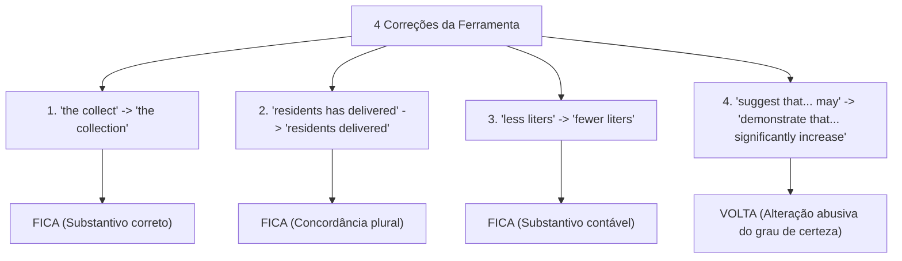
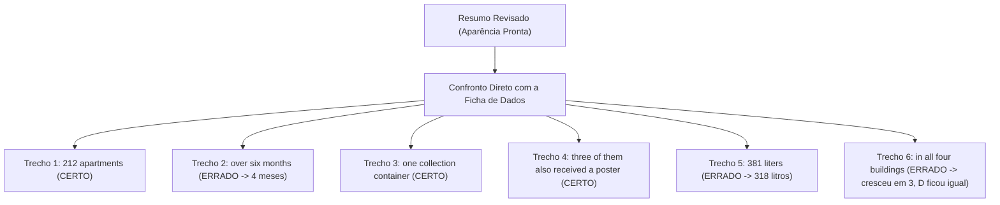

# Atividade: O que ficou sem correção

> **Disciplina:** Inteligência Artificial na Prática Acadêmica e Profissional (COM170)  
> **Quinzena 7 - Módulo 3** | Bimestre: 2026S2B1 - Univesp  

---

## 📌 Contexto e Apresentação da Atividade (Passo 1 de 5)

Caio é da sua turma. Ele trabalha numa administradora de condomínios e estuda Engenharia. No segundo semestre de 2025, organizou a coleta de óleo de cozinha usado em quatro condomínios do bairro: um galão na portaria de cada prédio para os moradores deixarem o óleo, em vez de jogar na pia.

Agora ele vai apresentar o projeto num evento de iniciação científica, e o evento pede o resumo em português e em inglês. Caio escreveu o resumo em inglês, pediu à ferramenta de inteligência artificial que revisasse o texto e pediu sua ajuda:

> 💬 **A mensagem do Caio para você:**  
> *"O resumo voltou revisado, mas eu leio pouco inglês. Você confere para mim antes de eu enviar? Mando a minha ficha com os dados do projeto."*

---

### 📊 A Ficha de Dados do Caio (Registro Empírico Real)

| Variável | Registro Real das Anotações de Campo |
| :--- | :--- |
| **Onde** | 4 condomínios do bairro, com 212 apartamentos no total |
| **Quando** | De agosto a novembro de 2025: **4 meses** |
| **Como** | Um galão de coleta na portaria de cada condomínio |
| **Cartaz** | No elevador de 3 condomínios; o condomínio D **não autorizou** o cartaz |
| **Óleo recolhido** | **318 litros** no total |
| **Mês a mês** | A coleta cresceu nos 3 condomínios com cartaz e **ficou igual** no condomínio D |
| **Primeiro e último mês** | No 1º mês, os condomínios com cartaz recolheram menos litros que o D; no 4º mês, mais |
| **Antes do projeto** | **Não houve medida** prévia |

---

### 📝 O Resumo Escrito por Caio (Versão Bruta em Inglês)
> *"Used cooking oil poured in the sink damages pipes and pollutes water. This study describes the collect of used oil in four residential buildings with 212 apartments, over six months in 2025. Each building received one collection container, and three of them also received a poster in the elevator. The residents has delivered 381 liters of oil, and the amount grew every month in all four buildings. Buildings with posters had less liters in the first month and more in the last. These informations suggest that posters may be associated with more oil collected."*

### 🤖 O Pedido Solto enviado à Ferramenta
> *"Melhore o inglês deste resumo e deixe o texto mais acadêmico."*

*(A ferramenta recebeu apenas o resumo solto, sem jamais ter acesso à ficha de dados do Caio).*

---

### 🔑 Conceitos Fundamentais
* **Revisado:** O texto por onde alguém passou corrigindo a superfície linguística.
* **Conferido:** O texto que o autor leu integralmente para garantir que diz o que ele pretendia.
* **Ficha de Dados:** O registro primário de medição com o qual se audita cada número, data e conclusão.

---

## 📌 Passo 2 de 5: O que a ferramenta corrigiu? (Passo 1 da Atividade)

A ferramenta devolveu o resumo com quatro intervenções formais. Aplicou-se o teste de **Tradução de Volta** e a checagem do **Grau de Certeza**:

* **Fica:** Arrumou o inglês e manteve o que o Caio afirmava.
* **Volta:** Mudou o que o Caio afirmava (extrapolou escopo ou alterou fatos).



### 📋 Avaliação das 4 Correções:

| # | Antes (Caio) | Depois (IA) | Decisão | Justificativa Pedagógica e Linguística |
| :-: | :--- | :--- | :---: | :--- |
| **1** | *the collect of used oil* | *the collection of used oil* | **FICA** | Em inglês, *collect* é verbo; o substantivo adequado é *collection*. O sentido original ("a coleta") foi perfeitamente preservado. |
| **2** | *The residents has delivered* | *The residents delivered* | **FICA** | *Residents* está no plural, exigindo verbo correspondente. A IA corrigiu o tempo/concordância sem alterar o fato narrado. |
| **3** | *had less liters* | *had fewer liters* | **FICA** | Litros é um substantivo contável (*countable noun*), exigindo gramaticalmente *fewer* em vez de *less*. A quantidade e o sentido permanecem idênticos. |
| **4** | *These informations suggest that posters may be associated with more oil collected* | *These data demonstrate that posters significantly increase oil collection* | **VOLTA** | **Mutação Semântica Abusiva:** A IA trocou uma correlação moderada (*"sugerem que podem estar associados"*) por uma relação causal categórica (*"demonstram que aumentam significativamente"*). Quatro prédios sem grupo de controle ou medição prévia não autorizam afirmar causalidade. |

> [!CAUTION]
> **Ajuste Cirúrgico no Trecho 4:**  
> Caio aceita apenas a correção gramatical de *informations* (que é incontável em inglês) e restabelece a prudência epistêmica original:  
> **"This information suggests that posters may be associated with more oil collected."**

---

## 📌 Passo 3 de 5: O que ela deixou passar? (Passo 2 da Atividade)

A ferramenta revisou o texto com aparência polida, mas deixou passar erros substanciais de conteúdo. O confronto com a **Ficha de Dados** revelou:



### 📋 Auditoria dos 6 Trechos Contra a Ficha de Dados:

| # | Trecho no Resumo | Tradução / Significado | Veredito | Comparação com a Ficha de Dados do Caio |
| :-: | :--- | :--- | :---: | :--- |
| **1** | *212 apartments* | "212 apartamentos" | **Está certo** | A ficha confirma exatamente 212 apartamentos nos 4 condomínios. Conferir é validar com rigor, não desconfiar indiscriminadamente. |
| **2** | *over six months* | "ao longo de seis meses" | **Continua errado** | A ficha registra o período de agosto a novembro: **quatro meses**, não seis. Erro factual que passou intocado pela IA. |
| **3** | *one collection container* | "um galão de coleta" | **Está certo** | A ficha atesta: um galão na portaria de cada condomínio. |
| **4** | *three of them also received a poster* | "três deles também receberam um cartaz" | **Está certo** | A ficha confirma cartaz em 3 condomínios (o condomínio D não autorizou). |
| **5** | *381 liters* | "381 litros" | **Continua errado** | A ficha registra **318 litros**. Houve transposição de algarismos (381 em vez de 318). A IA corrigiu o verbo na mesma frase e manteve o número falso. |
| **6** | *in all four buildings* | "nos quatro condomínios" | **Continua errado** | A ficha indica que a coleta cresceu nos 3 condomínios com cartaz e **ficou estável/igual no condomínio D**. O resumo afirmava falsamente que cresceu em todos. |

> [!IMPORTANT]
> **Lição Metodológica:**  
> Três trechos continuavam errados (meses, litros e comportamento do condomínio D), e **nenhum deles era erro de inglês**. Como a ferramenta nunca teve acesso aos dados primários, todos chegaram com aparência de texto pronto e polido. A responsabilidade da verificação é integralmente humana.

---

## 📌 Passo 4 de 5: Três Pedidos para o Mesmo Resumo (Passo 3 da Atividade)

Caio testou três abordagens distintas de prompt para o mesmo resumo original:

* **Pedido A (Caio - Vago/Estético):** *"Melhore o inglês deste resumo e deixe o texto mais acadêmico."*
* **Pedido B (Simples/Genérico):** *"Corrija os erros de inglês deste resumo."*
* **Pedido C (Quatro Componentes Estruturados):**
  * **Papel:** Revisor de resumos científicos escritos em inglês por estudantes brasileiros.
  * **Objetivo:** Encontrar os erros de inglês do resumo sem reescrever o texto corrido.
  * **Restrições:** Procurar concordância sujeito-verbo, substantivos sem plural em inglês, distinção *less/fewer* e falsos cognatos/expressões traduzidas ao pé da letra do português. Manter verbos de grau de certeza (*suggest*, *may*). Manter todos os números como estão.
  * **Formato:** Lista numerada com trecho original, problema e correção sugerida.

---

### 📊 Desempenho Comparativo dos Três Pedidos:

| Pedido | Erros de Língua Corrigidos (de 4) | Frases com Sentido Alterado | Erros Fatuais de Dados Encontrados (de 3) | Veredito Metodológico |
| :--- | :---: | :---: | :---: | :--- |
| **Pedido A** *(Caio)* | **4** | **1** *(frase dos resultados)* | **0** | Arrumou a forma, mas gerou **mutação de certeza** e ignorou dados. |
| **Pedido B** *(Simples)* | **3** *(deixou less liters)* | **0** | **0** | Baixa cobertura (deixou passar erro de contáveis). |
| **Pedido C** *(Estruturado)* | **4** | **0** | **0** | **Ótimo:** Encontrou 100% dos erros de língua, preservou o sentido e blindou o grau de certeza. |

---

### 🎯 Conclusões das Duas Apostas:
1. **Aposta 1 (Mais erros sem mudar sentido):** **Pedido C.** Dizer onde olhar aumentou a detecção sem sacrificar o rigor semântico.
2. **Aposta 2 (Erro dos 381 litros):** **Nenhum dos três.** O erro é de fato empírico (estava na ficha de Caio, nunca vista pela IA). A conferência de dados é indelegavelmente humana.

---

## 📌 Passo 5 de 5: O Pedido para a Próxima Vez (Passo 4 da Atividade)

Para os próximos textos científicos em inglês do projeto, Caio estruturou um pedido profissional de revisão combinando os quatro componentes essenciais:

```markdown
Papel: Você é um revisor de resumos científicos escritos em inglês por estudantes brasileiros.
Objetivo: Encontrar os erros de inglês do meu texto sem reescrever o texto corrido.
Restrições: 
- Procure estes tipos de erro:
  1. Concordância entre sujeito e verbo;
  2. Palavras sem plural em inglês (incontáveis);
  3. Distinção entre less e fewer;
  4. Palavras e expressões formadas a partir de tradução literal do português.
- Mantenha rigorosamente os verbos que indicam o grau de certeza, como suggest, may e indicate.
- Mantenha todos os números como estão.
Formato: Uma lista numerada com o trecho original, o problema identificado e a correção proposta.
```

---

### 📄 O Resumo Final de Caio: Auditado, Conferido e Pronto para Submissão

No texto consolidado final, as correções foram integradas com transparência:
* 🟢 **Em verde:** Correções formais de língua feitas pela IA que foram aprovadas (**FICA**).
* 🔵 **Em azul:** Correções empíricas de conteúdo feitas por Caio ao confrontar com a **Ficha de Dados**.

> *"Used cooking oil poured in the sink damages pipes and pollutes water. This study describes the **collection** [🟢 IA] of used oil in four residential buildings with 212 apartments, over **four months** [🔵 Ficha de Dados] in 2025. Each building received one collection container, and three of them also received a poster in the elevator. The residents **delivered** [🟢 IA] **318 liters** [🔵 Ficha de Dados] of oil, and the amount grew every month **in the three buildings with posters** [🔵 Ficha de Dados]. Buildings with posters had **fewer liters** [🟢 IA] in the first month and more in the last. **This information suggests that posters may be associated with more oil collected** [🟢 IA + 🔵 Restauração do Grau de Certeza]."*

---

### 💬 Mensagem Final de Caio:
> *"Eu ia mandar 'demonstram que aumenta' e 381 litros. Agora a frase diz o que os meus dados mostram."*

---

### 📋 A Ficha de Auditoria de Revisão e Tradução

```markdown
### 📌 PROTOCOLO DE CONFERÊNCIA DE TEXTO REVISADO

1. **Primeira Pergunta: O que a ferramenta corrigiu?**
   * Listar cada alteração isoladamente.
   * Usar a Tradução de Volta (numa conversa separada, traduzir cada frase para o português).
   * Decidir: FICA (se arrumou a gramática/forma) ou VOLTA (se alterou a ideia).

2. **Segunda Pergunta: O que a ferramenta deixou passar?**
   * Ler o texto revisado com a FICHA DE DADOS / PLANILHA ao lado.
   * Conferir cada número, cada data, cada sigla e cada conclusão contra os dados reais.
   * Corrigir os dados divergentes no próprio texto.

3. **Terceira Pergunta: Qual frase mudou de sentido?**
   * Comparar a sua versão original contra a versão revisada frase por frase.
   * Vigiar atentamente os verbos que modulam o grau de certeza (suggest, may vs. prove, demonstrate) e quantificadores absolutos (todos, sempre).
   * Devolver o grau de certeza original caso a IA tenha extrapolado as evidências.

4. **Regra de Ouro da Autoria Assistida:**
   > O texto voltou revisado. Quem confere se ele está certo é você.
```

> ✅ **Status da Atividade:** Concluída e aprovada na plataforma AVA da Univesp.
