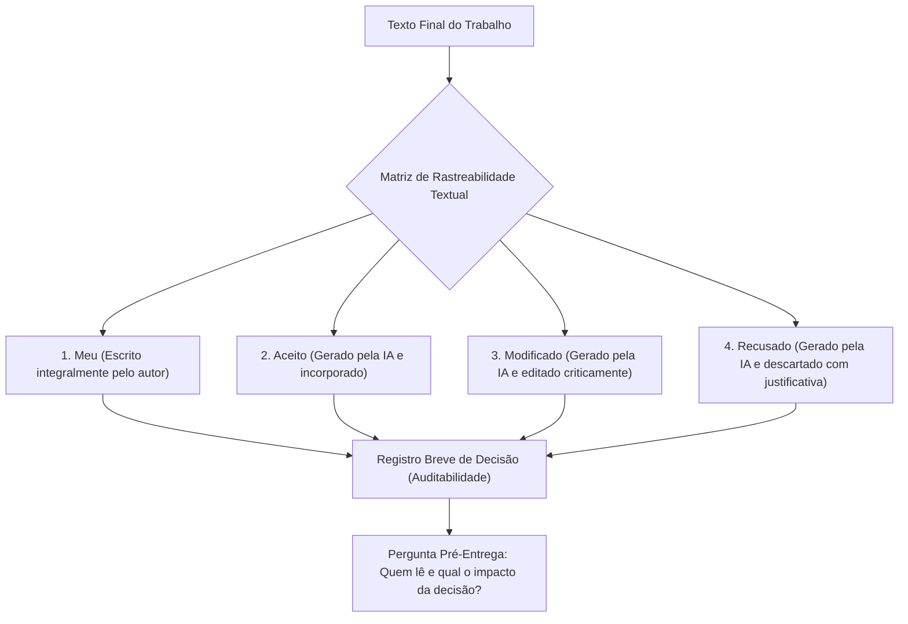

# Q7 M4 - A linha diz que você usou

> **Disciplina:** Inteligência Artificial na Prática Acadêmica e Profissional (COM170)  
> **Quinzena 7 - Módulo 4** | Bimestre: 2026S2B1 - Univesp  
> **Docente Responsável:** Prof. Dr. José Avelino Placca  

---

## 💬 Apresentação do Módulo 4

Escolha um trabalho que você entregou no semestre passado. Se hoje alguém pedisse para você mostrar o que escreveu sozinho e o que veio de uma ferramenta, quanto tempo você levaria para responder?

A declaração de uso que você conheceu na Quinzena 6 conta que a ferramenta participou do trabalho. Este módulo vai além dela: ensina **quatro palavras para escrever ao lado de cada parágrafo** e um registro curto, feito na hora da decisão, que guarda o motivo de cada escolha. E termina com a pergunta que vale fazer antes de qualquer entrega: *quem vai ler este texto, e o que essa pessoa vai fazer a partir dele?*

Este é o **último módulo de conteúdo teórico** da disciplina.

---

## 🎯 Objetivos de Aprendizagem

* **04. Matriz de Rastreabilidade Textual:** Indicar de onde veio cada parágrafo de um texto com as palavras **Meu**, **Aceito**, **Modificado** e **Recusado**, registrando o motivo de cada escolha.
* **05. Autoria Assistida e Defesa por Escrito:** Consolidar a prestação de contas (*accountability*) e a ética na autoria compartilhada com inteligência artificial.
* Responder ao **Miniquiz de seis situações** no formato de prova, integrando os quatro módulos da Quinzena 7.
* Liberar a etapa prática avaliativa em grupo.
