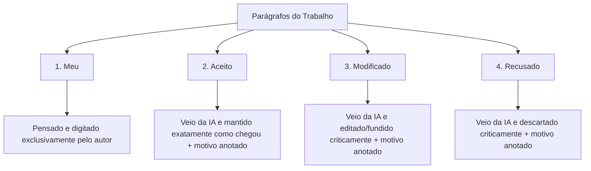
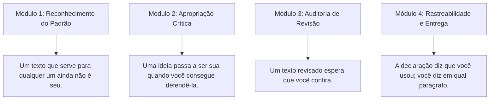

# Videoaula: A linha diz que você usou

> **Disciplina:** Inteligência Artificial na Prática Acadêmica e Profissional (COM170)  
> **Quinzena 7 - Módulo 4** | Bimestre: 2026S2B1 - Univesp  
> **Docente Responsável:** Prof. Dr. José Avelino Placca  
> **Link da Videoaula:** [YouTube (Zfq9djgDG2s)](https://www.youtube.com/watch?v=Zfq9djgDG2s)

---

## 📌 Visão Geral da Videoaula

Na Quinzena 6, aprendemos a redigir a **Declaração de Uso** no final do trabalho acadêmico ou relatório técnico:
> *"Neste trabalho, usei uma ferramenta de inteligência artificial para revisar a redação e li cada parágrafo revisado para conferir se ele ainda dizia o que eu queria dizer."*

Essa declaração é verdadeira e atesta a transparência geral. Contudo, semanas após a entrega, o avaliador, professor ou cliente faz uma pergunta direta de apenas três palavras:
> ❓ **"Em qual parágrafo?"**

Tentar responder de memória duas semanas depois é uma armadilha: a memória humana perde com facilidade a linha exata em que a máquina interveio, se um parágrafo foi fundido, reduzido ou reescrito.

---

## 🔑 A Matriz de Rastreabilidade Textual: As Quatro Palavras

Para registrar a proveniência e a autoria sem depender da memória falível, atribui-se a cada parágrafo do texto uma de quatro palavras-chave:

### 📋 As Quatro Categorias:

| Palavra-Chave | Origem do Conteúdo | Ação do Autor | Registro Obrigatório |
| :--- | :--- | :--- | :--- |
| **Meu** | Criado exclusivamente pelo estudante. | Pensou, estruturou e redigiu diretamente. | Apenas a marcação "Meu". |
| **Aceito** | Gerado pela ferramenta de inteligência artificial. | Adotado integralmente no trabalho final. | Uma linha abaixo registrando o prompt e o motivo da aceitação. |
| **Modificado** | Gerado pela ferramenta de IA. | Editado, corrigido, depurado ou fundido com dados próprios. | Uma linha abaixo registrando o que foi alterado e por quê. |
| **Recusado** | Gerado pela ferramenta de IA. | Descartado por erro fático, alucinação, clichê ou inadequação. | Registro do descarte e da razão técnica/fática da rejeição. |

---

## ⏱️ A Regra do Registro Imediato

* **Não confie na memória:** Duas semanas são suficientes para esquecer onde a ferramenta atuou.
* **No mesmo dia, no próprio arquivo:** Escreva a palavra e anote o prompt/motivo imediatamente no rascunho de trabalho:
  > *"São duas linhas por vez. Elas guardam o lugar que a sua memória vai perder."*

---

## 🧭 A Pergunta Ética Pré-Entrega

Resgatando a **Bússola de Decisão Ética** da Quinzena 6 (*"Quem é o afetado por este sistema?"*), a pergunta que todo profissional e acadêmico deve fazer antes de assinar e entregar um trabalho é:

> 🛡️ **"Quem vai ler este texto, e o que essa pessoa vai fazer/decidir a partir dele?"**

### ⚠️ O Caso Real de Hong Kong (Quinzena 5):
* Um artigo científico internacional foi retirado de circulação (*retracted*) porque continha referências bibliográficas falsas, alucinadas por IA.
* O artigo era assinado por dois autores.
* Apenas um deles gerou as referências na máquina.
* **Ambos responderam solidariamente** e tiveram suas reputações manchadas. Na ciência e na profissão, quem assina responde pelo todo.

---

## 🏛️ A Síntese da Quinzena 7: O que Faz um Texto ser Seu

A Quinzena 7 fecha com quatro preceitos fundamentais de autoria assistida:

> [!IMPORTANT]
> **A Máxima Final da Autoria:**  
> **A declaração diz que você usou. Você diz em qual parágrafo.**
